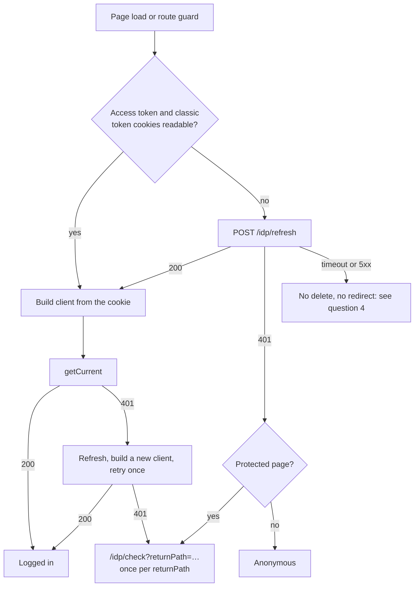

# Keycloak login for published sites

**Ticket:** CHALKY-2080, "CRB: Update to support new Keycloak IDP". Neil Flatley implements and approves the work.
**Keycloak side:** KEYC-199, linked to CHALKY-2080 as Relates. Must be fixed before the first customer with MFA member login; it does not block the first tenant switched to Keycloak.
**Status:** implemented. This overview was written to agree the scope with Neil; he built the change from his own plan in PR [#30](https://github.com/zengenti/contensis-react-base/pull/30), merged to `master` on 2026-10-20 as `791250b1`. It ships in 4.1.0 (release PR #27, open) and is in the 4.0.1-beta builds from beta.24. "What react-base now does" below compares the implementation with this overview. The rest of the document is the pre-implementation analysis: where it says what react-base does "today", it describes `29ab2e28`, which is still the behaviour with the new setting off.
**Checked against code:** every statement about how a system behaves was checked against source code and config on 2026-10-09: identity-client `main` `206359e`, svc-identity `main` `eb5d790` (Keycloak 26.6.3), contensis-app, contensis-app-ui, contensis-svc-security and contensis-svc-delivery `main`, the Zengenti .NET services library 17.7.0, platform `master`, and react-base `master` `29ab2e28`. Re-checked on 2026-10-12 against identity-client `9d7e121`, svc-identity `236c3d5` and contensis-app `5d178c1a50a`: the changes since were the KEYC-308 scopes (described here), a comment-only change in identity-client, a refresh-token-reuse test and a login-theme restyle in svc-identity, and docs in contensis-app. Points that only a running system can settle were checked on `nlgpsf-temp-dev` on 2026-10-10 to 2026-10-12; results are in [Keycloak login: tests](keycloak-tests.md). The implementation was checked against react-base `master` `c416c44c` (4.0.1-beta.27) on 2026-10-25, by code reading only; nothing was run. Re-checked on 2026-10-26 (`master` unchanged): the two open points found on 2026-10-25 do not hold and were removed.
**Shared page:** [claude.ai artifact](https://claude.ai/artifact/KP9mfHEAezgnW6cgFMX9jq), rendered from this file. Change this file, then republish the artifact with this file as its `README.md` so the two stay the same.
**Last updated:** 2026-10-26

## What this document is about

On a tenant that has moved to Keycloak with MFA turned on, a website member completes the login page and the one-time code, comes back to the site, and is still logged out. No error appears. KEYC-199 records the bug; CHALKY-2080 is where react-base gets the fix.

This document is written for someone who knows react-base but has not followed the Keycloak migration. It explains how Keycloak login works in Contensis, why react-base's login fails with it, what the fix has to achieve, a recommended direction, and the questions to settle. Everything needed to discuss the work is here or in its two companions, [Keycloak login: details](keycloak-details.md) and [Keycloak login: tests](keycloak-tests.md); the sources at the end are only for checking. It does not list implementation steps; PR #30 was built from Neil's own plan, and "What react-base now does" compares the result with this document.

## Terms

| Term | Meaning here |
|---|---|
| IS3 | IdentityServer 3, the identity server Contensis used before Keycloak |
| Keycloak | The new identity server. Runs the login pages, including MFA, and issues tokens |
| Realm | One tenant's configuration in Keycloak: login settings, session lengths, MFA. One realm per CMS alias, named `contensis-{alias}` |
| identity-client, `/idp/*` | The service that runs the Keycloak login for a site and writes the login cookies, reached at `/idp/*` on the site's own host. Also called the BFF ("backend for frontend") |
| Member | A website user. Stored in the tenant's CMS database alongside CMS users |
| Access token / bearer | The Keycloak token (a JWT) sent to Contensis APIs. Cookie `ContensisSecurityBearerToken` |
| Refresh token | The Keycloak token identity-client uses to get a new access token. Cookie `ContensisSecurityRefreshToken`, not readable by page JavaScript |
| Classic security token | The existing Contensis session token, which react-base already stores as `contensisClassicToken`. Keycloak still issues one |
| Classic grants | `contensis_classic` (username and password) and `contensis_classic_refresh_token`: the token requests react-base uses today. Keycloak supports them for old callers, but not for MFA users |
| `.Contensis.Auth` | identity-client's own session cookie |
| contensis-app-ui | The CMS admin UI (Angular). Already uses `/idp/refresh` on Keycloak tenants |

## The short version

1. **react-base's login can't work for MFA members on Keycloak.** Every way react-base gets a token uses a classic grant, directly or through the CMS's `IsAuthenticated` endpoint. Those requests can't ask for a one-time code, so Keycloak refuses them for anyone who needs MFA.
2. **The member already has what react-base needs.** After a Keycloak login, identity-client has written the access token and a refresh token as cookies on the site's own host, and it offers `/idp/refresh`, `/idp/check` and `/idp/logout` on that host.
3. **The Management API calls react-base's login makes accept the website login's access token.** `security/users/@current` and the user-groups call are served by contensis-svc-security, which accepts it for any logged-in user. `@current` returned 200 with that token on the test tenant.
4. **Recommended:** a site setting turns on Keycloak login. With it off, react-base behaves as it does today. With it on, react-base reads the access token from its cookie whenever it builds a Management API client, stores no token or expiry, refreshes through `/idp/refresh`, sends members who need to log in to `/idp/check`, and logs out through `/idp/logout`. It never uses a classic grant or `IsAuthenticated`.
5. **It keeps storing the classic security token,** because sites read it through `selectUserSecurityToken`.
6. **Only a 401 from `/idp/refresh` should end the session.** A timeout or 5xx on a healthy session must not send the member to log in. The CMS admin UI gets this wrong today, and the withdrawn plan repeated it.
7. **A blocker outside react-base, now fixed in the realm config (KEYC-308):** on most tenants the Delivery API runs inside the CMS, which answered 403 to a request carrying the website login's access token, because that token had none of the CMS API scopes. The browser sends the token automatically as a cookie, so every content request from a logged-in member failed. Since 2026-10-10 the `contensis-web` client gets the same 13 CMS resource scopes as under IS3, and the same request returns 200 on the test tenant. Production realms get the change when they are switched.
8. **Four questions needed answers before a plan was written.** The main one was how react-base knows a site uses Keycloak. The implementation answers all four; see "Questions for Neil".
9. **Implemented in PR #30** behind a new site setting, `useIdp` (`USE_IDP`). It follows the recommended direction, with differences listed under "What react-base now does": the server never redirects, and a refresh failure that isn't a 401 is handled differently depending on where it happens.

## Where things stand

| Item | Status |
|---|---|
| This overview | On `feat/keyc-199-bff-session-login`, draft PR [#29](https://github.com/zengenti/contensis-react-base/pull/29), a tracking PR. The detailed plan from 2026-10-08 is withdrawn; it stays in `docs/plans/` marked retired, for reference only |
| react-base code | Merged: PR [#30](https://github.com/zengenti/contensis-react-base/pull/30), `791250b1`, 2026-10-20. Developer guide `docs/IDP_LOGIN.md` on `master`. In 4.0.1-beta.24 and later; released as 4.1.0 when release PR #27 is merged. `3f13e2bd` (2026-10-22) also exports the active login method |
| identity-client (`/idp/*`) | Built. The platform routes `/idp/*` to it for three aliases: `idp`, `nlgpsf-temp-dev` and `standard`. No customer alias yet. No change needed for this work |
| Keycloak in production | Being prepared under the production release ticket, KEYC-302. Its report lists KEYC-199 / CHALKY-2080 as a must-fix before the first customer with MFA member login, and the 30-minute member token that renews only through `/idp/refresh` (KEYC-165, KEYC-181) as a should-fix |
| Member API permissions (KEYC-308, done) | `contensis-web` gets the 13 CMS resource scopes, as under IS3. Merged in svc-identity's realm config and contensis-app's docs (#248, 2026-10-12); contensis-svc-security's realm template has it on `feature/identity-management`, which reaches `main` with its PR #25 (KEYC-301, open). The `nlgpsf-temp-dev` and `idp` realms are updated, and same-origin Delivery API requests with the cookie return 200 on both (2026-10-11); a member with no CMS role was checked on `nlgpsf-temp-dev`. Production realms and `standard` are updated at the switch |
| `nlgpsf-website` | On react-base v3 (`^3.1.1-beta.16`). Needs a v3→v4 upgrade to use the fix. No ticket yet. A local, unpushed branch `feat/nlgpsf-temp-dev-deploy`, which is what `nlgpsf-temp-dev` runs, adds a "Sign in securely" button to the site's login page that goes to `/idp/check`, and a `useBffSessionBridge` hook. The hook dispatches `VALIDATE_USER`, which goes through `IsAuthenticated`, so it is not a fix |
| Test tenant | `nlgpsf-temp-dev` has `Identity_UseKeycloak` and `Identity_EnableMFA` on (CMS 17.3.1.20). Until 2026-10-09 about 23:00 UTC its load balancers sent the old token endpoint to the wrong Keycloak host, so classic refreshes failed there; that is fixed. The checks run there are summarised under "Checks on the test tenant" |
| Testing on a real site | Waits on the `nlgpsf-website` upgrade |

## What react-base now does

Checked against `master` `c416c44c` on 2026-10-25 by reading the code. Paths are on `master`. The new code is in `src/user/idp/`; the existing sagas hand over to it with one `if (isIdpEnabled())` each (`src/user/redux/sagas/login.ts`, `sagas/resetPassword.js`, `src/routing/redux/sagas.js`).

**The setting.** `useIdp: true` in `ServerConfig` sets the server global `USE_IDP` (`src/server/internalServer.ts:40`). Every server-rendered page carries `window.USE_IDP = true|false;` in its inline script (`src/server/webApp.tsx:219`), so the browser gets the same answer. A `USE_IDP` build-time define wins over the global (`src/user/idp/setting.ts:29-42`). With it on, `USE_IDP` takes precedence over `WSFED_LOGIN`.

**Against "What the fix has to achieve":**

| # | Result | How |
|---|---|---|
| 1 | Met | The session is built only from identity-client's cookies: `@current` and the user groups with the access token as `Authorization: Bearer` (`idp/session.ts:45-71`) |
| 2 | Met | Login, logout, validate, `refreshSecurityToken`, change password and the protected-route decision all hand over to `idp/` (`login.ts:46-66,259`, `resetPassword.js:31`). The Management API client has no client type, so a slip sends `grant_type=null` (`idp/managementClient.ts:68-77`). The access-token release gets no refresh token, so its classic fallback can't run (`authenticateRequest.ts:32-39`) |
| 3 | Met | A missing access token or classic token cookie triggers `/idp/refresh` (`idp/session.ts:116-120`). A Management API 401 gets one refresh and one retry (`idp/managementClient.ts:118-135`). The check runs at the start of every route change in the browser (`sagas.js:207`) |
| 4 | Met, with differences | Only a 401 from `/idp/refresh` means no session (`idp/refresh.ts:65`); nothing in `idp/` writes or deletes a cookie. A protected route with no session goes to `/idp/check` from the browser (`idp/sagas/requireLogin.ts:120-121`). Non-401 failures: see question 4 |
| 5 | Met | `logoutUser` navigates to `/idp/logout?returnPath=…` (`idp/sagas/userActions.ts:68-85`) |
| 6 | Met, with changes that reach sites with the setting off | The release call is shared between concurrent callers and has a 15-second timeout (`sagas.js:92-128`); every page carries `window.USE_IDP = false;`; the page hints are now written when `disableSsrRedux` is on (`webApp.tsx:389-392`); `NotFound` labels an unmapped 5xx "Something Went Wrong" (`NotFound.tsx:19-24`) |
| 7 | Met | The server never reads the session, refreshes or redirects (`isSSR` guards in `idp/sagas/`). A server-side Delivery 401 or 403 reaches `do500` with its own status, as before (`idp/sagas/deliveryAuthError.ts:33`); the browser fetches the content again after hydration. In the browser a Delivery 401 gets one refresh and one reload per path |
| 8 | Met | The server renders every page as an anonymous visitor; the `user` slice is not serialised (`webApp.tsx:371-374`). The only per-site value in the page is `window.USE_IDP`. There is no cookie-dependent server response, so nothing needs `no-store` |
| 9 | Met | `clientCredentials` is `{ contensisClassicToken }`, read from the `ContensisClassicToken` cookie (`idp/session.ts:91,184-195`) |
| 10 | Met | `returnPath` must resolve to the site's own origin and not start with `//`; `securityToken`, `credentials` and `password` are removed in any letter case (`idp/returnPath.ts:47-73`). On `/account/login` the page's own `redirect_uri` or `ReturnURL` is used instead |

**Where it differs from the recommended direction:**

- **The setting** reaches the browser as `window.USE_IDP` in its own script, not inside `window.DELIVERY_API_CONFIG`.
- **The client builder** is a new function, `createIdpManagementClient` (`idp/managementClient.ts:55-80`), not `getManagementApiClient`. It reads the access token cookie at each call and sets a 10-year expiry. It is never built on the server, so nothing reads the raw `Cookie` header there.
- **No server redirect.** A logged-out visitor on a protected page gets the page rendered anonymously, with the site's loading component on a `requireLogin` route, and the browser navigates to `/idp/check` after hydration (`window.location.replace`).
- **The loop guard** is a `sessionStorage` entry per `returnPath`, kept for 5 minutes (`idp/loginGuard.ts`), not a marker on `returnPath`. The second automatic redirect for the same path is replaced by a 401 error page rendered through the site's `notFoundComponent`. A click on the site's login control is never blocked. Where `sessionStorage` is unavailable the redirect is always allowed.
- **The access-token release** accepts only the access token (the `Authorization` header, then the `ContensisSecurityBearerToken` cookie) and answers 401 without it. In the browser a failed release goes to `/account/access-denied`, as on classic sites (`sagas.js:162-166`); there is no refresh and retry.
- **`loginUser()`** takes no credentials. Any passed are ignored with a console warning, and the member is sent to `/idp/check` (`idp/sagas/userActions.ts:53-61`). Sites replace their username and password form with a sign-in control.
- **The timeout** is 5 seconds for `/idp/refresh` and the Management API calls, through `enterprise-fetch` 2.0.3, which uses `AbortController` and a timer, not `AbortSignal.timeout` (`src/util/fetch.ts`).

**Not covered by this overview:**

- **Delivery API 401 and 403** for route content, on public and protected routes alike (`idp/sagas/deliveryAuthError.ts`):
  - A 401 gets one refresh and one reload of the route. A second 401 for the same path goes to `/idp/check` once, under its own guard, then shows the 401 error page.
  - A 403 for a logged-in member goes to `/account/access-denied`; a 403 with no session goes to `/idp/check`.
  - A refresh that isn't a 200 or a 401 shows a 503 error page.
- **Loading state.** From store creation, on the server and in the browser, the user state reports `isLoading: true` until the first check settles (`idp/sagas/userActions.ts:42-44`). A site's own component-level guard must render nothing while `useLogin().isLoading` is true.
- **Another tab.** If the `ContensisClassicToken` cookie no longer matches the token in state, the session is resolved again (`idp/session.ts:140-144`).
- **A group lookup failure** is treated as unknown, never as a member with no groups (`idp/session.ts:63-68`).
- **Local development.** When `USE_IDP` is on, the site's server forwards six exact paths (`/idp/check`, `login`, `callback`, `logout`, `refresh`, `error`) to the tenant's preview host (`src/server/features/reverse-proxy/index.ts:86-130`). It is registered whenever the setting is on.
- **Exports** (`3f13e2bd`, 2026-10-22): `isIdpEnabled`, `activeLoginMethod`, `isWsFedLoginEnabled`, and `loginMethod` on `useLogin` and `withLogin`.

**Open points from the code reading:** none.

## How Keycloak login works in Contensis

Contensis used IdentityServer 3 (IS3), which has been unsupported for years and can't do MFA for website logins. Keycloak replaces it, one tenant at a time. The basics:

- **Switching a tenant** takes two settings turned on together: `Identity_UseKeycloak` in the tenant's database, and the alias added to the platform's routing for `/idp/*`. react-base reads neither.
- **identity-client runs the login** at `/idp/*` on the site's own host. It sends the member to Keycloak's login page (password, then a one-time code if MFA is required) and writes the login cookies on the site's host. react-base calls `/idp/*` with relative URLs.
- **Members stay in the CMS database.** Keycloak reads users and checks passwords there. MFA is one switch per tenant, `Identity_EnableMFA`.
- **The access token works against the Contensis APIs.** contensis-svc-security (`@current`, user groups, change password) takes it only in the `Authorization` header. The CMS's own API, which serves the Delivery API on most tenants, also takes it from the cookie and needs the KEYC-308 scopes.
- **The classic grants fail for MFA users.** react-base's login uses them today, which is why it can't log an MFA member in.

The detail, checked against code, is in [Keycloak login: details](keycloak-details.md): how a tenant is switched, where identity-client runs, members and MFA, the login sequence, what each service accepts, and why the classic grants fail.

## Why react-base's login fails today

This section describes `29ab2e28`. On `master` it is still the behaviour with `USE_IDP` off; with it on, none of these paths run, and react-base's own `RefreshToken` cookie and the `securityToken` query string are ignored.

react-base gets a member's tokens in three ways, and all of them use classic grants:

- **A security token handed to the site.** When a token arrives in the query string or a `VALIDATE_USER` action, `validateUserSaga` calls `LoginHelper.GetCredentialsForSecurityToken`, which posts to `IsAuthenticated` in the CMS. That endpoint logs the user in again on the server with their stored password and the `contensis_classic` grant. For an MFA user Keycloak refuses the grant; the endpoint still reports success, but with no access token.
- **A stored session.** With a `RefreshToken` cookie, `validateUserSaga` goes straight to `LoginUser`, which builds the Management API client with the `contensis_classic_refresh_token` grant; the first `getCurrent` call asks for a token through it.
- **The login form.** `LoginUser` with a username and password uses the `contensis_classic` grant.

The only credential the member holds that has passed MFA is identity-client's access and refresh token pair. And a logged-out member on a protected page is sent to `/account/login`, so react-base can't start a Keycloak login either.

On the server none of this runs: the sagas' cookie helper has no request cookies during server rendering, whatever `enableSsrCookies` is set to.

### Protected content today

Server-rendered requests to the Delivery API carry no member credentials. `getClientConfig` (`src/util/ContensisDeliveryApi.ts:146`) passes the `CookieHelper` object, not its cookies, to `findLoginCookies`, so the filter finds nothing and no `Cookie` header is sent. The Delivery API wouldn't read `ContensisCMSUserName` or `RefreshToken` anyway. Protected content is therefore only fetched successfully in the browser, where the browser sends the access token cookie itself. This is how `master` behaves today, on classic sites as well.

## The `/idp/*` endpoints and cookies react-base would use

Cookies are host-only and `Path=/`, with `SameSite=Lax`. They are `Secure` when identity-client sees the request as HTTPS, which it takes from the forwarded-protocol header set by the proxies in front of it; the repos don't show what those proxies send for `/idp/*`.

| Cookie | Readable by page JavaScript | Lasts |
|---|---|---|
| `ContensisSecurityBearerToken` (access token) | yes | 30 minutes (the realm's access-token lifespan) |
| `ContensisSecurityRefreshToken` | no | until the Keycloak session ends: at most 15 days after login (realm config) |
| `ContensisClassicToken`, `ContensisCMSUserName` (classic security token, same value) | yes | until the browser closes |
| `ContensisLastUserName`, `ContensisDisplayName` | yes | until the browser closes; written only when Keycloak supplies the user's name |
| `.Contensis.Auth.{alias}` (identity-client's session) | no | until the browser closes, or until the identity token it was issued with expires, whichever is first. Keycloak gives the identity token the same expiry as the access token, so that is 30 minutes. It doesn't slide; a login or a server-side refresh issues a new one |

After a browser restart the member still has the refresh cookie, and the access token if it is under 30 minutes old, but no classic token cookies and no identity-client session. Within one browser session, the identity-client session also lapses about 30 minutes after the last login or refresh. No cookie carries the access token's expiry.

- **`POST /idp/refresh`** needs an `X-Contensis-Refresh` header (any value); without it the answer is 403. That header is the CSRF protection: a page on another origin can't send it. A 200 has an empty body and writes a new access token cookie, and a new refresh cookie when Keycloak returns one. It also rewrites the classic token cookies and the identity-client session when Keycloak returns an identity token, which Keycloak 26.6.3 does because the login asked for the `openid` scope.
- **When `/idp/refresh` fails.** With no refresh cookie it returns 401 and deletes nothing. If Keycloak rejects the refresh, or the response can't be used (no access token, an invalid identity token, a missing classic token claim), or Keycloak's discovery endpoint can't be reached, or one of a few configuration checks fails, identity-client deletes every login cookie and returns 401. A network or JSON error while calling Keycloak returns 500 and deletes nothing.
- **Refresh tokens can be reused.** Each refresh returns a new refresh token, and the old one stays valid until the session ends. The realm config sets a `revoke.refresh.token` client attribute, but Keycloak 26.6.3 ignores it; only the realm-level setting, which is off, would make them single-use. So two tabs refreshing at the same time don't log each other out today (KEYC-180 tracks rotation).
- **`GET /idp/check?returnPath=…`** sends a member without an identity-client session to `/idp/login` and on to Keycloak. A member with a session and all four of the access token, `ContensisCMSUserName`, `ContensisClassicToken` and refresh cookies goes straight back to `returnPath`. A member with a session but a missing cookie gets a server-side refresh first, then goes back; if that refresh fails, the cookies are deleted and the member goes to login. Without `returnPath` it goes to an error page.
- **After a browser restart, or once the identity-client session lapses,** `/idp/check` sends the browser to Keycloak. Keycloak shows the login form unless its own session cookie is still there; that cookie survives a browser restart only if the member ticked "Remember me". This is why a session is restored after a restart with `/idp/refresh`, which needs only the refresh cookie.
- **`GET /idp/logout?returnPath=…`** deletes every login cookie, including the refresh cookie the page can't see, ends the Keycloak session with a server-side call, and redirects to Keycloak's logout endpoint. Without `returnPath` it deletes nothing and goes to an error page. Deleting cookies from the page is not enough, because the refresh cookie and the Keycloak session would remain.

`returnPath` must be a local path starting with `/`; anything else is replaced with `/`. identity-client keeps the query string and removes nothing from it.

## What the fix has to achieve

1. An MFA member who logs in through Keycloak is logged in on the site.
2. No classic grant and no `IsAuthenticated` call for a Keycloak session, whether logging in, refreshing or changing a password.
3. A missing or rejected access token is recovered through `/idp/refresh`, including after a browser restart, for as long as the refresh cookie lasts.
4. A recoverable failure deletes nothing. A session that can't be recovered sends the member to `/idp/check`, and a logged-out member on a protected page goes there too instead of `/account/login`.
5. Logout goes through `/idp/logout`.
6. Sites not using Keycloak behave exactly as today.
7. Server rendering never turns a recoverable session into a 500 or a reload loop on protected content.
8. Server-rendered pages are sent with `Surrogate-Control: max-age=3600`, so an edge cache can keep them for an hour. Nothing per-member goes into them: no session flag, classic token or access token. Any server response that depends on the request's cookies is sent `no-store`.
9. `selectUserSecurityToken` keeps returning the classic security token, because sites use it.
10. `returnPath` values sent to `/idp/*` never carry `securityToken`, `credentials` or `password`, matched case-insensitively. react-base is the only place this can be done.

## Recommended direction

This is the direction the withdrawn plan took, as proposed to Neil before the implementation. Where PR #30 differs, see "What react-base now does".

- **A site setting declares Keycloak login.** It lives in the server config and reaches the browser the way the access-token config does, through the inline `window.DELIVERY_API_CONFIG` script. It is the same for every visitor, so it is safe in cached pages. The cookies only decide the next step: build a client, refresh, or send the member to log in.
- **The browser finds out whether a session exists.** If the access token and classic token cookies are both readable, it builds a client. If either is missing, it calls `/idp/refresh`: a 200 means there is a session, a 401 means there isn't. The browser can't see the refresh cookie, so the refresh call is the check.
- **One function builds every Keycloak client.** `getManagementApiClient` reads the access token cookie at that moment, gives the client a far-future expiry so the SDK never asks for a token itself, and passes no grant type, so a slip sends `grant_type=null` and fails instead of firing a classic grant. On the server it reads the request's raw `Cookie` header, because the sagas' cookie helper is empty there.
- **What is stored.** Redux holds no access token, refresh token or expiry, only `contensisClassicToken`, read from the `ContensisClassicToken` cookie. react-base never writes or deletes identity-client's cookies; today `LoginUser` writes 1-day copies through `SetLoginCookies`, which is skipped on Keycloak sites.
- **Refreshing.** On a missing cookie, or a 401 from the Management API: one `/idp/refresh` shared by concurrent callers, then build a new client and retry once. After a 200 the new cookie is read from the browser directly, not from a cookie map captured earlier.
- **Sessions that can't be recovered.** react-base navigates to `/idp/check?returnPath=…` instead of `/account/login`. The change is made in `handleRequiresLoginSaga`, so protected content, the access-token saga and routes marked `requireLogin` all get it. A marker on `returnPath` limits this to one round trip; if the member comes back and still gets a 401, react-base shows an error instead of looping. This matters when an API rejects an access token that identity-client still treats as valid, because `/idp/check` would then send the member straight back.
- **Server rendering.** The server never refreshes and never deletes cookies; the browser holds the cookie jar that receives new cookies. On a protected page with no refresh cookie, the server redirects to `/idp/check` before rendering, with `no-store` headers so the redirect is never cached. With a refresh cookie present, a protected page that gets a 401 renders a state the browser recovers after hydration, instead of `do500` or the route reload that repeats without limit today.
- **Logout** navigates to `/idp/logout?returnPath=…`.
- **`refreshSecurityToken`** keeps its no-argument signature. It calls `/idp/refresh` and dispatches only the classic token.
- **Change password** keeps working: it builds its client the same way, and contensis-svc-security accepts the access token.
- **The access-token release** (`authenticateRequest.ts`), if Neil agrees (question 2): on a Keycloak session it uses the access token cookie instead of `ContensisCMSUserName`, and returns 401 instead of falling back to a classic grant, so the browser can refresh and retry.

Members of a site that switches to Keycloak log in once more after the switch, because their old react-base cookies are not a Keycloak session.

The flow in the browser, with the setting on:

### Code areas affected

As proposed. PR #30 put the new code in `src/user/idp/` and left `SSRContext`, `ContensisManagementApi.ts` and the server redirect unchanged; it also changed `reverse-proxy`, `internalServer.ts`, `util/fetch.ts`, `NotFound.tsx`, `useLogin` and `withLogin`.

| Area | What changes |
|---|---|
| `ServerConfig`, `SSRContext` | The site setting; reading the refresh cookie from the raw request on the server |
| `ContensisManagementApi.ts` | `getManagementApiClient` builds Keycloak clients from the cookie |
| `LoginHelper.class.ts` | A `/idp/refresh` helper; `GetCachedCredentials`, `LoginUser`, `LogoutUser` |
| `sagas/login.ts` | `validateUserSaga` skips `IsAuthenticated`; `handleRequiresLoginSaga`; `refreshSecurityToken` |
| `sagas/resetPassword.js` | `changePasswordSaga` builds its client through `getManagementApiClient` |
| `routing/redux/sagas.js` | A protected-content 401 with a session present no longer calls `do500` or reloads |
| `server/webApp.tsx` | The existing redirect, used for `/idp/check` with `no-store` headers |
| `access-token-api/authenticateRequest.ts` | Cookie order and no classic fallback (question 2) |

## How the CMS admin UI does it

The CMS admin UI (contensis-app-ui) already calls `/idp/refresh` on Keycloak tenants and is the nearest example. It refreshes only when a cookie it needs is missing, never on a timer, in two places:

- **At startup**, if its first API call (`/ui/projects/initialise`) fails or a login cookie is missing, it calls `/idp/refresh` once and tries again. It does this whether or not the tenant uses Keycloak, because it learns that from the first API call, which needs a logged-in CMS user. On a tenant routed to identity-client but with the Keycloak setting off, that refresh deletes the login cookies (KEYC-208). If startup still fails, it sends the user to the classic CMS entry page, `/Default.aspx`.
- **During a session**, on Keycloak tenants only, when the access token cookie is empty on the next outgoing request, one refresh is shared by all requests waiting at that moment. If it fails, it deletes the access token, `ContensisCMSUserName` and `ContensisClassicToken` cookies and goes to `/idp/check` (except on localhost). A 401 from an API doesn't trigger a refresh; it deletes the same cookies and goes straight to `/idp/check`.

Its request is the one react-base would send: `POST`, the `X-Contensis-Refresh: 1` header, same-origin credentials, a 5-second timeout.

What this means for react-base:

- The trigger, the shared request and the `/idp/check` fallback match the recommended direction.
- react-base's site setting avoids the admin UI's startup guess and the KEYC-208 cookie deletion.
- Refresh and retry on a Management API 401 goes further than the admin UI does today.
- react-base would not delete identity-client's cookies before redirecting; identity-client already clears them when a refresh is rejected.
- react-base renders on the server and the admin UI doesn't; the server never refreshes.
- The admin UI uses `AbortSignal.timeout`. Browser compatibility data (not code) puts it at Chrome 103, Firefox 100 and Safari 16. react-base's own build targets Chrome 78 and Firefox 70, so it needs `AbortController` and a timer.

**The failure both share.** The admin UI treats a 401, a timeout, a network error, a 5xx and a 200 with no access token cookie the same way, and any of them can end in `/idp/check`. The withdrawn react-base plan did the same: its refresh helper returned one "failed" result for all of them, although only a 401 was meant to end the session. identity-client returns 500 on a network error during its token call to Keycloak, and contensis-app's diagnosis notes record intermittent 503s from `/idp/refresh` on a test tenant. On a healthy session, a 5xx or a 5-second stall would send the member to `/idp/check`. After a browser restart the identity-client session is gone, so that means the Keycloak login form. This is question 4.

## Risks

The mitigation column says what PR #30 does, checked by code reading.

| Risk | Why it matters | Mitigation |
|---|---|---|
| An old react-base session survives a Keycloak login | The site shows a different user, and that user's documents (seen on the test tenant) | With the setting on, react-base takes the member only from identity-client's cookies and never reads its own `RefreshToken` cookie (test 28a in [Keycloak login: tests](keycloak-tests.md)) |
| The setting check is wrong somewhere | Classic sites change behaviour | Setting off by default; each hand-over is one `isIdpEnabled()` check, read when the action is handled. Some changes reach classic sites anyway (requirement 6 above) |
| Transient refresh failure treated as logout | Healthy members sent to log in again | Only a 401 ends the session; see question 4 for what each caller shows |
| A Keycloak client built outside the one builder | The SDK asks for a token itself | One builder, `createIdpManagementClient`; no grant type, so a slip fails instead of firing a classic grant |
| Redirect loop through `/idp/check` | An API rejects a token identity-client thinks is valid | One automatic redirect per `returnPath` in 5 minutes (`sessionStorage`), then a 401 error page |
| Per-member data in cached pages, or a cached redirect | Shown to other visitors, or loops members | The server renders every page as anonymous and never redirects |
| Protected content after a 401 with `userLoggedIn` set | The route reloads without limit on classic sites | With the setting on: one refresh and one reload per path, then `/idp/check` once, then an error page |
| Access token readable by page JavaScript | Script on the site can read it and call `/idp/refresh` | identity-client's design, not changed here; noted for the threat model |
| The setting is lost on some pages | Classic login code runs in the browser on that page | The `window.USE_IDP` hint is now written with `disableSsrRedux` on and on dynamic renders |

Other effects to note in release notes (both as built): `selectClientCredentials` returns only `contensisClassicToken` on Keycloak sites, and `refreshSecurityToken` dispatches no access token. `@contensis/forms` (1.0.5) reads `ContensisSecurityBearerToken`; when it is missing, it tries its own classic refresh grant with a readable `ContensisSecurityRefreshToken` or `RefreshToken` cookie. On Keycloak sites the refresh cookie is HttpOnly, so it can't.

## Considered and rejected

- **Detecting Keycloak from the `ContensisClassicToken` cookie alone.** It is gone after a browser restart while the session is valid, and a logged-out member has none, so react-base could never start a Keycloak login.
- **Using `/idp/check` to restore a session after a restart.** The identity-client session is gone after a restart, so it sends the browser to Keycloak, which shows the login form unless the member ticked "Remember me". `/idp/refresh` needs only the refresh cookie.
- **Storing the access token in redux.** It would need a fresh expiry wherever a client is built, and would put the token into server state. Reading the cookie in one function does the same in one place.
- **Refreshing on the server during rendering.** It would need new cookies forwarded through the page response and coordinated with a browser refresh.

## Checks on the test tenant

All the checks that can run before the react-base change were run on `nlgpsf-temp-dev` from 2026-10-10 to 2026-10-12. Two of them shape the design:

- The user-groups call returns 401 with only the access token cookie: contensis-svc-security never reads the cookie, so react-base must send the `Authorization` header itself.
- After a member logs in with password and one-time code, identity-client writes the login cookies and today's site still shows the member as signed out (KEYC-199). An old react-base `RefreshToken` cookie left in the same browser showed a different user instead.

The full list with results, and the tests to run after the react-base change, are in [Keycloak login: tests](keycloak-tests.md).

## Questions for Neil

PR #30 answers all four; each question ends with what was built.

1. **How react-base knows a site uses Keycloak.** react-base does not read the tenant's Keycloak switch today. The options:
   - (a) the `ContensisClassicToken` cookie only. Fails after a browser restart and for logged-out members;
   - (b) a site setting only;
   - (c) a site setting decides whether the site uses Keycloak, and cookies decide whether to refresh or log in.

   **Recommendation: (c).** The setting has to be turned on together with the tenant's switch. Today `nlgpsf-temp-dev` sends a logged-out visitor to the site's own login page, and only its unpushed branch adds a button to `/idp/check`; with (c), react-base would send them to `/idp/check` itself.

   **Implemented: (c).** The setting is `useIdp` in `ServerConfig` (or a `USE_IDP` build-time define or startup global); the cookies decide whether to build a client or refresh first.
2. **Whether the access-token release is part of this work.** `ensureAccessTokenSaga` is covered anyway through `handleRequiresLoginSaga`. The open one is `authenticateRequest.ts`: it takes the bearer from the `Authorization` header, then `ContensisCMSUserName` (the classic token on a Keycloak site), then `ContensisSecurityBearerToken`, and falls back to a classic refresh grant with the `RefreshToken` cookie. **Recommendation: include it.** Otherwise sites that protect their access token with `requireLogin` still fail for MFA members.

   **Implemented: included.** The release takes the `Authorization` header, then the `ContensisSecurityBearerToken` cookie, and nothing else; without a valid token it answers 401. The browser then goes to access-denied without a refresh and retry.
3. **Where the new code goes.** Inside the existing functions, behind the setting, or a separate module that the sagas hand over to when the setting is on, which leaves the classic code untouched and narrows the review to one hand-over point. **Recommendation: inside the existing functions;** a separate module is a reasonable alternative if the number of checks in the classic functions feels unwieldy.

   **Implemented: a separate module,** `src/user/idp/`, which imports nothing from the classic login code. Each existing saga hands over to it with one `isIdpEnabled()` check.
4. **What a refresh failure that isn't a 401 does.** A timeout, network error or 5xx from `/idp/refresh` says nothing about the session. **Recommendation: only a 401 ends the session.** Anything else leaves the member on the page, does not delete or redirect, and lets the next request or page load try again. A 403 means the header is missing, which is a code defect.

   **Implemented: only a 401 ends the session.** A timeout, network error, 5xx, 403 or a 200 that leaves no readable access token cookie is "unknown": nothing is deleted and nobody is redirected. What the member sees depends on where it happens:
   - at a route change, if the member was shown as logged in, the member is shown as logged out for that page load, and the next navigation tries again (`idp/sagas/routeSession.ts:146`);
   - on a protected route, one more try after a second, then a 503 error page through the site's `notFoundComponent` (`idp/sagas/requireLogin.ts:165-181`);
   - from `VALIDATE_USER` or `refreshSecurityToken`, nothing changes; the member is cleared only on a 401.

One smaller point was left for the plan: the value of the far-future expiry date. It is 10 years from when each client is built.

## Not part of this work

- No change to the Management API SDK, identity-client, Keycloak or the CMS. The Delivery API 403 was fixed on the Keycloak side under KEYC-308.
- No test framework for react-base. Checks are typecheck, lint, build and review, then testing on a real site.
- The `nlgpsf-website` v3→v4 upgrade. Separate ticket, not yet filed.
- Issues that existed before Keycloak, in react-base or the CMS, such as the server-side Delivery API cookies described under "Protected content today". This work supports the Keycloak production release only.

## Suggested next actions

1. File the `nlgpsf-website` v3→v4 upgrade ticket. On top of the upgrade the site needs `useIdp: true`, a sign-in control that calls `loginUser()` in place of its username and password form, its own component guards waiting for `useLogin().isLoading`, and a `notFoundComponent` that shows 401 and 503 as errors, not "page not found" (`docs/IDP_LOGIN.md` on `master`).
2. After the site upgrade, run the tests in [Keycloak login: tests](keycloak-tests.md).

Done: the scope and the four questions were settled in PR #30, built from Neil's own plan.

## Appendix: tickets

| Ticket | What it is |
|---|---|
| CHALKY-2080 | react-base support for the new Keycloak login (this work) |
| KEYC-199 | MFA members never finish published-site login; fix belongs in react-base |
| KEYC-27 | Published-site member login through identity-client, using the `contensis-web` client |
| KEYC-183 | Keycloak refuses the classic grants for MFA users |
| KEYC-200 | The `CONTENSIS_ALLOW_MFA_CLASSIC_GRANTS` switch that turns that refusal off |
| KEYC-180 | Refresh-token rotation and refreshes from several tabs at once |
| KEYC-208 | A tenant routed to identity-client with the Keycloak setting off loses its login cookies on refresh |
| KEYC-302 | Keycloak production release |
| KEYC-308 | Give `contensis-web` the 13 CMS resource scopes, so signed-in members keep their IS3 API permissions |
| KEYC-165, KEYC-181 | A signed-in member's token lasts 30 minutes and renews only through `/idp/refresh` |

## Appendix: sources

For checking only; nothing above needs them to be understood. Branches as listed at the top.

- identity-client (`zengenti-svc-identity-client`): `src/Contensis.Identity.Oidc/ContensisOidcService.cs` (login, callback, refresh, logout, cookies, `returnPath`), `src/Contensis.Identity.Oidc/ContensisOidcOptions.cs` (scopes), `src/Contensis.Identity.Oidc.Web/Program.cs` (routes, refresh header, session cookie options, forwarded headers), `src/Contensis.Identity.Oidc.Web/IdpEndpoints.cs` (`/idp/check`, `/idp/logout`), `CmsContextMiddleware.cs` (`x-alias`), `appsettings.json` (client per host).
- svc-identity (`zengenti-svc-identity`): `realm-config/contensis-realm-standard.json` (lifetimes, scopes, `contensis_claims`, login flow), `ops-scripts/generate-tenant-realm-config.ps1` and `import-realm.sh` (realm creation), `user-storage-spi/…/ContensisUserStorageProvider.java`, `ContensisIdentityClient.java` (user store, MFA setting, classic token), `ContensisSecurityTokenMapper.java`, `grants/ContensisClassicGrantType.java`, `grants/ContensisClassicRefreshTokenGrantType.java`, `grants/ContensisGrantHelper.java` (MFA refusal, test switch), `docker/Keycloak.Dockerfile` (Keycloak 26.6.3), `docs/architecture-decisions.md` ADR-13 (the decision behind KEYC-308's scopes). Refresh-token reuse and identity-token expiry: Keycloak 26.6.3 `TokenManager` (`idToken.exp(accessToken.getExp())`).
- platform (`zengenti-platform`): `pod/roles/haproxy_server/templates/haproxy.j2` (alias list, `/idp/` routing, `x-alias`, token-endpoint redirect, `/api/security` and `/api/delivery` routing), `ansible_zengenti/plugins/filter/zengenti_extras.py` (`use_central_delivery_api`: the three central-delivery aliases), `charts/identity-client` (deployment).
- Zengenti .NET services library (`zengenti-lib-services-netcore-web` 17.7.0): `BearerTokenAuthenticator.cs`, `ZengentiAuthenticationOptions.cs`.
- contensis-svc-security: `UserController.cs`, `AuthorizeAnyAdminOrCurrentUserOrSelf.cs`, `AuthorizeSysAdminOrUserAdminOrSelf.cs`, `UpdatePasswordValidator.cs`.
- contensis-svc-delivery: `AuthenticationService.cs`.
- contensis-app (CMS): `Zengenti.Contensis.Api.WebHost/Startup.cs`, `…/Middleware/Extensions/ContensisAuthenticationAppBuilderExtensions.cs`, `…/Middleware/Security/RequiredScopesGate.cs`, `…/Middleware/Security/Services/ContensisAuthorisationService.cs` (CMS API token handling); `api/Contensis.Services/Security/SecurityService.vb` (`IsAuthenticated`); `WebAuthentication.vb` (classic cookies); `RequestFlagLatch.vb` and `dbo.xp_System_Setup.sql` (`Identity_UseKeycloak`); `IntegrationInfo.vb` (user types); `engine/App_Start/InitializeMvcFilters.vb`, `Contensis.UI/GlobalFilters/ContensisUserFilter.cs` (admin UI startup call); `docs/solutions/architecture-patterns/flag-on-keycloak-503-diagnosis.md` (503s).
- contensis-app-ui: `packages/contensis/http/src/identity/identity.service.ts`, `providers/keycloak.ts`, `providers/shared.ts`, `packages/contensis/http/src/interceptors/contensis-auth.ts`.
- react-base `master` `c416c44c` (the implementation): `src/user/idp/` (all files), `src/user/redux/sagas/login.ts`, `src/user/redux/sagas/resetPassword.js`, `src/routing/redux/sagas.js`, `src/server/webApp.tsx`, `src/server/internalServer.ts`, `src/server/features/access-token-api/authenticateRequest.ts`, `src/server/features/reverse-proxy/index.ts`, `src/util/fetch.ts`, `src/routing/components/NotFound.tsx`, `docs/IDP_LOGIN.md`; `enterprise-fetch` 2.0.3 package source.
- react-base `29ab2e28`: `src/user/redux/sagas/login.ts`, `src/user/util/LoginHelper.class.ts`, `src/user/util/ContensisManagementApi.ts`, `src/user/util/CookieHelper.class.ts`, `src/user/util/CookieConstants.ts`, `src/util/ContensisDeliveryApi.ts`, `src/routing/redux/sagas.js`, `src/server/webApp.tsx`, `src/server/util/headers.ts`, `src/server/features/access-token-api/`, `src/user/transformations/mapClientCredentials.ts`, `rollup/rollup.config.lib.mjs`; `contensis-management-api` 2.4.0 package source; `@contensis/forms` 1.0.5 package source.
- `nlgpsf-website`: `package.json`, `src/app/redux/documents/sagas.ts`, `src/server/features/index.ts`; branch `feat/nlgpsf-temp-dev-deploy` `src/app/hooks/useBffSessionBridge.ts`.
