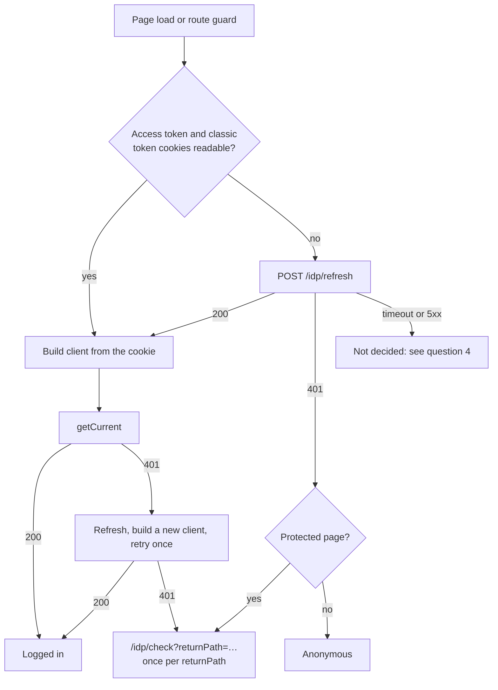

# Keycloak login for published sites

**Ticket:** CHALKY-2080, "CRB: Update to support new Keycloak IDP". Neil Flatley implements and approves the work.
**Keycloak side:** KEYC-199, linked to CHALKY-2080 as Relates. Must be fixed before the first customer with MFA member login; it does not block the first tenant switched to Keycloak.
**Status:** overview for agreeing the scope with Neil. The earlier detailed plan has been withdrawn; a new plan is written once the scope and the questions below are agreed.
**Checked against code:** every statement about how a system behaves was checked against source code and config on 2026-10-09: identity-client `main` `206359e`, svc-identity `main` `eb5d790` (Keycloak 26.6.3), contensis-app, contensis-app-ui, contensis-svc-security and contensis-svc-delivery `main`, the Zengenti .NET services library 17.7.0, platform `master`, and react-base `master` `29ab2e28`. Re-checked on 2026-10-12 against identity-client `9d7e121`, svc-identity `236c3d5` and contensis-app `5d178c1a50a`: the changes since were the KEYC-308 scopes (described here), a comment-only change in identity-client, a refresh-token-reuse test and a login-theme restyle in svc-identity, and docs in contensis-app. Points that only a running system can settle were checked on `nlgpsf-temp-dev` on 2026-10-10 to 2026-10-12; results are under "Checks on the test tenant".
**Shared page:** [claude.ai artifact](https://claude.ai/artifact/KP9mfHEAezgnW6cgFMX9jq), rendered from this file. Change this file, then republish the artifact with this file as its `README.md` so the two stay the same.
**Last updated:** 2026-10-09

## What this document is about

On a tenant that has moved to Keycloak with MFA turned on, a website member completes the login page and the one-time code, comes back to the site, and is still logged out. No error appears. KEYC-199 records the bug; CHALKY-2080 is where react-base gets the fix.

This document is written for someone who knows react-base but has not followed the Keycloak migration. It explains how Keycloak login works in Contensis, why react-base's login fails with it, what the fix has to achieve, a recommended direction, what still needs verifying, and the questions to settle. Everything needed to discuss the work is here; the sources at the end are only for checking. It does not list implementation steps; those go in a new plan after the questions are answered.

## Terms

| Term | Meaning here |
|---|---|
| IS3 | IdentityServer 3, the identity server Contensis used before Keycloak |
| Keycloak | The new identity server. Runs the login pages, including MFA, and issues tokens |
| Realm | One tenant's configuration in Keycloak: login settings, session lengths, MFA. One realm per CMS alias, named `contensis-{alias}` |
| identity-client, `/idp/*` | The service that runs the Keycloak login for a site and writes the login cookies, reached at `/idp/*` on the site's own host. Also called the BFF ("backend for frontend") |
| Member | A website user. Stored in the tenant's CMS database alongside CMS users |
| Access token / bearer | The Keycloak token (a JWT) sent to Contensis APIs. Cookie `ContensisSecurityBearerToken` |
| Refresh token | The Keycloak token identity-client uses to get a new access token. Cookie `ContensisSecurityRefreshToken`, not readable by page JavaScript |
| Classic security token | The existing Contensis session token, which react-base already stores as `contensisClassicToken`. Keycloak still issues one |
| Classic grants | `contensis_classic` (username and password) and `contensis_classic_refresh_token`: the token requests react-base uses today. Keycloak supports them for old callers, but not for MFA users |
| `.Contensis.Auth` | identity-client's own session cookie |
| contensis-app-ui | The CMS admin UI (Angular). Already uses `/idp/refresh` on Keycloak tenants |

## The short version

1. **react-base's login can't work for MFA members on Keycloak.** Every way react-base gets a token uses a classic grant, directly or through the CMS's `IsAuthenticated` endpoint. Those requests can't ask for a one-time code, so Keycloak refuses them for anyone who needs MFA.
2. **The member already has what react-base needs.** After a Keycloak login, identity-client has written the access token and a refresh token as cookies on the site's own host, and it offers `/idp/refresh`, `/idp/check` and `/idp/logout` on that host.
3. **The Management API calls react-base's login makes accept the website login's access token.** `security/users/@current` and the user-groups call are served by contensis-svc-security, which accepts it for any logged-in user. `@current` returned 200 with that token on the test tenant.
4. **Recommended:** a site setting turns on Keycloak login. With it off, react-base behaves as it does today. With it on, react-base reads the access token from its cookie whenever it builds a Management API client, stores no token or expiry, refreshes through `/idp/refresh`, sends members who need to log in to `/idp/check`, and logs out through `/idp/logout`. It never uses a classic grant or `IsAuthenticated`.
5. **It keeps storing the classic security token,** because sites read it through `selectUserSecurityToken`.
6. **Only a 401 from `/idp/refresh` should end the session.** A timeout or 5xx on a healthy session must not send the member to log in. The CMS admin UI gets this wrong today, and the withdrawn plan repeated it.
7. **A blocker outside react-base, now fixed in the realm config (KEYC-308):** on most tenants the Delivery API runs inside the CMS, which answered 403 to a request carrying the website login's access token, because that token had none of the CMS API scopes. The browser sends the token automatically as a cookie, so every content request from a logged-in member failed. Since 2026-10-10 the `contensis-web` client gets the same 13 CMS resource scopes as under IS3, and the same request returns 200 on the test tenant. Production realms get the change when they are switched.
8. **Four questions need answers before a plan is written.** The main one is how react-base knows a site uses Keycloak.

## Where things stand

| Item | Status |
|---|---|
| This overview | On `feat/keyc-199-bff-session-login`, draft PR [#29](https://github.com/zengenti/contensis-react-base/pull/29). The detailed plan from 2026-10-08 is withdrawn; it stays in `docs/plans/` marked retired, for reference only |
| react-base code | None. The branch holds only docs, on top of `master` (`29ab2e28`, 4.0.1-beta.22) |
| identity-client (`/idp/*`) | Built. The platform routes `/idp/*` to it for three aliases: `idp`, `nlgpsf-temp-dev` and `standard`. No customer alias yet. No change needed for this work |
| Keycloak in production | Being prepared under the production release ticket, KEYC-302. Its report lists KEYC-199 / CHALKY-2080 as a must-fix before the first customer with MFA member login, and the 30-minute member token that renews only through `/idp/refresh` (KEYC-165, KEYC-181) as a should-fix |
| Member API permissions (KEYC-308, done) | `contensis-web` gets the 13 CMS resource scopes, as under IS3. Merged in svc-identity's realm config and contensis-app's docs (#248, 2026-10-12); contensis-svc-security's realm template has it on `feature/identity-management`, which reaches `main` with its PR #25 (KEYC-301, open). The `nlgpsf-temp-dev` and `idp` realms are updated, and same-origin Delivery API requests with the cookie return 200 on both (2026-10-11); a member with no CMS role was checked on `nlgpsf-temp-dev`. Production realms and `standard` are updated at the switch |
| `nlgpsf-website` | On react-base v3 (`^3.1.1-beta.16`). Needs a v3→v4 upgrade to use the fix. No ticket yet. A local, unpushed branch `feat/nlgpsf-temp-dev-deploy`, which is what `nlgpsf-temp-dev` runs, adds a "Sign in securely" button to the site's login page that goes to `/idp/check`, and a `useBffSessionBridge` hook. The hook dispatches `VALIDATE_USER`, which goes through `IsAuthenticated`, so it is not a fix |
| Test tenant | `nlgpsf-temp-dev` has `Identity_UseKeycloak` and `Identity_EnableMFA` on (CMS 17.3.1.20). Until 2026-10-09 about 23:00 UTC its load balancers sent the old token endpoint to the wrong Keycloak host, so classic refreshes failed there; that is fixed. Checks run on 2026-10-10 are below |
| Testing on a real site | Waits on the `nlgpsf-website` upgrade |

## How Keycloak login works in Contensis

Contensis used IdentityServer 3 (IS3), which has been unsupported for years and can't do MFA for website logins. Keycloak replaces it, one tenant at a time. The basics:

- **Switching a tenant** takes two settings turned on together: `Identity_UseKeycloak` in the tenant's database, and the alias added to the platform's routing for `/idp/*`. react-base reads neither.
- **identity-client runs the login** at `/idp/*` on the site's own host. It sends the member to Keycloak's login page (password, then a one-time code if MFA is required) and writes the login cookies on the site's host. react-base calls `/idp/*` with relative URLs.
- **Members stay in the CMS database.** Keycloak reads users and checks passwords there. MFA is one switch per tenant, `Identity_EnableMFA`.
- **The access token works against the Contensis APIs.** contensis-svc-security (`@current`, user groups, change password) takes it only in the `Authorization` header. The CMS's own API, which serves the Delivery API on most tenants, also takes it from the cookie and needs the KEYC-308 scopes.
- **The classic grants fail for MFA users.** react-base's login uses them today, which is why it can't log an MFA member in.

The detail, checked against code, is in [Keycloak login: details](keycloak-details.md): how a tenant is switched, where identity-client runs, members and MFA, the login sequence, what each service accepts, and why the classic grants fail.

## Why react-base's login fails today

react-base gets a member's tokens in three ways, and all of them use classic grants:

- **A security token handed to the site.** When a token arrives in the query string or a `VALIDATE_USER` action, `validateUserSaga` calls `LoginHelper.GetCredentialsForSecurityToken`, which posts to `IsAuthenticated` in the CMS. That endpoint logs the user in again on the server with their stored password and the `contensis_classic` grant. For an MFA user Keycloak refuses the grant; the endpoint still reports success, but with no access token.
- **A stored session.** With a `RefreshToken` cookie, `validateUserSaga` goes straight to `LoginUser`, which builds the Management API client with the `contensis_classic_refresh_token` grant; the first `getCurrent` call asks for a token through it.
- **The login form.** `LoginUser` with a username and password uses the `contensis_classic` grant.

The only credential the member holds that has passed MFA is identity-client's access and refresh token pair. And a logged-out member on a protected page is sent to `/account/login`, so react-base can't start a Keycloak login either.

On the server none of this runs: the sagas' cookie helper has no request cookies during server rendering, whatever `enableSsrCookies` is set to.

### Protected content today

Server-rendered requests to the Delivery API carry no member credentials. `getClientConfig` (`src/util/ContensisDeliveryApi.ts:146`) passes the `CookieHelper` object, not its cookies, to `findLoginCookies`, so the filter finds nothing and no `Cookie` header is sent. The Delivery API wouldn't read `ContensisCMSUserName` or `RefreshToken` anyway. Protected content is therefore only fetched successfully in the browser, where the browser sends the access token cookie itself. This is how `master` behaves today, on classic sites as well.

## The `/idp/*` endpoints and cookies react-base would use

Cookies are host-only and `Path=/`, with `SameSite=Lax`. They are `Secure` when identity-client sees the request as HTTPS, which it takes from the forwarded-protocol header set by the proxies in front of it; the repos don't show what those proxies send for `/idp/*`.

| Cookie | Readable by page JavaScript | Lasts |
|---|---|---|
| `ContensisSecurityBearerToken` (access token) | yes | 30 minutes (the realm's access-token lifespan) |
| `ContensisSecurityRefreshToken` | no | until the Keycloak session ends: at most 15 days after login (realm config) |
| `ContensisClassicToken`, `ContensisCMSUserName` (classic security token, same value) | yes | until the browser closes |
| `ContensisLastUserName`, `ContensisDisplayName` | yes | until the browser closes; written only when Keycloak supplies the user's name |
| `.Contensis.Auth.{alias}` (identity-client's session) | no | until the browser closes, or until the identity token it was issued with expires, whichever is first. Keycloak gives the identity token the same expiry as the access token, so that is 30 minutes. It doesn't slide; a login or a server-side refresh issues a new one |

After a browser restart the member still has the refresh cookie, and the access token if it is under 30 minutes old, but no classic token cookies and no identity-client session. Within one browser session, the identity-client session also lapses about 30 minutes after the last login or refresh. No cookie carries the access token's expiry.

- **`POST /idp/refresh`** needs an `X-Contensis-Refresh` header (any value); without it the answer is 403. That header is the CSRF protection: a page on another origin can't send it. A 200 has an empty body and writes a new access token cookie, and a new refresh cookie when Keycloak returns one. It also rewrites the classic token cookies and the identity-client session when Keycloak returns an identity token, which Keycloak 26.6.3 does because the login asked for the `openid` scope.
- **When `/idp/refresh` fails.** With no refresh cookie it returns 401 and deletes nothing. If Keycloak rejects the refresh, or the response can't be used (no access token, an invalid identity token, a missing classic token claim), or Keycloak's discovery endpoint can't be reached, or one of a few configuration checks fails, identity-client deletes every login cookie and returns 401. A network or JSON error while calling Keycloak returns 500 and deletes nothing.
- **Refresh tokens can be reused.** Each refresh returns a new refresh token, and the old one stays valid until the session ends. The realm config sets a `revoke.refresh.token` client attribute, but Keycloak 26.6.3 ignores it; only the realm-level setting, which is off, would make them single-use. So two tabs refreshing at the same time don't log each other out today (KEYC-180 tracks rotation).
- **`GET /idp/check?returnPath=…`** sends a member without an identity-client session to `/idp/login` and on to Keycloak. A member with a session and all four of the access token, `ContensisCMSUserName`, `ContensisClassicToken` and refresh cookies goes straight back to `returnPath`. A member with a session but a missing cookie gets a server-side refresh first, then goes back; if that refresh fails, the cookies are deleted and the member goes to login. Without `returnPath` it goes to an error page.
- **After a browser restart, or once the identity-client session lapses,** `/idp/check` sends the browser to Keycloak. Keycloak shows the login form unless its own session cookie is still there; that cookie survives a browser restart only if the member ticked "Remember me". This is why a session is restored after a restart with `/idp/refresh`, which needs only the refresh cookie.
- **`GET /idp/logout?returnPath=…`** deletes every login cookie, including the refresh cookie the page can't see, ends the Keycloak session with a server-side call, and redirects to Keycloak's logout endpoint. Without `returnPath` it deletes nothing and goes to an error page. Deleting cookies from the page is not enough, because the refresh cookie and the Keycloak session would remain.

`returnPath` must be a local path starting with `/`; anything else is replaced with `/`. identity-client keeps the query string and removes nothing from it.

## What the fix has to achieve

1. An MFA member who logs in through Keycloak is logged in on the site.
2. No classic grant and no `IsAuthenticated` call for a Keycloak session, whether logging in, refreshing or changing a password.
3. A missing or rejected access token is recovered through `/idp/refresh`, including after a browser restart, for as long as the refresh cookie lasts.
4. A recoverable failure deletes nothing. A session that can't be recovered sends the member to `/idp/check`, and a logged-out member on a protected page goes there too instead of `/account/login`.
5. Logout goes through `/idp/logout`.
6. Sites not using Keycloak behave exactly as today.
7. Server rendering never turns a recoverable session into a 500 or a reload loop on protected content.
8. Server-rendered pages are sent with `Surrogate-Control: max-age=3600`, so an edge cache can keep them for an hour. Nothing per-member goes into them: no session flag, classic token or access token. Any server response that depends on the request's cookies is sent `no-store`.
9. `selectUserSecurityToken` keeps returning the classic security token, because sites use it.
10. `returnPath` values sent to `/idp/*` never carry `securityToken`, `credentials` or `password`, matched case-insensitively. react-base is the only place this can be done.

## Recommended direction

This is the direction the withdrawn plan took. It needs Neil's agreement and the answers to the questions below before it becomes a plan.

- **A site setting declares Keycloak login.** It lives in the server config and reaches the browser the way the access-token config does, through the inline `window.DELIVERY_API_CONFIG` script. It is the same for every visitor, so it is safe in cached pages. The cookies only decide the next step: build a client, refresh, or send the member to log in.
- **The browser finds out whether a session exists.** If the access token and classic token cookies are both readable, it builds a client. If either is missing, it calls `/idp/refresh`: a 200 means there is a session, a 401 means there isn't. The browser can't see the refresh cookie, so the refresh call is the check.
- **One function builds every Keycloak client.** `getManagementApiClient` reads the access token cookie at that moment, gives the client a far-future expiry so the SDK never asks for a token itself, and passes no grant type, so a slip sends `grant_type=null` and fails instead of firing a classic grant. On the server it reads the request's raw `Cookie` header, because the sagas' cookie helper is empty there.
- **What is stored.** Redux holds no access token, refresh token or expiry, only `contensisClassicToken`, read from the `ContensisClassicToken` cookie. react-base never writes or deletes identity-client's cookies; today `LoginUser` writes 1-day copies through `SetLoginCookies`, which is skipped on Keycloak sites.
- **Refreshing.** On a missing cookie, or a 401 from the Management API: one `/idp/refresh` shared by concurrent callers, then build a new client and retry once. After a 200 the new cookie is read from the browser directly, not from a cookie map captured earlier.
- **Sessions that can't be recovered.** react-base navigates to `/idp/check?returnPath=…` instead of `/account/login`. The change is made in `handleRequiresLoginSaga`, so protected content, the access-token saga and routes marked `requireLogin` all get it. A marker on `returnPath` limits this to one round trip; if the member comes back and still gets a 401, react-base shows an error instead of looping. This matters when an API rejects an access token that identity-client still treats as valid, because `/idp/check` would then send the member straight back.
- **Server rendering.** The server never refreshes and never deletes cookies; the browser holds the cookie jar that receives new cookies. On a protected page with no refresh cookie, the server redirects to `/idp/check` before rendering, with `no-store` headers so the redirect is never cached. With a refresh cookie present, a protected page that gets a 401 renders a state the browser recovers after hydration, instead of `do500` or the route reload that repeats without limit today.
- **Logout** navigates to `/idp/logout?returnPath=…`.
- **`refreshSecurityToken`** keeps its no-argument signature. It calls `/idp/refresh` and dispatches only the classic token.
- **Change password** keeps working: it builds its client the same way, and contensis-svc-security accepts the access token.
- **The access-token release** (`authenticateRequest.ts`), if Neil agrees (question 2): on a Keycloak session it uses the access token cookie instead of `ContensisCMSUserName`, and returns 401 instead of falling back to a classic grant, so the browser can refresh and retry.

Members of a site that switches to Keycloak log in once more after the switch, because their old react-base cookies are not a Keycloak session.

The flow in the browser, with the setting on:

### Code areas affected

| Area | What changes |
|---|---|
| `ServerConfig`, `SSRContext` | The site setting; reading the refresh cookie from the raw request on the server |
| `ContensisManagementApi.ts` | `getManagementApiClient` builds Keycloak clients from the cookie |
| `LoginHelper.class.ts` | A `/idp/refresh` helper; `GetCachedCredentials`, `LoginUser`, `LogoutUser` |
| `sagas/login.ts` | `validateUserSaga` skips `IsAuthenticated`; `handleRequiresLoginSaga`; `refreshSecurityToken` |
| `sagas/resetPassword.js` | `changePasswordSaga` builds its client through `getManagementApiClient` |
| `routing/redux/sagas.js` | A protected-content 401 with a session present no longer calls `do500` or reloads |
| `server/webApp.tsx` | The existing redirect, used for `/idp/check` with `no-store` headers |
| `access-token-api/authenticateRequest.ts` | Cookie order and no classic fallback (question 2) |

## How the CMS admin UI does it

The CMS admin UI (contensis-app-ui) already calls `/idp/refresh` on Keycloak tenants and is the nearest example. It refreshes only when a cookie it needs is missing, never on a timer, in two places:

- **At startup**, if its first API call (`/ui/projects/initialise`) fails or a login cookie is missing, it calls `/idp/refresh` once and tries again. It does this whether or not the tenant uses Keycloak, because it learns that from the first API call, which needs a logged-in CMS user. On a tenant routed to identity-client but with the Keycloak setting off, that refresh deletes the login cookies (KEYC-208). If startup still fails, it sends the user to the classic CMS entry page, `/Default.aspx`.
- **During a session**, on Keycloak tenants only, when the access token cookie is empty on the next outgoing request, one refresh is shared by all requests waiting at that moment. If it fails, it deletes the access token, `ContensisCMSUserName` and `ContensisClassicToken` cookies and goes to `/idp/check` (except on localhost). A 401 from an API doesn't trigger a refresh; it deletes the same cookies and goes straight to `/idp/check`.

Its request is the one react-base would send: `POST`, the `X-Contensis-Refresh: 1` header, same-origin credentials, a 5-second timeout.

What this means for react-base:

- The trigger, the shared request and the `/idp/check` fallback match the recommended direction.
- react-base's site setting avoids the admin UI's startup guess and the KEYC-208 cookie deletion.
- Refresh and retry on a Management API 401 goes further than the admin UI does today.
- react-base would not delete identity-client's cookies before redirecting; identity-client already clears them when a refresh is rejected.
- react-base renders on the server and the admin UI doesn't; the server never refreshes.
- The admin UI uses `AbortSignal.timeout`. Browser compatibility data (not code) puts it at Chrome 103, Firefox 100 and Safari 16. react-base's own build targets Chrome 78 and Firefox 70, so it needs `AbortController` and a timer.

**The failure both share.** The admin UI treats a 401, a timeout, a network error, a 5xx and a 200 with no access token cookie the same way, and any of them can end in `/idp/check`. The withdrawn react-base plan did the same: its refresh helper returned one "failed" result for all of them, although only a 401 was meant to end the session. identity-client returns 500 on a network error during its token call to Keycloak, and contensis-app's diagnosis notes record intermittent 503s from `/idp/refresh` on a test tenant. On a healthy session, a 5xx or a 5-second stall would send the member to `/idp/check`. After a browser restart the identity-client session is gone, so that means the Keycloak login form. This is question 4.

## Risks

| Risk | Why it matters | Mitigation |
|---|---|---|
| A realm without the KEYC-308 scope update | The CMS answers 403 to every Delivery API request from a logged-in member's browser; the member lands on `/account/access-denied` | Fixed in svc-identity's realm config (contensis-svc-security's template on its feature branch); `nlgpsf-temp-dev` and `idp` updated. Production realms and `standard` are updated at the switch (KEYC-302) |
| An old react-base session survives a Keycloak login | The site shows a different user, and that user's documents (seen on the test tenant) | With the setting on, react-base takes the member only from identity-client's cookies and ignores its own leftover cookies (test 28a) |
| The setting check is wrong somewhere | Classic sites change behaviour | Setting off by default; every branch reviewed against it |
| Transient refresh failure treated as logout | Healthy members sent to log in again | Question 4 |
| A Keycloak client built outside `getManagementApiClient` | The SDK asks for a token itself | One builder; no grant type, so a slip fails instead of firing a classic grant |
| Redirect loop through `/idp/check` | An API rejects a token identity-client thinks is valid | One round trip per `returnPath`, then an error |
| Per-member data in cached pages, or a cached redirect | Shown to other visitors, or loops members | Nothing per-member in server state; redirect sent `no-store` |
| Protected content after a 401 with `userLoggedIn` set | The route reloads without limit today | The same one-round-trip limit, applied to that reload |
| Access token readable by page JavaScript | Script on the site can read it and call `/idp/refresh` | identity-client's design, not changed here; noted for the threat model |
| The setting is lost with `disableSsrRedux` | The `window.DELIVERY_API_CONFIG` script is not written on the hydrate path when `disableSsrRedux` is on, or on a 404 | Deliver it another way for such sites, as `WSFED_LOGIN` is (the site sets `window.WSFED_LOGIN` itself) |

Other effects to note in release notes: `selectClientCredentials` returns only `contensisClassicToken` on Keycloak sites, and `refreshSecurityToken` dispatches no access token. `@contensis/forms` (1.0.5) reads `ContensisSecurityBearerToken`; when it is missing, it tries its own classic refresh grant with a readable `ContensisSecurityRefreshToken` or `RefreshToken` cookie. On Keycloak sites the refresh cookie is HttpOnly, so it can't.

## Considered and rejected

- **Detecting Keycloak from the `ContensisClassicToken` cookie alone.** It is gone after a browser restart while the session is valid, and a logged-out member has none, so react-base could never start a Keycloak login.
- **Using `/idp/check` to restore a session after a restart.** The identity-client session is gone after a restart, so it sends the browser to Keycloak, which shows the login form unless the member ticked "Remember me". `/idp/refresh` needs only the refresh cookie.
- **Storing the access token in redux.** It would need a fresh expiry wherever a client is built, and would put the token into server state. Reading the cookie in one function does the same in one place.
- **Refreshing on the server during rendering.** It would need new cookies forwarded through the page response and coordinated with a browser refresh.

## Checks on the test tenant

Run read-only on `nlgpsf-temp-dev` on 2026-10-10, on the preview host and its CMS. The login was a Keycloak login through `/idp/check`, so the cookies came from the `contensis-web` client. The only account available was the CMS user `zengenti`, which is excluded from MFA; no website member account was used.

1. **Delivery API with the access token cookie: 403, then 200 after the KEYC-308 realm update** (re-checked by the KEYC-308 work on 2026-10-10, with the same account). See "Tokens and what accepts them" in [Keycloak login: details](keycloak-details.md).
2. **`security/users/@current` with a `contensis-web` token: confirmed, 200** on both the site host and the CMS host. The user-groups call was not tried.
3. **`/idp/refresh` restores the classic token cookies: confirmed.** With `ContensisClassicToken` and `ContensisCMSUserName` deleted and the refresh cookie kept, `POST /idp/refresh` returned 200 and both cookies were back. Whether `.Contensis.Auth` was rewritten can't be seen from the browser, because it is HttpOnly.
4. **Change password with a `contensis-web` token: not run.** No disposable member account was available.
5. **`Secure` cookies: confirmed for the cookies page JavaScript can see** (access token, classic token, user-name cookies): `Secure`, `SameSite=Lax`, `Path=/`, host-only. The HttpOnly refresh and session cookies can't be seen from page JavaScript; identity-client sets `Secure` on all cookies by the same rule.
6. **Logged-out visitor on a protected page:** `/account/user` redirects (302) to the site's own `/account/login`. On the test tenant's branch, that page has a "Sign in securely" button that goes to `/idp/check`, then to the Keycloak login with the `contensis-web` client and PKCE. The site defines no `requireLogin` routes; `/account/user` is protected by a component.

The next three were run on 2026-10-11 with `testUser1` as a member with no CMS role (groups Everyone and one "Level 1" group).

7. **User-groups call: confirmed.** The member's own groups return 200 with `Authorization: Bearer`; another user's groups return 403. With only the cookie and no header it returns 401: the security API never reads the cookie, so react-base must send the header itself. (With CMS groups, the call leaves them out of its answer.)
8. **Delivery API: confirmed, 200** with only the cookie and with the header. With `versionStatus=latest` the member also gets draft entries (1,777 against 1,629 published). That adds no draft access the public site doesn't already have. react-base requests `published` on live and staging hosts and `latest` on preview hosts, but a `?versionStatus=latest` query string overrides that on any host, on the server and in the browser. The site's own Delivery API access token, which is in the page's JavaScript, returns draft entries for that request on the test tenant's live host with no member cookie (1,777 against 1,629 published, 2026-10-12). Production `nlgpsf` was not probed. Management API entry requests return 403.
9. **Today's site after a member login with password and one-time code:** identity-client set the access token, classic token and name cookies for the member, and react-base still shows the member as signed out. That is KEYC-199 as expected. An earlier run showed a different user instead: react-base's own `RefreshToken` cookie, left from a `zengenti` login in the same browser, kept that session alive (test 28a covers it).

10. **Change password: confirmed** (2026-10-12, same member, who has MFA). `POST /api/security/users/{id}/credentials/password` with `Authorization: Bearer` and the current and new password returned 200, and the next Keycloak login accepted the new password.

All the checks that can run before the react-base change are done.

## Questions for Neil

1. **How react-base knows a site uses Keycloak.** react-base does not read the tenant's Keycloak switch today. The options:
   - (a) the `ContensisClassicToken` cookie only. Fails after a browser restart and for logged-out members;
   - (b) a site setting only;
   - (c) a site setting decides whether the site uses Keycloak, and cookies decide whether to refresh or log in.

   **Recommendation: (c).** The setting has to be turned on together with the tenant's switch. Today `nlgpsf-temp-dev` sends a logged-out visitor to the site's own login page, and only its unpushed branch adds a button to `/idp/check`; with (c), react-base would send them to `/idp/check` itself.
2. **Whether the access-token release is part of this work.** `ensureAccessTokenSaga` is covered anyway through `handleRequiresLoginSaga`. The open one is `authenticateRequest.ts`: it takes the bearer from the `Authorization` header, then `ContensisCMSUserName` (the classic token on a Keycloak site), then `ContensisSecurityBearerToken`, and falls back to a classic refresh grant with the `RefreshToken` cookie. **Recommendation: include it.** Otherwise sites that protect their access token with `requireLogin` still fail for MFA members.
3. **Where the new code goes.** Inside the existing functions, behind the setting, or a separate module that the sagas hand over to when the setting is on, which leaves the classic code untouched and narrows the review to one hand-over point. **Recommendation: inside the existing functions;** a separate module is a reasonable alternative if the number of checks in the classic functions feels unwieldy.
4. **What a refresh failure that isn't a 401 does.** A timeout, network error or 5xx from `/idp/refresh` says nothing about the session. **Recommendation: only a 401 ends the session.** Anything else leaves the member on the page, does not delete or redirect, and lets the next request or page load try again. A 403 means the header is missing, which is a code defect.

One smaller point is settled when the plan is written: the value of the far-future expiry date.

## Not part of this work

- No change to the Management API SDK, identity-client, Keycloak or the CMS. The Delivery API 403 was fixed on the Keycloak side under KEYC-308.
- No test framework for react-base. Checks are typecheck, lint, build and review, then testing on a real site.
- The `nlgpsf-website` v3→v4 upgrade. Separate ticket, not yet filed.
- Issues that existed before Keycloak, in react-base or the CMS, such as the server-side Delivery API cookies described under "Protected content today". This work supports the Keycloak production release only.

## Tests after the react-base change

These tests check that the react-base change delivers the fix described above. Each one says what to do and what must happen. Run them on `nlgpsf-temp-dev` once `nlgpsf-website` is on a react-base build with the change and the Keycloak setting on.

Before starting:

- `Identity_UseKeycloak` and `Identity_EnableMFA` on; the realm has the KEYC-308 scopes; `CONTENSIS_ALLOW_MFA_CLASSIC_GRANTS` off.
- Accounts: a member with MFA set up, a member who has never set up MFA, and a member with no CMS permissions. None of them a CMS admin.
- Browser developer tools with the network log kept across navigations, and a way to block or slow one request (request blocking, throttling or a local response override).
- For the last group, a site on the same react-base build with the Keycloak setting off.

**Logging in**

Tests 1 to 3 need pages that react-base protects: a route marked `requireLogin` and a protected node. `nlgpsf-website` has no `requireLogin` routes today and protects `/account/user` with its own component, so either add one for testing or check that the site's own redirect goes to `/idp/check`.

1. Logged out, open a protected page in the browser. Expect a redirect to `/idp/check?returnPath=<that page>`, not `/account/login`.
2. Request a `requireLogin` route with no cookies from the command line. Expect a 302 to `/idp/check` before any page is rendered, with `Cache-Control: no-store, private` and `Surrogate-Control: no-store`.
3. Open a protected page with `?securityToken=x&Credentials=y&PASSWORD=z` added. Expect the `returnPath` sent to `/idp/check` to contain none of the three.
4. Complete the password and the one-time code. Expect to land back on the protected page, logged in, with the account page and the member's documents showing.
5. Log in with the member who has never set up MFA. Expect Keycloak to ask for authenticator setup, then land back on the site logged in.
6. In the network log for tests 4 and 5, expect no `IsAuthenticated` call, no request to `/authenticate/connect/token` and no `contensis_classic` grant of either kind. Expect `security/users/@current` and the user-groups call to return 200 with an `Authorization: Bearer` header.
7. After login, check the cookies. Expect react-base to have written none: `ContensisSecurityBearerToken` still expires 30 minutes after it was issued, not after a day; `ContensisCMSUserName` is still a session cookie; no `RefreshToken` cookie exists.
8. Check redux state. Expect `clientCredentials` to hold only `contensisClassicToken`, and `selectUserSecurityToken` to equal the `ContensisClassicToken` cookie.
9. View the page source of a server-rendered page while logged in. Expect no access token, classic token or session flag in the HTML or the serialised state, and the same `Surrogate-Control` header as for a logged-out visitor.

**Refreshing**

10. Delete the `ContensisSecurityBearerToken` cookie and navigate. Expect one `POST /idp/refresh` with an `X-Contensis-Refresh` header to the site's own host, then the page loads logged in.
11. Delete the access token cookie on a page that makes several API calls at once. Expect exactly one `/idp/refresh`.
12. Stay idle on a page for more than 30 minutes, then navigate. Expect one refresh and no login page.
13. Replace the access token cookie's value with an invalid token and navigate. Expect the Management API call to get 401, then one refresh, a retry that succeeds, and no cookies deleted by react-base.
13a. With the same invalid cookie, open a protected node. Expect the CMS-served Delivery API to answer as for an anonymous visitor using the site's access key, not 401 (the CMS ignores a token it can't validate). The member's access to the node comes back only after the refresh in test 13.
14. Close the browser completely and reopen it within 30 minutes. Expect to be logged in without a login page, the classic token cookies back after the first refresh, and the documents listed.
15. Repeat test 14 after more than 30 minutes. Same result.

**When the session can't be recovered**

16. Delete the access token and refresh cookies, then open a protected page. Expect `/idp/refresh` to return 401 and one navigation to `/idp/check`.
17. Do the same on a public page. Expect the member to be shown as logged out, with no redirect.
18. Make the retry fail: block or override `security/users/@current` to return 401 after a successful refresh. Expect one round trip through `/idp/check`, then an error page, with no loop.
19. Block `/idp/refresh` (network error), slow it past the timeout, and override it to return 503, in three runs. Expect what question 4 decides; with the recommendation, the member stays on the page logged in, no cookies are deleted, and the next page load recovers.

**Logging out**

20. Log out. Expect a navigation to `/idp/logout?returnPath=…`, every login cookie gone including the HttpOnly refresh cookie, and opening a protected page afterwards to show the Keycloak login form, not a silent login.

**Server rendering and protected content**

21. Logged in, open a protected content page directly (a full page load, not a client-side navigation), both a static route with `requireLogin` and a protected node. Expect no 500 and no repeated reload; the content appears after the page hydrates.
22. Logged in as a member without access to a protected node, open it. Expect one access-denied or login outcome, with no reload loop.
23. As the member with no CMS permissions, browse public and protected pages. Expect Delivery API requests to return 200 for content the member may see.

**Other features**

24. Change the password. Expect success with no classic grant in the network log, and the next Keycloak login to accept the new password.
25. If the site calls `refreshSecurityToken`, trigger it. Expect one `/idp/refresh`, no `authenticate()` call, and only the classic token dispatched.
26. On a page with `@contensis/forms`, submit a form while logged in. Expect it to succeed with no classic grant.
27. Only if question 2 brings the access-token release into scope: on a route protected by `accessTokens` with `requireLogin`, expect the release to succeed with the access token cookie, a 401 to trigger one refresh and retry, and no classic grant.
28. With leftover cookies from the old react-base login (`RefreshToken`, a 1-day `ContensisCMSUserName`) and no Keycloak cookies, open a protected page. Expect no classic grant, a refresh that returns 401, and one Keycloak login.
28a. In a browser that holds an old react-base session for user A, log in through Keycloak as member B. Expect the site to show member B everywhere (header, account page, documents), never user A, and no classic grant made with A's leftover `RefreshToken`.

**Sites with the setting off**

29. On the site without the Keycloak setting, repeat login, refresh after deleting the access token cookie, change password and logout. Expect today's behaviour: `/account/login`, classic grants, and react-base's own cookies.

**In code review**

30. With the setting off, no new code path runs.
31. No Keycloak code path can reach `GetCredentialsForSecurityToken`, `contensis_classic` or `contensis_classic_refresh_token`.
32. Only `getManagementApiClient` builds Keycloak clients and sets the expiry, from a newly created date; the access token comes from the cookie source passed in, never from module state.
33. `/idp/*` URLs are relative to the site; the refresh sends the header with same-origin credentials, has a timeout that doesn't use `AbortSignal.timeout`, and is shared across concurrent callers.
34. react-base never writes or deletes identity-client's cookies, and the server never calls `/idp/refresh`.

## Suggested next actions

1. Get a disposable MFA member account on `nlgpsf-temp-dev` and run the open checks.
2. Alex and Neil agree the scope and answer the four questions.
3. Write a new plan from this document (`/ce-plan`).
4. Add a short description to CHALKY-2080 pointing at this document.
5. File the `nlgpsf-website` v3→v4 upgrade ticket.
6. After the react-base change and the site upgrade, run "Tests after the react-base change".

## Appendix: tickets

| Ticket | What it is |
|---|---|
| CHALKY-2080 | react-base support for the new Keycloak login (this work) |
| KEYC-199 | MFA members never finish published-site login; fix belongs in react-base |
| KEYC-27 | Published-site member login through identity-client, using the `contensis-web` client |
| KEYC-183 | Keycloak refuses the classic grants for MFA users |
| KEYC-200 | The `CONTENSIS_ALLOW_MFA_CLASSIC_GRANTS` switch that turns that refusal off |
| KEYC-180 | Refresh-token rotation and refreshes from several tabs at once |
| KEYC-208 | A tenant routed to identity-client with the Keycloak setting off loses its login cookies on refresh |
| KEYC-302 | Keycloak production release |
| KEYC-308 | Give `contensis-web` the 13 CMS resource scopes, so signed-in members keep their IS3 API permissions |
| KEYC-165, KEYC-181 | A signed-in member's token lasts 30 minutes and renews only through `/idp/refresh` |

## Appendix: sources

For checking only; nothing above needs them to be understood. Branches as listed at the top.

- identity-client (`zengenti-svc-identity-client`): `src/Contensis.Identity.Oidc/ContensisOidcService.cs` (login, callback, refresh, logout, cookies, `returnPath`), `src/Contensis.Identity.Oidc/ContensisOidcOptions.cs` (scopes), `src/Contensis.Identity.Oidc.Web/Program.cs` (routes, refresh header, session cookie options, forwarded headers), `src/Contensis.Identity.Oidc.Web/IdpEndpoints.cs` (`/idp/check`, `/idp/logout`), `CmsContextMiddleware.cs` (`x-alias`), `appsettings.json` (client per host).
- svc-identity (`zengenti-svc-identity`): `realm-config/contensis-realm-standard.json` (lifetimes, scopes, `contensis_claims`, login flow), `ops-scripts/generate-tenant-realm-config.ps1` and `import-realm.sh` (realm creation), `user-storage-spi/…/ContensisUserStorageProvider.java`, `ContensisIdentityClient.java` (user store, MFA setting, classic token), `ContensisSecurityTokenMapper.java`, `grants/ContensisClassicGrantType.java`, `grants/ContensisClassicRefreshTokenGrantType.java`, `grants/ContensisGrantHelper.java` (MFA refusal, test switch), `docker/Keycloak.Dockerfile` (Keycloak 26.6.3), `docs/architecture-decisions.md` ADR-13 (the decision behind KEYC-308's scopes). Refresh-token reuse and identity-token expiry: Keycloak 26.6.3 `TokenManager` (`idToken.exp(accessToken.getExp())`).
- platform (`zengenti-platform`): `pod/roles/haproxy_server/templates/haproxy.j2` (alias list, `/idp/` routing, `x-alias`, token-endpoint redirect, `/api/security` and `/api/delivery` routing), `ansible_zengenti/plugins/filter/zengenti_extras.py` (`use_central_delivery_api`: the three central-delivery aliases), `charts/identity-client` (deployment).
- Zengenti .NET services library (`zengenti-lib-services-netcore-web` 17.7.0): `BearerTokenAuthenticator.cs`, `ZengentiAuthenticationOptions.cs`.
- contensis-svc-security: `UserController.cs`, `AuthorizeAnyAdminOrCurrentUserOrSelf.cs`, `AuthorizeSysAdminOrUserAdminOrSelf.cs`, `UpdatePasswordValidator.cs`.
- contensis-svc-delivery: `AuthenticationService.cs`.
- contensis-app (CMS): `Zengenti.Contensis.Api.WebHost/Startup.cs`, `…/Middleware/Extensions/ContensisAuthenticationAppBuilderExtensions.cs`, `…/Middleware/Security/RequiredScopesGate.cs`, `…/Middleware/Security/Services/ContensisAuthorisationService.cs` (CMS API token handling); `api/Contensis.Services/Security/SecurityService.vb` (`IsAuthenticated`); `WebAuthentication.vb` (classic cookies); `RequestFlagLatch.vb` and `dbo.xp_System_Setup.sql` (`Identity_UseKeycloak`); `IntegrationInfo.vb` (user types); `engine/App_Start/InitializeMvcFilters.vb`, `Contensis.UI/GlobalFilters/ContensisUserFilter.cs` (admin UI startup call); `docs/solutions/architecture-patterns/flag-on-keycloak-503-diagnosis.md` (503s).
- contensis-app-ui: `packages/contensis/http/src/identity/identity.service.ts`, `providers/keycloak.ts`, `providers/shared.ts`, `packages/contensis/http/src/interceptors/contensis-auth.ts`.
- react-base `29ab2e28`: `src/user/redux/sagas/login.ts`, `src/user/util/LoginHelper.class.ts`, `src/user/util/ContensisManagementApi.ts`, `src/user/util/CookieHelper.class.ts`, `src/user/util/CookieConstants.ts`, `src/util/ContensisDeliveryApi.ts`, `src/routing/redux/sagas.js`, `src/server/webApp.tsx`, `src/server/util/headers.ts`, `src/server/features/access-token-api/`, `src/user/transformations/mapClientCredentials.ts`, `rollup/rollup.config.lib.mjs`; `contensis-management-api` 2.4.0 package source; `@contensis/forms` 1.0.5 package source.
- `nlgpsf-website`: `package.json`, `src/app/redux/documents/sagas.ts`, `src/server/features/index.ts`; branch `feat/nlgpsf-temp-dev-deploy` `src/app/hooks/useBffSessionBridge.ts`.
