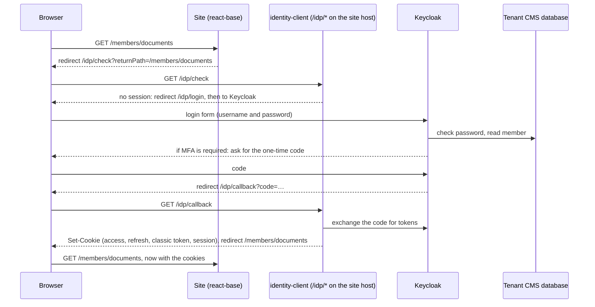

# Keycloak login: details

**Companion to:** [Keycloak login for published sites](README.md), the overview. This file holds the detail behind its "How Keycloak login works in Contensis" section.
**Checked against code:** the same sources as the overview, on 2026-10-09, re-checked on 2026-10-12, with test-tenant results from 2026-10-10 to 2026-10-12.
**Last updated:** 2026-10-11

## How a tenant is switched

Each CMS alias gets its own Keycloak realm, created by running svc-identity's ops scripts against a standard realm config. A tenant is switched by two settings that must go live together:

- `Identity_UseKeycloak`, a setting in the tenant's own database, which tells the CMS to use Keycloak. Several parts of the CMS read it only at startup, so changing it needs a CMS restart;
- the alias being added to a list in the platform's HAProxy template. That routes `/idp/*` to identity-client, and also sends the old IS3 token endpoint (`/authenticate/connect/token` on the CMS host) to Keycloak.

If only the first is on, `/idp/*` never reaches identity-client: on the CMS host it reaches the CMS, which has no `/idp` handler, and on website hosts it reaches the site's own server. The CMS still sends logins to `/idp/check`, so login breaks.

If only the second is on, the CMS keeps writing its IS3 refresh token into a cookie with the same name as Keycloak's, `ContensisSecurityRefreshToken`. A call to `/idp/refresh` sends that token to Keycloak, Keycloak rejects it, and identity-client deletes every login cookie (KEYC-208, seen in production with CMS users in the admin UI).

react-base reads neither setting today.

## Where identity-client runs

identity-client is one multi-tenant service, deployed once per Kubernetes cluster. HAProxy matches any request whose path starts with `/idp/` on the hosts it serves for a switched alias (the CMS host, preview and live hosts, customer domains) and sends it to identity-client. Rules evaluated earlier take precedence: registered redirects, reverse-proxied paths, and sub-site hosts that add a path prefix. HAProxy adds an `x-alias` header to every request, and identity-client uses it to pick the realm; without it, identity-client answers 400.

For the browser, `/idp/*` is part of the site's own host, and identity-client's cookies are written on that host. identity-client sends no CORS headers, so a page on another origin can't read its responses or send a request with a custom header; plain navigations to `/idp/*` still work from anywhere. react-base must call `/idp/*` with relative URLs.

## Members, passwords and MFA

Keycloak holds no user records or passwords. A plugin (a user storage SPI) reads users from the tenant's CMS database and checks passwords there. Keycloak does keep some per-user state of its own: the authenticator-app secret, pending setup steps, and flags such as whether MFA is required. Self-registered website users are CMS users with integration type 8 ("External"); the plugin treats them the same as ordinary CMS users (type 0).

Change password is handled by contensis-svc-security, which reads and writes the CMS database directly and needs no token grant. A member may change only their own password and must give the current one. Registration and forgot-password are separate: react-base posts them to `/account/register` and `/account/reset` on the site, and `nlgpsf-website` proxies those to a per-alias registration service. That service's source was not found, so whether Keycloak affects it is not known.

MFA is one switch per tenant, `Identity_EnableMFA` in the tenant's global settings (value 1 means on; if it can't be read, MFA is treated as off). It covers ordinary CMS users and website members alike, and excludes the `zengenti` user, API-key users and other integration types. It uses a time-based one-time code from an authenticator app. A user with no code set up is asked to set one up during login.

## The login sequence

identity-client runs a standard OpenID Connect login (authorization code with PKCE) on the server, as a public client with no client secret. The browser never handles a token exchange. Website hosts (preview, staging, live and any customer domain) use a Keycloak client called `contensis-web`; the CMS host uses `contensis-cms`.

Keycloak's login form asks for the username and password together. A one-time code step follows only for users whose MFA is required. If the tenant has a default external identity provider configured, Keycloak sends the browser there instead of showing the form.

The diagram shows a logged-out member opening a protected page.

The first step is the part react-base does not do today: in the browser it sends a logged-out member to `/account/login`, the classic form, which can't run MFA.

## Tokens and what accepts them

- **Access token, at contensis-svc-security and contensis-svc-delivery.** These services are built on the Zengenti .NET services library. They read only the `Authorization` and `x-alias` headers, never cookies. They accept a Keycloak token whose issuer is the alias's realm on one of three Keycloak hosts built into the library (`idp.zengenti.io`, `idp.zengenti.com`, `idp-dev.zengenti.com`), and check its signature and lifetime. They don't check its audience, client or scopes. HAProxy sends `/api/security` to contensis-svc-security. There, `security/users/@current` is open to any logged-in user and the user-groups call to the user themself or an admin, so the calls react-base's login makes accept a `contensis-web` token.
- **Access token, at the CMS's own API.** `/api` on the CMS host is the CMS's API application. With Keycloak on, it validates the token against the realm and, if the token is valid, requires at least one of the CMS resource scopes (such as `Entry_Read`). When a request has no `Authorization` header, the CMS takes the token from the `ContensisSecurityBearerToken` cookie. Until 2026-10-10 `contensis-web` tokens carried none of those scopes: on `nlgpsf-temp-dev` the token's `scope` claim was `openid profile email`, its issuer the tenant's realm on `idp-dev.zengenti.com`, and the CMS answered `403` with `WWW-Authenticate: Bearer error="insufficient_scope"`. KEYC-308 gives `contensis-web` the same 13 resource scopes as `contensis_classic` (svc-identity's realm config; contensis-svc-security's realm template has it on `feature/identity-management`). The `nlgpsf-temp-dev` and `idp` realms have been updated; a session that started before picks up the scopes on its next `/idp/refresh`. Member requests then run with the member's own permissions, as under IS3.
- **Delivery API.** For all but three aliases (`new-delivery`, `delivery-specs`, `tpicentre`), HAProxy sends `/api/delivery` to the CMS's API, and so to the scope check above. Neither Delivery API reads `ContensisCMSUserName` or `RefreshToken`. The CMS reads the `Authorization` header, the `ContensisSecurityBearerToken` cookie, a `ContensisAuthorisation` header, or the site's access key (`AccessToken` header, query string or cookie); contensis-svc-delivery reads the `Authorization` header or an access token. In the browser, react-base calls the Delivery API with a relative URL, so the browser sends the access token cookie itself. Before KEYC-308, on `nlgpsf-temp-dev`, a node request from the site host with the site's Delivery API access key and no `Authorization` header got 403 when the browser sent its cookies, and 200 when cookies were omitted: the CMS turns the cookie into a bearer, and its scope check runs before the access-key check. react-base's routing saga turned the 403 into a redirect to `/account/access-denied`. After the realm update the same request with the cookie returns 200, and the site's account page and secure documents load. The scope check applies only to a token that validates: an expired, badly signed or wrong-issuer token in the cookie is ignored, the request continues as anonymous, and with the site's access key the CMS-served Delivery API answers as for any visitor instead of returning 401 (code reading, not run live). Only the Management API and contensis-svc-security return 401 for a dead member token.
- **Classic security token.** The legacy encrypted CMS token: host, user ID, expiry and username, encrypted with the tenant's key, valid for 15 days. Under Keycloak the user-store plugin creates it when the password is checked and keeps it with the Keycloak login session. Keycloak adds it as the `contensis_security_token` claim to the access token, the identity token (the OpenID Connect id_token, returned alongside the access token) and the userinfo response; the realm config's `contensis_claims` scope, a default for every client, turns all three on. identity-client writes it into the `ContensisClassicToken` and `ContensisCMSUserName` cookies. A standard refresh returns the same value, because it comes from the same login session.
- **Where the classic token is accepted.** CMS pages accept the `ContensisCMSUserName` cookie. CMS REST endpoints such as `IsAuthenticated` take it as a parameter or header. `nlgpsf-website` sends it as a `ContensisCMSUserName` header to its own `/secure-documents` route to list a member's documents.

## Why the classic grants fail

IS3 had two custom ways to get a token: one with a username and password (`contensis_classic`), and one with a refresh token (`contensis_classic_refresh_token`). Keycloak reimplements both under the same names, and returns the classic token under the same cookie and header names as IS3 (`ContensisClassicToken`, `x-contensis-classic-token`), so existing callers keep working. react-base's management client is one of those callers; the CMS's `IsAuthenticated` endpoint is another.

Neither request can show a page to ask for a one-time code, so Keycloak refuses both for any user whose MFA is required (KEYC-183); it also refuses the standard password grant. An environment variable on the Keycloak server, `CONTENSIS_ALLOW_MFA_CLASSIC_GRANTS` (KEYC-200), turns the refusal off. It is off by default and no deployment config in the platform repo sets it; only a code comment says it must never be deployed. If it is on in a test realm, it hides this bug.
