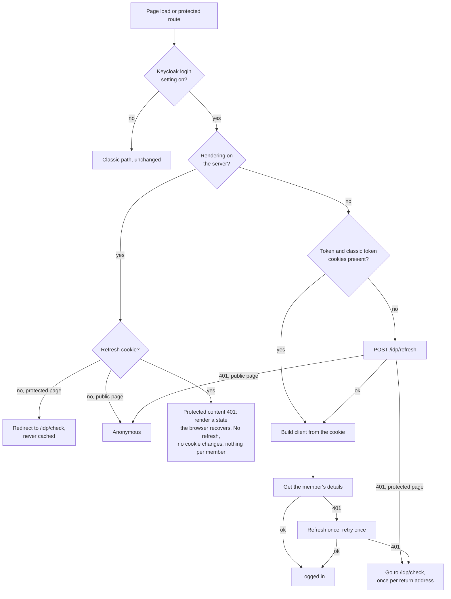

# Keycloak login for published sites in react-base — plain-English version

> **Retired 2026-10-09 — do not use.** Kept for reference only. The base document is now the overview,
> [docs/features/keycloak-login/README.md](../features/keycloak-login/README.md). A new plan will be written once the scope is agreed.

**Status:** Retired. Was a proposal from the Keycloak migration, awaiting approval by the react-base owner (Neil Flatley).
**Date:** 2026-10-08
**Repo:** `contensis-react-base`, line `master` (v4)
**Tickets:** CHALKY-2080 (react-base work), KEYC-199 (Keycloak side), linked as Relates

> **For human readers — review copy, not the canonical source.**
> Tools, agents, and any automated requirement trace should use the working plan, not this copy.
> Canonical working doc:
> [2026-07-21-001-fix-keyc-199-bff-session-login-plan.md](./2026-07-21-001-fix-keyc-199-bff-session-login-plan.md).
> Substantive changes are made there, not here.

## What this document is about

On a tenant that has moved to Keycloak and turned on MFA for website members, a member can go through the whole login — password, then the one-time code — and land back on the site still logged out. Nothing on the page says anything went wrong.

The cause is in react-base. It logs a member in by asking the CMS for two older kinds of token (the "classic" grants), and Keycloak refuses both for anyone who needs MFA. That refusal is deliberate and stays.

After a Keycloak login, the member's browser already holds everything react-base needs. Identity-client has written the access token and a refresh token as cookies on the site's own host. This plan makes react-base use those cookies instead of asking for classic tokens, and use identity-client's `/idp/*` endpoints for refreshing, logging in again and logging out.

It must be fixed before the first customer that has both MFA and member login. It does not block the `standard` environment.

## The short version

1. **A site setting turns on Keycloak login.** With it off, react-base behaves exactly as it does today, so classic sites are untouched.
2. **The access token is read from its cookie every time react-base talks to the Management API.** react-base never stores it and never asks for a token itself. Identity-client owns the token and replaces the cookie when it is refreshed.
3. **A missing or rejected token is refreshed by calling `POST /idp/refresh`.** That should work even after the browser has been closed and reopened, for up to 15 days without use (from the realm config, to be confirmed in testing).
4. **When the session can't be recovered, or there is no session, the member goes to `/idp/check`,** which takes them through the Keycloak login (including MFA) and back. The server sends them there before the page renders when it can already tell there is no session, and that redirect is never cached.
5. **Nothing about a particular member goes into the server-rendered page,** because those pages are cached and shared. The browser works out the member's session itself.
6. **Logout goes to `/idp/logout`,** because only identity-client can remove the refresh cookie and end the Keycloak session.
7. **react-base keeps storing the classic security token,** because sites read it. `nlgpsf-website` uses it to list a member's documents.
8. Four questions are left to Neil; the main one is how react-base knows a site uses Keycloak.

## Terms

| Term | Plain meaning |
|---|---|
| Bearer / access token | The Keycloak token sent to the Management API to prove who the member is. Lasts 30 minutes. |
| Refresh token | A longer-lived token used to get a new access token without logging in again. |
| Classic security token | The older Contensis session token. Keycloak still issues one, and sites still use it. |
| Classic grants | The two older ways react-base asks for tokens (`contensis_classic`, `contensis_classic_refresh_token`). Keycloak refuses them for MFA users. |
| identity-client | `zengenti-svc-identity-client`: the service that runs the Keycloak login for a site through its `/idp/*` endpoints, on the site's own host, and writes the login cookies. |
| identity-keycloak | The Keycloak server itself, built from `zengenti-svc-identity`: the realm config, the user storage SPI that reads members from the CMS database, and the classic grants it refuses for MFA members |
| BFF session | The login identity-client (`zengenti-svc-identity-client`) sets up through its `/idp/*` endpoints, held in cookies on the site's host. |
| SSR | Server-side rendering: react-base renders the first page on the server before the browser takes over. These pages are cached and served to other visitors, for up to an hour. |

Labels used below: **[FACT]** verified in code or config; **[ASSUMPTION]** reasonable but not yet proved; **[OPEN]** a decision still to be made.

## Where this stands

- The plan is written against the current code: react-base `master` (`29ab2e28`, 4.0.1-beta.22) and `zengenti-svc-identity-client` `origin/main` (`206359e`).
- No react-base code has been written. The branch `feat/keyc-199-bff-session-login` is at `origin/master`.
- identity-client is built and running on the test tenant `nlgpsf-temp-dev`. Nothing needs to change there.
- The live site that needs this, `nlgpsf-website`, is on react-base v3. It needs a v3→v4 upgrade before it can use the fix, and that ticket hasn't been filed.

## How login works today, and why it fails

When a member logs in, react-base does two things, and both depend on a classic grant **[FACT]**:

- **Checking the login.** `validateUserSaga` calls `IsAuthenticated` in `contensis-app`. That endpoint logs the user in again on the server using their password and the `contensis_classic` grant.
- **Getting a token for the Management API.** `LoginUser` builds the API client with the `contensis_classic_refresh_token` grant. The first call (`getCurrent`) asks for a token through it.

Keycloak rejects both grants for users who need MFA (`zengenti-svc-identity` `ContensisClassicGrantType.java:202-216`, `ContensisClassicRefreshTokenGrantType.java:89-104`). There is a bypass flag for testing (`CONTENSIS_ALLOW_MFA_CLASSIC_GRANTS`, from KEYC-200). It is off by default. If it is on in a test realm it hides the bug, so it must be confirmed off before testing.

A few other things about react-base today matter for the fix **[FACT]**:

- After a successful login react-base writes its own copies of the access token and the classic token as cookies, valid for one day (`LoginHelper.class.ts:217-229, 338-340`; `CookieHelper.class.ts:4`).
- It stores the token and its expiry date in redux. The expiry is turned into text on the way in (`mapClientCredentials.ts`). The Management API SDK compares it as a date, so the token always looks expired and the SDK asks for a new token with a classic grant. This already happens on classic sites today.
- A logged-out member who opens a protected page is sent to `/account/login`, the old login form (`login.ts:82-83`).
- Two newer login paths come from the access-token feature: `ensureAccessTokenSaga` in `src/routing/redux/sagas.js` and `src/server/features/access-token-api/authenticateRequest.ts`.
- The redirect to `/account/login` lives in one saga, `handleRequiresLoginSaga`, which three places call: protected content, the access-token saga, and routes marked `requireLogin` (`sagas.js:113-117, 369-372, 493-496`).
- Server-rendered pages are cached for up to an hour, so react-base strips the `user` part of its state before sending it with the page (`webApp.tsx:352-355`).
- On the server, react-base's cookie helper is empty unless the site sets `enableSsrCookies` (`webApp.tsx:238-243`); `nlgpsf-website` doesn't. The raw `Cookie` header of the request is always available.
- Protected content is fetched through the Delivery API, which carries only the forwarded login cookies (`ContensisCMSUserName`, `RefreshToken`), not a Management API token (`ContensisDeliveryApi.ts:138-155`).
- All redux selectors are public (`src/user/index.ts:27`). `nlgpsf-website` reads `selectUserSecurityToken` (the classic token) and sends it to its `/secure-documents` route to list a member's documents (`src/app/redux/documents/sagas.ts:14-20, 59`).
- There is no automated test suite in react-base.

## What identity-client provides

The cookies and endpoints below are from `zengenti-svc-identity-client` **[FACT]**; the two points that come from the Keycloak realm config instead are marked. Its `/idp/*` endpoints run on the published site's own host, and there is no cross-origin access, so react-base must call them with relative URLs (`/idp/refresh`, not a CMS hostname).

After login the browser holds these cookies:

| Cookie | Page JavaScript can read it | How long it lasts |
|---|---|---|
| `ContensisSecurityBearerToken` (access token) | yes | 30 minutes |
| `ContensisSecurityRefreshToken` | no; only the server sees it | up to 15 days without use **[ASSUMPTION — realm config, confirm in testing]** |
| `ContensisClassicToken` and `ContensisCMSUserName` (classic token, same value) | yes | until the browser closes |

So after the browser is closed and reopened, the refresh cookie is still there (and the access token too, if it is under 30 minutes old), but the classic token cookies are gone.

The endpoints:

- **`POST /idp/refresh`** needs the header `X-Contensis-Refresh`. On success it writes a new access token cookie. The service writes the classic token cookies again only when Keycloak returns an id_token with the refresh. The login asks for the `openid` scope, so Keycloak should return one **[ASSUMPTION — confirm in testing]**. If Keycloak rejects the refresh, the service deletes every login cookie itself and returns 401. If there is no refresh cookie, it returns 401 and deletes nothing. The refresh token can be used more than once at the moment; KEYC-180 may change that.
- **`GET /idp/check?returnPath=…`** sends a logged-out member to the Keycloak login page and back to `returnPath`. A logged-in member goes straight back. If they are logged in but a cookie is missing, it repairs the cookies first. "Logged in" here means identity-client's own session cookie (`.Contensis.Auth`) is valid, and that is a session cookie too. After a browser restart `/idp/check` therefore goes to the login page rather than repairing. Whether the member then has to type their password and code again depends on whether they ticked "Remember me" at login (the realm allows it).
- **`GET /idp/logout?returnPath=…`** deletes every login cookie, including the refresh cookie the page can't see, and ends the Keycloak session. Deleting cookies from the page is not enough. The refresh cookie and the Keycloak session would survive, and the next `/idp/check` would log the member straight back in.

## What react-base has to do

### Know that a site uses Keycloak

react-base needs to know, on the server and in the browser, whether a site uses Keycloak login. Looking at cookies alone doesn't work. The classic token cookie is gone after a browser restart even though the session is still valid, and a logged-out member has no cookies at all, so react-base would never send them to the Keycloak login.

The proposal **[OPEN — Neil's question 1]** is a site setting, passed from the server config to the browser the same way the access-token feature passes its config. The setting is the same for every visitor, so it can safely sit in a cached page. With the setting on:

- the server reads the refresh cookie from the raw request header, only to decide whether to redirect a logged-out member before rendering. It puts nothing about the member into the page;
- in the browser, react-base uses the access token and classic token cookies if both are there. If either is missing, it calls `/idp/refresh`: a 200 means there is a session, and a 401 means there isn't. The browser can't see the refresh cookie itself, so the refresh call is how it finds out. With no session on a protected page, it sends the member to `/idp/check`.

When a site is switched over, members still have react-base's old one-day cookies but no Keycloak refresh cookie. They will be asked to log in once. That is expected.

### Read the access token from its cookie, every time

With the setting on, react-base keeps no access token and no expiry date of its own. Every Management API client is built by one function, `getManagementApiClient`, which reads the access token cookie at that moment.

The SDK needs an expiry date, or it tries to fetch a token itself. The function gives each client a date far in the future (for example 24 hours). Each client is created for one call and thrown away, so that date is never stored or turned into text. The function passes no grant type, so if anything ever does make the SDK ask for a token, the request fails instead of falling back to a classic grant.

The function needs to know where to read cookies from. In the browser that is `document.cookie`. On the server it has to be the raw `Cookie` header of the request being rendered, because react-base's cookie helper is empty there on most sites, so the caller passes it in as an argument. A single shared "current token" variable would mix up members whose pages are being rendered at the same time.

> Illustrative only — not prescription. `isKeycloakLogin`, `CookieSource`, `readCookie`, `FAR_FUTURE_MS` and `classicClient` are placeholders; Neil chooses the real names and helpers. What matters is that this is the only place a Keycloak-path client is built, the cookie source comes in as an argument, and the date is created per client.

```ts
// src/user/util/ContensisManagementApi.ts (sketch)
export const getManagementApiClient = async (
  credentials: ManagementApiClientCredentials,
  cookies?: CookieSource // <- request cookies on the server; document.cookie by default in the browser
) => {
  if (isKeycloakLogin()) {
    const bearerToken = readCookie(cookies, BEARER_TOKEN_COOKIE); // <- read now, never from redux
    const client = Client.create({ ...baseConfig }); // <- no clientType: a stray authenticate() fails, it can't fire a classic grant
    client.bearerToken = bearerToken;
    client.bearerTokenExpiryDate = new Date(Date.now() + FAR_FUTURE_MS); // <- a new Date per client, never stored
    return client;
  }
  return classicClient(credentials); // <- unchanged
};
```

The sketch shows one place to review, an untouched classic branch, and nothing token-related surviving past the call.

### Keep storing the classic token

Sites read the classic token through the public `selectUserSecurityToken`, so react-base keeps storing that one value. The browser reads it from the `ContensisClassicToken` cookie; it never comes from the server-rendered page. Nothing else goes into stored credentials. `selectClientCredentials` on a Keycloak site therefore returns only the classic token; that belongs in the release notes.

After a browser restart the classic token cookie is gone until the first refresh writes it again, so react-base reads it after refreshing and before reporting the member as logged in.

react-base must also stop writing its own one-day cookie copies when the setting is on. Today it does that after every successful login; on a Keycloak site it would overwrite identity-client's 30-minute access token and keep the classic token for a day.

### Refresh when the token is missing or rejected

react-base calls `POST /idp/refresh` with a relative URL, the `X-Contensis-Refresh` header and same-origin credentials, and a 5-second timeout. The timeout uses `AbortController` and a timer, because `AbortSignal.timeout` isn't available in the browsers react-base is built for.

It refreshes in two situations:

- the access token or the classic token cookie is missing, for example after a browser restart or when the token is more than 30 minutes old. If the refresh returns 401, there is no session;
- the Management API answers 401. react-base refreshes once, builds a new client (which picks up the new cookie), and tries once more.

If several parts of the page need a refresh at the same moment, they share one request. Today that only saves requests, because the refresh token can be reused. If KEYC-180 makes refresh tokens single-use, the shared request still works.

After a restart, react-base restores the session with `/idp/refresh`, not `/idp/check`. `/idp/refresh` only needs the refresh cookie, which survives for up to 15 days without use. `/idp/check` would send the member to the login page.

### When the session can't be recovered

If the refresh returns 401, or the retry after a successful refresh still gets 401, react-base sends the member to `/idp/check?returnPath=<current page>`. It does not delete any cookies itself. When Keycloak rejects a refresh, identity-client has already deleted them; when there was no refresh cookie, there is nothing to delete.

There is one loop to guard against. If the Management API keeps rejecting a token that identity-client considers valid, `/idp/check` sends the member straight back, the call fails again, and so on. Each round trip is a new page load, so a flag kept in memory would reset every time. react-base therefore adds a query parameter to `returnPath` before going to `/idp/check`. If the member comes back with that parameter and still gets a 401, react-base shows an error instead of going round again, and it removes the parameter once the login succeeds. Identity-client has no loop-breaker of its own.

Before building `returnPath`, react-base removes any `securityToken`, `credentials` or `password` values from the query string, matching names regardless of case. react-base's own token parameter is spelled `securityToken` or `securitytoken`, and identity-client doesn't strip anything.

The change replaces the redirect to `/account/login` inside `handleRequiresLoginSaga`, so all three places that call it — protected content, the access-token saga and routes marked `requireLogin` — send members to `/idp/check`.

### Logging out

With the setting on, logout navigates to `/idp/logout?returnPath=…`. That is the only way to remove the refresh cookie and end the Keycloak session.

### Server rendering

The server reads the request's raw `Cookie` header, which includes the refresh cookie. With the setting on:

- for a protected page and no refresh cookie, the server redirects to `/idp/check` before rendering. react-base already supports redirects from the render (`src/server/webApp.tsx:439-447`). The redirect is sent with `Cache-Control: no-store, private` and `Surrogate-Control: no-store`, as the access-token endpoint already does. Otherwise the page's normal one-hour cache header would apply, and a cached redirect could send members who are logged in round a loop the browser can't stop;
- it never refreshes and never deletes cookies, because the new cookies have to land in the browser;
- it puts nothing about the member into the page: no session flag, no classic token, no access token;
- a protected page that gets 401 while a refresh cookie is present renders a state the browser recovers after the page loads. Today that 401 either becomes a 500 error page or reloads the route with no limit (`src/routing/redux/sagas.js:363-391`). A Management API client built on the server wouldn't help, because protected content comes through the Delivery API with only the forwarded login cookies.

### Change password

Change password keeps working for Keycloak members **[FACT]**. Their passwords stay in the CMS database, which Keycloak reads when they log in (`zengenti-svc-identity` user storage SPI). `contensis-svc-security` checks the existing password and stores the new one without any grant (`UserController.cs:186-208`, `UpdatePasswordCommandHandler.cs:30-60`), so MFA does not block it. The change-password saga builds its client through the same function.

### The access-token release (if Neil agrees)

The access-token saga in the browser is already covered by the `handleRequiresLoginSaga` change. Sites that protect their delivery access token with `requireLogin` release it through `authenticateRequest.ts` on the server. Today it takes the token from `ContensisCMSUserName` before the access token cookie, and on a Keycloak site that cookie holds the classic token, not the Keycloak token. It also falls back to a classic grant. With a refresh cookie present it should use the access token cookie, build its client through the same function, and return 401 instead of falling back, so the browser can refresh and try again **[OPEN — Neil's question 2]**.

### What stays the same

With the setting off, none of the above runs. Classic sites see no change.

The flow below shows how a request is handled with the setting on.



## What this work does not do

- No change to the Management API SDK, `zengenti-svc-identity-client`, `zengenti-svc-identity` or `contensis-app`.
- No test framework for react-base.
- No `nlgpsf-website` change; its v3→v4 upgrade is separate.
- No fix for the expiry-date bug on classic sites (Neil's question 3).

## Security

- The access token cookie is readable by page JavaScript; that is how identity-client designed it, and this plan doesn't change it. Script injected into the site could read it and could call `/idp/refresh` to keep a stolen session going. The refresh cookie itself is protected from scripts.
- Server-rendered pages are cached and shared, so nothing about a member goes into them: react-base already strips its `user` state before sending it, and this work adds no session flag or token anywhere else. The one response that depends on the member's cookies, the redirect to `/idp/check`, is marked never to be cached.
- On Keycloak sites react-base doesn't store the access token at all. Classic sites still store it in the browser, as today.
- Writing a fake `ContensisClassicToken` cookie has no effect on which login path is used, because the site setting decides that.
- The bypass flag `CONTENSIS_ALLOW_MFA_CLASSIC_GRANTS` must be off wherever this is tested.

## Risks and trade-offs

| Risk | Mitigation |
|---|---|
| A wrong check affects classic sites | The setting is off by default; every place it is checked gets reviewed |
| A client built outside the one function has no date and asks for a token | One function, one review check; with no grant type the request fails instead of using a classic grant |
| Redirect loop through `/idp/check` | One round trip per return address, tracked by a query parameter, then an error |
| A member's data or a redirect cached and served to someone else | Nothing per member in server-rendered pages; the `/idp/check` redirect is never cached |
| 500 page or endless reload for a member whose session is still valid | The server renders a state the browser recovers |
| Classic token missing after a restart | The refresh writes it again when it returns an id_token, which it should; `/idp/check` can't repair it after a restart **[ASSUMPTION — confirm in testing]** |
| Protected content rejects the classic token issued through Keycloak | The route would reload in a loop; checked on a real protected page in testing |
| Two tabs refreshing at once | Harmless today because refresh tokens can be reused; if KEYC-180 changes that, a losing tab goes through `/idp/check` |
| No automated tests | Typecheck, lint, build and review, then testing on a real site |

## The work

The plan is one piece of work. In the order it is likely to be built:

1. Add the site setting (passed to the browser), the cookie names, and a server helper that reads the refresh cookie from the raw request header.
2. Add the `/idp/refresh` helper: relative URL, header, timeout, shared request, reads the new cookie afterwards, does nothing on the server.
3. Make `getManagementApiClient` the one place clients are built on Keycloak sites; store only the classic token; route change password through it.
4. Change login: skip `IsAuthenticated`, refresh when a cookie is missing and on 401, stop writing react-base's own cookies, send unrecoverable sessions and logged-out members to `/idp/check` from inside `handleRequiresLoginSaga` (once per return address), send logout to `/idp/logout`, redirect from the server when there is no refresh cookie (never cached), and render a recoverable state instead of a 500 or a reload.
5. Make the public `refreshSecurityToken` call `/idp/refresh` and pass on only the classic token.
6. If Neil agrees, fix the access-token release.

## How it is checked

In react-base: install, lint, typecheck and build, plus a review that checks, among other things, that nothing on the Keycloak path can reach a classic grant or `IsAuthenticated`, that only one function builds clients, that no token or expiry is stored, that nothing about a member is in a server-rendered page, that the server's redirect is never cached, and that the server never refreshes or deletes cookies.

On `nlgpsf-temp-dev`, after the upgrade, with member MFA on and the bypass flag off:

- a logged-out member opening a protected page is sent to the Keycloak login, completes MFA, and sees their account page and their documents;
- the browser's network log shows no `IsAuthenticated` call and no classic grant;
- deleting the access token cookie leads to one refresh, and the page carries on;
- a protected content page, not only the documents route, loads for a logged-in member, including after a browser restart, without reloading in a loop;
- a logged-out request for a protected page gets a redirect to `/idp/check` that is marked never to be cached;
- after closing and reopening the browser, both within 30 minutes and after longer, the member is still logged in without a login page and still sees their documents;
- a member can change their password and log in with the new one;
- after logout, reloading shows no session.

## What "done" means

- Neil has approved the plan and answered the open questions.
- The work is on `feat/keyc-199-bff-session-login`, and the react-base checks pass.
- Classic sites behave as before with the setting off.
- The overview (`docs/features/keycloak-login/README.md`) is updated in the same pull request.
- Testing on the real site is recorded as waiting on the `nlgpsf-website` upgrade.

## Open questions

1. **How react-base knows a site uses Keycloak.** Cookie only, site setting only, or a site setting plus cookies to choose between refreshing and logging in. Recommendation: the setting plus cookies. *(Neil)*
2. **Whether the access-token release is part of this work.** Recommendation: yes; otherwise sites that use `requireLogin` still fail for MFA members. *(Neil)*
3. **The expiry-date bug on classic sites.** Keycloak sites aren't affected. Recommendation: a separate ticket. *(Neil)*
4. **Where the new code goes** — inside the existing functions, or a separate module the sagas hand over to. Recommendation: inside the existing functions, as the plan is written; a separate module is a reasonable alternative. *(Neil)*
5. **The far-future date** — pick the value and document it. *(Decided during implementation)*

## Next actions

1. Neil reviews the plan and answers the questions.
2. Commit the plan, this copy and the overview on `feat/keyc-199-bff-session-login`.
3. Add a short description to CHALKY-2080 pointing at the plan and the overview.
4. File the `nlgpsf-website` v3→v4 upgrade ticket.
5. Confirm the bypass flag is off on `nlgpsf-temp-dev`.

## Appendix — how this maps to the canonical plan

| This copy | Canonical plan |
|---|---|
| Know that a site uses Keycloak | Q1, KTD1, U1 |
| Read the access token from its cookie | KTD3, U3 |
| Keep storing the classic token | KTD5, R10, U3, U4 |
| Refresh when missing or rejected | KTD2, KTD4, U2 |
| When the session can't be recovered | KTD6, R4, R9, U4 |
| Logging out | KTD6, R7, U4 |
| Server rendering | KTD7, R6, R8, R11, U4, Deferred item 2 |
| Change password | System-Wide Impact, U3 |
| Access-token release | Q2, U6 |
| Open questions 1–5 | Q1–Q4, Deferred item 6 |
