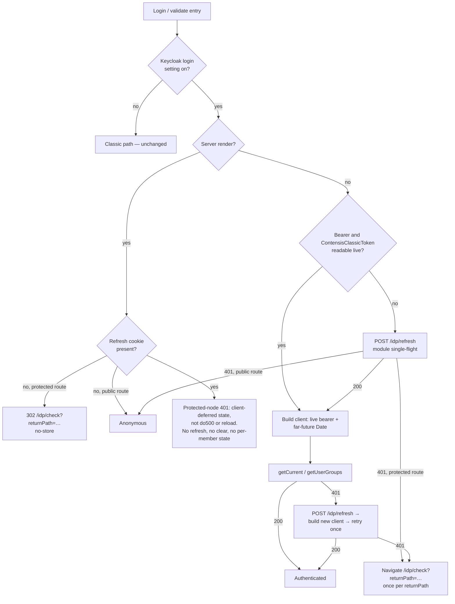
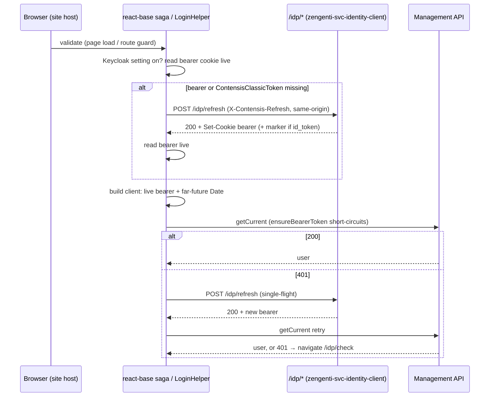

# fix: Complete MFA-required published-site login via the BFF `/idp/*` session (KEYC-199)

> **Retired 2026-10-09 — do not implement from this plan.** Kept for reference only. The base document is now the overview,
> [docs/features/keycloak-login/README.md](../features/keycloak-login/README.md). A new plan will be written once the scope is agreed with the react-base owner.

**Target repo:** `contensis-react-base`, line `master` (v4). Branch `feat/keyc-199-bff-session-login` is at `origin/master` (`29ab2e28`, 4.0.1-beta.22) with no commits of its own. Paths are repo-relative to `contensis-react-base` unless another repo is named.

**Status:** proposal from the Keycloak migration for the react-base owner to approve. Four design questions are left to the owner (see Open Questions for the react-base Owner). Written against `zengenti-svc-identity-client` `origin/main` `206359e` and react-base `master` `29ab2e28` (2026-10-08).

**Overview:** [`docs/features/keycloak-login/README.md`](../features/keycloak-login/README.md) — the summary for discussion; this plan holds the detail.

---

## Summary

On a Keycloak tenant with member MFA enabled, a published-site member completes the browser login (including OTP) but the React site never shows them as authenticated, with no visible error. Root cause (confirmed live, see origin): react-base logs in and refreshes only through the two classic grants (`contensis_classic`, `contensis_classic_refresh_token`), and Keycloak rejects both for MFA-required users (KEYC-183).

The fix makes react-base use the BFF `/idp/*` session served by `zengenti-svc-identity-client` on the site's own host:

- build every management client from the JS-readable `ContensisSecurityBearerToken` cookie at the moment it is needed, with a far-future `bearerTokenExpiryDate`, and store no bearer or expiry;
- skip the `IsAuthenticated` round-trip;
- refresh with `POST /idp/refresh`, never a classic grant;
- send login and terminal failures to `GET /idp/check`, and logout to `GET /idp/logout`.

The design follows the `/idp/*` contract in the next section. When no BFF session is detected the classic path behaves as today.

Priority: KEYC-199 must be fixed before the first customer with MFA member login; it does not gate `standard` (`zengenti-svc-identity` branch `feature/keyc-302-keycloak-production-release`, `docs/keycloak-production-release.md:56`). The live site (`nlgpsf-website`) is on react-base v3 and needs a v3→v4 upgrade to consume the fix — out of scope here.

---

## The `/idp/*` Contract

Naming: `zengenti-svc-identity-client` is deployed as `identity-client` and serves `/idp/*`. Keycloak itself (realm config, user storage SPI, classic grants) is built from `zengenti-svc-identity` and deployed as `identity-keycloak`.

Verified in `zengenti-svc-identity-client` `origin/main` `206359e` (2026-10-08). `Svc` = `src/Contensis.Identity.Oidc/ContensisOidcService.cs`; `Web` = `src/Contensis.Identity.Oidc.Web/`.

**Host.** `/idp/*` is served on the published site's own host. Realm redirect URIs are `https://preview-…/idp/callback`, `https://live-…/idp/callback` and customer domains (`contensis-svc-security` realm template `:826-836`; runbook `:133-135`); HAProxy `keycloak_migrated_aliases` enables the route (runbook `:274`). There is no CORS policy (identity-client `docs/open-issues.md` OI-9), so calls must be site-relative.

**Cookies.** All are written by `AppendCookie` (`Svc:735-754`): `Path=/`, `SameSite=Lax`, `Secure` when the request is HTTPS (forwarded-proto honoured, `Web/Program.cs:148-167`), no `Domain` (host-only).

| Cookie | httpOnly | Lifetime | Value | Source |
|---|---|---|---|---|
| `ContensisSecurityBearerToken` | no | `ExpiresIn` (realm access-token lifespan, 1800 s by default) | Keycloak access token | `Svc:679-684`, refresh `:633-638` |
| `ContensisSecurityRefreshToken` | **yes** | `RefreshExpiresIn` (follows the realm SSO session: 15 days idle / 15 days max) | Keycloak refresh token | `Svc:688-693`, refresh `:642-647` |
| `ContensisClassicToken` | no | session (no Max-Age) | classic security token | `Svc:699` |
| `ContensisCMSUserName` | no | session | classic security token (same value) | `Svc:700-704` |
| `ContensisLastUserName`, `ContensisDisplayName` | no | session | display data | `Svc:706-732` |

Consequences for react-base:

- The bearer and the refresh cookie persist across a browser restart; `ContensisClassicToken` and `ContensisCMSUserName` do not. After a restart within the bearer lifetime the browser holds a bearer and the (unreadable) refresh cookie, with no `ContensisClassicToken`.
- `ContensisSecurityRefreshToken` is visible to the server on every request (SSR) but not to page JavaScript.
- There is no cookie carrying the bearer's expiry.

**`POST /idp/refresh`** (`Web/Program.cs:293-304`, logic `Svc:284-362`)

- Header `X-Contensis-Refresh` required, else `403` with `{error:"missing_header"}`.
- `200`, empty body: bearer and refresh cookies re-minted (`Svc:337`). `ContensisClassicToken`/`ContensisCMSUserName` are re-minted only when Keycloak returns an id_token (`Svc:649-661`).
- `401` with **nothing cleared** when there is no refresh cookie (`Svc:288-291`).
- `401` with **all auth cookies cleared** (`ClearAuthenticationCookies`, `Svc:784-797`) when Keycloak rejects the refresh, returns no access token, or validation throws (`Svc:311-321`, `:323-328`, `:352-361`).
- The refresh token is reusable: realm `revokeRefreshToken` is unset (default `false`); the `revoke.refresh.token` client attribute in the realm JSON is not recognised by Keycloak 26.0.5 (`zengenti-svc-identity` `docs/contensis-classic-payload-is3-vs-keycloak.md:85,141`). KEYC-180 (To Do) may introduce rotation.

**`GET /idp/check?returnPath=`** (`Web/IdpEndpoints.cs:18-87`)

- `returnPath` required, else redirect to `/idp/error?code=missing_return_path` (`:25-27`).
- Authenticated with the full cookie set (bearer, `ContensisCMSUserName`, `ContensisClassicToken`, refresh; `:10-16`) → local redirect to `returnPath`.
- Authenticated but a cookie missing → server-side refresh to restore the set, else `/idp/login` (added as a loop safety net; `zengenti-svc-identity` `docs/brainstorms/2026-06-11-idp-check-cookie-heal-requirements.md`).
- Not authenticated → `/idp/login?returnPath=…`, the Keycloak login (including MFA).
- "Authenticated" means the `.Contensis.Auth` session cookie (alias-scoped name) is valid. It is a session cookie (`IsPersistent = false`, `Svc:1283`), expires with the id_token (`Svc:1284`) and does not slide (`Web/Program.cs:99`). After a browser restart `/idp/check` therefore goes to `/idp/login`. That login is silent only if the member ticked "Remember me" at login (realm `rememberMe: true`). Without it, Keycloak's login cookie is a session cookie (Deferred item 10). `POST /idp/refresh` needs only the persistent refresh cookie, and when it receives an id_token it also renews `.Contensis.Auth` (`Svc:340-343`).

**`GET /idp/logout?returnPath=`** (`Web/IdpEndpoints.cs:119-163`, `Svc:400-467`): signs out, clears every auth cookie including the httpOnly refresh cookie (`Svc:414-415`), ends the Keycloak session, redirects via the Keycloak end-session endpoint. Clearing cookies in the browser alone leaves the refresh cookie and the Keycloak session, and the next `/idp/check` logs the user back in.

**Classic grants for MFA users** remain rejected (`zengenti-svc-identity` `ContensisClassicGrantType.java:202-216`, `ContensisClassicRefreshTokenGrantType.java:89-104`). The KEYC-200 bypass `CONTENSIS_ALLOW_MFA_CLASSIC_GRANTS` is off by default; if it is on in a test realm it hides this bug.

---

## Problem Frame

Two failure points make an MFA login impossible today (origin diagnostic):

- **FP1 — `IsAuthenticated` password replay.** `validateUserSaga` → `LoginHelper.GetCredentialsForSecurityToken` → `POST REST/Contensis/Security/IsAuthenticated`, which re-authenticates server-side via the `contensis_classic` grant. Rejected for MFA users, so `isAuthenticated` never flips. `SecurityService.IsAuthenticated` is unchanged on `contensis-app` main (`api/Contensis.Services/Security/SecurityService.vb:214-262`).
- **FP2 — the classic refresh grant.** `LoginHelper.LoginUser` builds the client with `contensis_classic_refresh_token` (or `contensis_classic`), and `getCurrent()` → `ensureBearerToken()` fires it. Also rejected.

The only MFA-passed credential the user holds is the BFF bearer/refresh pair.

**Current react-base facts** (`master` `29ab2e28`):

- `src/user/util/ContensisManagementApi.ts` — `getManagementApiClient` picks `contensis_classic_refresh_token` when a `refreshToken` is passed, else `contensis_classic`; `bearerToken`/`bearerTokenExpiryDate` are assigned after construction.
- `src/user/util/LoginHelper.class.ts`
  - `SetLoginCookies` (`:217-229`) writes `ContensisSecurityBearerToken`, `ContensisCMSUserName` (the classic token) and `RefreshToken`. `CookieHelper.SetCookie` defaults to a 1-day expiry (`CookieHelper.class.ts:4,54-66`), so classic cookies persist across a restart. react-base never writes `ContensisClassicToken` or `ContensisSecurityRefreshToken`.
  - `GetCachedCredentials` (`:232-241`) hardcodes `bearerToken: null`, `bearerTokenExpiryDate: null`, and reads `RefreshToken` and `ContensisCMSUserName`.
  - `ClearCachedCredentials` (`:243-258`) deletes `ContensisCMSUserName`, `RefreshToken`, `ContensisSecurityBearerToken`; not `ContensisClassicToken`.
  - `LoginUser` (`:260-353`) clears credentials on any `getCurrent` error; `GetUserDetails` (`:43-63`) returns the SDK error object unwrapped, so `errorMessage` at `:331` is `undefined` for an HTTP error. `LogoutUser` (`:355`) calls `ClearCachedCredentials`.
- `src/user/redux/sagas/login.ts`
  - `validateUserSaga` (`:96-161`) proceeds only when `securityToken || cachedSecurityToken || refreshToken` is present (`:101-105`); the bearer is not in the guard.
  - `refreshSecurityToken` (`:219-232`) takes no arguments, reads `selectClientCredentials`, and calls `client.authenticate()`. It has **no internal caller**; it is re-exported from `src/user/index.ts:23`.
  - An unauthenticated protected route ends in `ClientRedirectToSignInPage` (`:82-83`) → `/account/login`, the classic form.
- `src/user/redux/sagas/resetPassword.js:143-144` — `changePasswordSaga` builds a management client from redux credentials (`selectClientCredentials`, `selectors.ts:27-35`).
- `src/user/transformations/mapClientCredentials.ts` — unconditionally calls `.toISOString()` on both expiry dates, so redux holds ISO **strings**.
- `src/routing/redux/sagas.js`:
  - The protected-node `401`/`403` path is at `:363-391`; an unresolved 401 calls `do500` (`:386`, `:389`).
  - `ensureAccessTokenSaga` (`:100-142`, called at `:173`, skipped on the server at `:105`) runs `handleRequiresLoginSaga({ requireLogin: true })` on every client route while `config.accessToken` is unset, then POSTs the site-relative `releaseUri` (`:85-94`); failure goes to access-denied (`:128-132`).
- `src/server/features/access-token-api/authenticateRequest.ts` — `getRequestCredentials` (`:19-28`) takes the bearer from the `Authorization` header, then `ContensisCMSUserName`, then `ContensisSecurityBearerToken`, and the refresh token from `RefreshToken`. On a BFF session `ContensisCMSUserName` holds the classic token, not the JWT. `:52-58` calls `@current` with a raw bearer; `:128` falls back to a classic refresh grant. Applies only to sites that configure `accessTokens` with `requireLogin`.
- Stored credentials are public: `src/user/index.ts:27` exports every selector, including `selectClientCredentials` and `selectUserSecurityToken` (`clientCredentials.contensisClassicToken`, `selectors.ts:55-62`). `nlgpsf-website` reads `selectUserSecurityToken` (`src/app/redux/documents/sagas.ts:59`) and sends it as a `ContensisCMSUserName` header to its `/secure-documents` route (`:14-20`) to list the member's Level-1 documents.
- `getManagementApiClient` creates a new client on every call (`ContensisManagementApi.ts:48`); nothing caches a client.
- SSR can redirect: `src/server/webApp.tsx:439-447` calls `response.redirect(context.statusCode || 302, context.url)` when the render context sets a URL. `addStandardHeaders` runs earlier (`:374`) and sets `surrogate-control: max-age=<cache duration>` (`src/server/util/headers.ts:58-61`), so a redirect inherits a cacheable header unless it overrides it.
- SSR output is shared-cached. `webApp.tsx:352-355` deletes the whole `user` slice before serializing state ("prevent user details from being cached in SSR"), so nothing in `user` (including `clientCredentials`) reaches the browser from the server. The access-token endpoint shows the pattern for a per-user response: `Cache-Control: no-store, private` and `Surrogate-Control: no-store` (`src/server/features/access-token-api/index.ts:45-46`).
- SSR cookies: unless the site sets `enableSsrCookies`, the server render gets an empty `new Cookies()` stub (`webApp.tsx:238-243`), so the saga `CookieHelper` sees no request cookies on the server. `nlgpsf-website` does not set it. `getRequestCredentials` reads the raw `Cookie` header instead (`authenticateRequest.ts:17-20`).
- SSR protected content is fetched by the Delivery API client (`api.getNode`, `sagas.js:347-361`), whose only member credential is the `Cookie` header that `getClientConfig` builds from `findLoginCookies` (`ContensisDeliveryApi.ts:138-155`): `ContensisCMSUserName` and `RefreshToken` only. A management client plays no part in that request.
- `handleRequiresLoginSaga` has three callers: `ensureAccessTokenSaga` (`sagas.js:113-117`), the protected-node 401/403 path (`:369-372`), and the route-level `requireLogin` check for static routes and content-type mappings (`:493-496`). After a node 401 with `userLoggedIn` true, the route reloads (`setRouteSaga`, `:376-379`) with no limit.
- **Pre-existing defect (master):** the SDK does not coerce a string expiry (see Deferred item 1). Every client built from redux credentials (`login.ts:220-222`, `resetPassword.js:143-144`) therefore sees an expired bearer and calls `authenticate()` with a classic grant. Once this plan lands it affects classic sites only, because the Keycloak path stores no expiry (KTD5); see Q3.
- **No test harness:** no jest/vitest, no `test` script, no `*.test.*` files. `node_modules` is not installed in this checkout; the lockfile resolves `contensis-management-api` 2.4.0 and `contensis-core-api` 1.2.1.

---

## Requirements

- **R1** — With a BFF session present, an MFA-required member completes login on the published React site.
- **R2** — No classic grant and no `IsAuthenticated` round-trip is attempted for a BFF session, at login, at refresh, or at change-password.
- **R3** — A BFF session with an absent or rejected bearer recovers via `POST /idp/refresh`; the next client built reads the newly minted bearer cookie.
- **R4** — A recoverable 401 must not clear BFF cookies. A terminal failure sends the browser to `/idp/check?returnPath=…`.
- **R5** — With no BFF session detected, the classic login/refresh path behaves as today.
- **R6** — SSR must not turn a client-recoverable BFF session into a 500 on protected content.
- **R7** — Logout on a BFF session navigates to `GET /idp/logout?returnPath=…` so the server clears the httpOnly refresh cookie and ends the Keycloak session.
- **R8** — An unauthenticated member on a Keycloak tenant who opens a protected route is sent to `/idp/check?returnPath=…`, not `/account/login`. (Depends on Q1.)
- **R9** — `returnPath` values sent to `/idp/check` and `/idp/logout` do not carry `securityToken`, `credentials` or `password` query parameters, matched case-insensitively. react-base reads the token as `securityToken` or `securitytoken` (`login.ts:45`, `LoginHelper.class.ts:125-128`). identity-client's `ValidateReturnPathOrDefault` checks only that the path is local and strips no parameters (`ContensisOidcService.cs:505-527`), so react-base is the only place this happens.
- **R10** — With the setting on, redux holds no bearer and no expiry. `selectUserSecurityToken` keeps returning the classic security token, read from the `ContensisClassicToken` cookie, so sites that use it (e.g. `nlgpsf-website`'s documents page) keep working.
- **R11** — Serialized SSR state and cached HTML hold no per-member value: no session flag, no classic token, no bearer. Any SSR response that depends on the request's cookies sets `Cache-Control: no-store, private` and `Surrogate-Control: no-store`.

---

## Open Questions for the react-base Owner

Each has a recommendation from the Keycloak side. The owner decides; the units below are written against the recommendation and note where an answer changes them.

### Q1. How react-base knows a site is on Keycloak

Detecting a BFF session from the `ContensisClassicToken` cookie alone fails in two states:

- **Browser restarted.** The httpOnly refresh cookie survives (up to 15 days idle), and so does the bearer if it is under 30 minutes old; `ContensisClassicToken` and `ContensisCMSUserName` are session cookies and are gone. The marker check says "not BFF", the classic path finds no `ContensisCMSUserName`, and the member appears logged out although `/idp/refresh` would restore the session.
- **No session yet.** A logged-out member on a protected route is sent to `/account/login` (`login.ts:82-83`), the classic form. Nothing in react-base sends them to `/idp/login`, so an MFA member cannot start a login from the site.

Signals available:

| Signal | Where readable | Distinguishes BFF from classic? |
|---|---|---|
| A site config setting (e.g. a `ServerConfig` option, passed to the client the way the access-token config is; the same for every visitor, so safe in cached HTML) | server and client | yes, by declaration; covers the no-session state |
| `ContensisClassicToken` | server and client | yes when present; absent after a restart |
| `ContensisSecurityRefreshToken` | server only (httpOnly), from the raw `Cookie` header | yes; react-base classic writes `RefreshToken`, never this name; survives a restart |
| `ContensisSecurityBearerToken` alone | server and client | no; classic writes it too, with a 1-day expiry |

Options: (a) marker cookie only; (b) config setting only; (c) config setting decides classic vs. Keycloak login, cookies decide refresh vs. `/idp/check`.

**Recommendation: (c).** The config setting is the only signal that covers the no-session state (R8). With the setting on, the server reads `ContensisSecurityRefreshToken` from the raw `Cookie` header only to decide the pre-render redirect (KTD7); it passes nothing per-member to the browser (R11). The browser uses the bearer and `ContensisClassicToken` cookies, and a `/idp/refresh` call when either is missing, to choose between building a client and `/idp/check`. A site is either on Keycloak or not, so react-base does not need to infer the login type from cookies on each request. To confirm before choosing: where `nlgpsf-temp-dev` sends logged-out users today.

### Q2. Whether the access-token paths are in scope

The access-token feature has two login paths. `ensureAccessTokenSaga` (`sagas.js:100-142`) calls `handleRequiresLoginSaga`, so it is covered by U4 regardless of this answer. The open part is the server-side release, `authenticateRequest.ts`. On a BFF session:

- `getRequestCredentials` (`authenticateRequest.ts:19-28`) picks `ContensisCMSUserName` (the classic token) as the bearer before `ContensisSecurityBearerToken`, and its fallback (`:128`) is a classic refresh grant.

**Recommendation: in scope, as U6.** Without it, a site that protects its access token with `requireLogin` still fails for MFA members.

### Q3. Whether to fix the string-expiry defect

On master every redux-sourced client re-authenticates with a classic grant because the expiry is an ISO string. With this plan the Keycloak path stores no bearer or expiry and builds every client from the live cookie (KTD3, KTD5), so the defect does not affect Keycloak sites. Fixing it changes classic behaviour (R5).

**Recommendation: file it as a separate classic-only defect, with no dependency on this work.**

### Q4. In-place branching or a dedicated module

The units add the Keycloak handling inside the existing functions. A dedicated module the sagas hand over to when the setting is on would leave the classic functions untouched (see Alternatives Considered).

**Recommendation: in-place branching,** as the units are written; a dedicated module is a reasonable alternative if the number of checks in the classic functions feels unwieldy.

---

## Key Technical Decisions

### KTD1. A site setting declares Keycloak login; cookies only decide the next step

Per the recommendation on Q1 (revise this KTD and U1 if the owner chooses otherwise):

- A site setting turns on Keycloak login. With it off, every function behaves as today (R5).
- The setting itself reaches the browser the way the access-token config does. It is site-wide, so it is safe in cached HTML. Nothing per-member does (R11).
- With the setting on, on the server: read `ContensisSecurityRefreshToken` from the raw `Cookie` header (`SSRContext.request`), independent of `enableSsrCookies`. For a protected route with no refresh cookie, redirect (302, no-store) to `/idp/check?returnPath=…` before rendering (KTD7, R8).
- With the setting on, in the browser: bearer and `ContensisClassicToken` both readable ⇒ build the client (KTD3); either missing ⇒ `POST /idp/refresh` (KTD2). A `200` means a session exists; a `401` means none, and a protected route goes to `/idp/check?returnPath=…` (R8). The refresh call is the session check, because the browser cannot see the httpOnly refresh cookie and the server passes no flag.
- Switching an existing site to the setting: members still hold react-base's 1-day classic cookies (`RefreshToken`, `ContensisCMSUserName`, bearer) and no IdP refresh cookie. That resolves to build client → 401 → no session → `/idp/check` → Keycloak login: one forced re-login per member, once. Expected, not a defect.
- `ContensisClassicToken` does not decide classic vs. Keycloak login; the setting does. When it is missing it triggers a refresh, like a missing bearer. The server clears it on terminal refresh failure and on logout, so react-base does not delete it.

### KTD2. Missing bearer with the setting on: refresh first

If the bearer cookie or `ContensisClassicToken` is absent (restart, or bearer expired), `POST /idp/refresh` before building a client. The browser does not know in advance whether a session exists; the refresh answers that. A `200` restores the bearer, and — when Keycloak returns an id_token — `ContensisClassicToken`, `ContensisCMSUserName` and `.Contensis.Auth`. A `401` is terminal (KTD6). Never fall through to a classic grant.

`/idp/refresh`, not `/idp/check`, is the restore path. `/idp/check` repairs missing cookies only while `.Contensis.Auth` is valid. That session cookie does not survive a browser restart, so after a restart `/idp/check` goes to login. `/idp/refresh` needs only the persistent refresh cookie. `/idp/check` remains the fallback when refresh fails and the entry point when there is no session.

### KTD3. One function builds every Keycloak-path client from the live bearer cookie

SDK facts (management-api 2.4.0 source):

- `isBearerTokenExpired` (`client.ts:108-117`) compares `now + 60 s < bearerTokenExpiryDate` with no coercion (`:48-49` types it `Date`). An ISO string compares as `NaN` → treated as expired → `authenticate()`.
- `ensureBearerToken` (`:130-134`) returns the bearer without a grant when the bearer is set and the expiry passes that check.
- With no `clientType`, the default is `null` (`client-config.ts:6`) and `getAuthenticatePayload` (`client.ts:202-203`) sends `grant_type=null`, so an accidental `authenticate()` on a bearer-only client fails at the token endpoint instead of firing a classic grant. `clientType: 'none'` is not usable: it throws without an `accessToken` (core-api `http-client.ts:30-32`). No SDK version has a `bearer` client type.

Rule: with the setting on, `getManagementApiClient` is the only place a client is built. It ignores any stored credentials, reads `ContensisSecurityBearerToken` at that moment, and assigns a newly constructed `Date` well beyond the bearer lifetime (1800 s plus the SDK's 60 s lookahead; pick a constant such as 24 h and document it). It passes no `clientType`, so the `grant_type=null` fallback above holds. Every caller goes through it: login, `changePasswordSaga`, and `authenticateRequest` (U6). `refreshSecurityToken` builds no client on the Keycloak path (U5).

- **Bearer source is an argument.** `getManagementApiClient` is module-level and has no request context. It takes the cookie source and defaults to `document.cookie` in the browser. On the server the source is the raw `Cookie` header of the request (`SSRContext.request`, or the request in `authenticateRequest.ts`), not the saga `CookieHelper`, which is an empty stub unless `enableSsrCookies` is set (`webApp.tsx:238-243`). No module-level "current bearer": it would leak between concurrent SSR requests.
- **The date lives as long as one client.** Clients are created per call (`ContensisManagementApi.ts:48`), so the date is never stored, serialized or hydrated.
- This is a convention the SDK relies on, kept in one function with one review gate. Real staleness is handled by the 401 path (KTD4).

This follows the `/idp/*` contract: the IdP owns the token's lifetime and replaces the cookie on refresh; react-base reads it when it needs it.

### KTD4. Refresh with `POST /idp/refresh`, triggered by a missing bearer or a 401; read the new cookie live

- Request: `fetch('/idp/refresh', { method: 'POST', headers: { 'X-Contensis-Refresh': '1' }, credentials: 'same-origin', signal })` — site-relative; never prefixed with `LoginHelper.CMS_URL` (no CORS on `/idp/*`).
- Timeout: `AbortController` + `setTimeout`. `AbortSignal.timeout` is not available in the build's browser targets (chrome 78 / firefox 70, `rollup/rollup.config.lib.mjs:105`) and Babel does not polyfill it.
- After `200`, read `ContensisSecurityBearerToken` from live browser state (`document.cookie` or a new cookie instance). `CookieHelper.GetCookie` (`CookieHelper.class.ts:46-47`) returns a map captured at construction and does not see the `Set-Cookie`.
- The SDK does not refresh on 401. A 401 from `getCurrent` rejects with `{ status, statusText, url, data }` (core-api `http-client.ts:61-66,84-86`); match `error.status === 401`. On 401: refresh, build a new client (which reads the new cookie), retry once. A second 401 is terminal (KTD6).
- Single-flight: one module-scoped pending promise, because `LoginHelper` is re-created per saga call. The refresh token is reusable today, so the guard only turns several concurrent requests into one. It stays correct if KEYC-180 enables rotation. Browser-only, so no SSR cross-request leak.

### KTD5. Store no bearer and no expiry; store the classic security token

With the setting on, the Keycloak path never calls `mapClientCredentials`, and redux `clientCredentials` holds only `contensisClassicToken`, read from the `ContensisClassicToken` cookie (same value as `ContensisCMSUserName`, `Svc:699-704`). No bearer, no refresh token, no expiry dates.

- `selectUserSecurityToken` is public and used by sites (`nlgpsf-website` documents page), so the classic token stays (R10). `selectClientCredentials` on Keycloak sites returns only that field; state this in the release notes.
- After a restart `ContensisClassicToken` is gone until `/idp/refresh` restores it, which requires an id_token in the refresh response (Deferred item 9). react-base re-reads it after the refresh and before reporting the member as authenticated.
- On the server the `user` slice is stripped before serialization (`webApp.tsx:352-355`), so the stored classic token never reaches cached HTML. The browser reads `ContensisClassicToken` from `document.cookie` itself and stores it client-side (R11).

### KTD6. Three outcomes: recoverable, terminal, logout

- **Recoverable** (401 from `getCurrent` with a session present): refresh, build a new client, retry once. Clear nothing.
- **Terminal** (`/idp/refresh` returns 401, or the retry still 401s): navigate to `/idp/check?returnPath=<current path>` (R9 applies). Do not rely on react-base deleting cookies:
  - if Keycloak rejected the refresh, the server has already cleared every auth cookie (`Svc:784-797`);
  - if there was no refresh cookie, nothing needs clearing and `/idp/check` routes to login;
  - if the retry after a successful refresh still 401s, the cookie set is valid by the server's rules and `/idp/check` decides. With the full set present, `/idp/check` redirects straight back (`Web/IdpEndpoints.cs:35-37`) and the 401 would repeat.
  - Bound: at most one `/idp/check` round-trip per `returnPath`. react-base adds a query parameter to `returnPath` before navigating (name for the owner to choose; it is stripped with the R9 parameters on any later navigation). If a terminal 401 happens while that parameter is on the current URL, render an error state instead of navigating. Remove the parameter after authentication succeeds. A per-page-load flag does not work, because each round-trip is a new page load.
  Do not call the classic `ClearCachedCredentials` on the BFF path; on Keycloak tenants the cookies belong to the IdP, and react-base must not write their values.
- **Logout** (`LogoutUser` with the setting on): navigate to `GET /idp/logout?returnPath=…` (R7, R9). Browser-side deletion is not sufficient (see contract).

The terminal and no-session navigations replace `ClientRedirectToSignInPage` inside `handleRequiresLoginSaga` (`login.ts:82-83`), which covers all three callers: `sagas.js:113-117` (access token), `:369-372` (protected node) and `:493-496` (route-level `requireLogin`).

### KTD7. SSR: the server reads the raw `Cookie` header, may redirect to `/idp/check`, but does not refresh, clear or pass per-member state

The server reads the request's raw `Cookie` header (`SSRContext.request`), which includes the httpOnly refresh cookie, so it can tell a session exists. It does not rely on the saga `CookieHelper`, which is an empty stub unless `enableSsrCookies` is set (`webApp.tsx:238-243`). It does not call `/idp/refresh`: the browser holds the cookie jar that must receive the re-minted cookies, and a server-side refresh would need to forward `Set-Cookie` headers through the SSR response — not attempted here.

For a protected route with the setting on and no refresh cookie, the server redirects (302) to `/idp/check?returnPath=…` through the existing render-context redirect (`webApp.tsx:439-447`), so a logged-out member reaches login without the page rendering first (R8, R9). The redirect sets `Cache-Control: no-store, private` and `Surrogate-Control: no-store`, overriding the cacheable `surrogate-control` that `addStandardHeaders` set at `:374` (R11). A cached copy would send members who have a session round a loop between the cached 302 and `/idp/check`, and the browser-side bound cannot stop a server-side loop. This applies where the route is known to need login before the node is fetched (static routes and content-type mappings with `requireLogin`); a node protected by the Delivery API is only known after the 401, below. Optional, owner's call: the same redirect when `.Contensis.Auth` is present but the bearer or `ContensisClassicToken` is missing, where `/idp/check` is certain to repair the set; it needs the alias-scoped cookie name, so it is not in the units.

Protected content fetched during SSR is requested by the Delivery API client with only the cookies `findLoginCookies` forwards (`ContensisCMSUserName`, `RefreshToken`; `ContensisDeliveryApi.ts:146-153`). Building a management client on the server does not change that request. With the setting on and the refresh cookie present, a protected-node 401 renders a client-deferred state, so the browser runs KTD2/KTD4 after hydration. This covers both branches of `sagas.js:363-391`: the `do500` branch and the `userLoggedIn && 401 → setRouteSaga` reload branch (`:376-379`), which would otherwise reload without limit.

SSR state carries no per-member value (R11).

### KTD8. Setting off ⇒ behaviour unchanged

Every new branch is behind the Keycloak login setting check (KTD1). With it off, `GetCachedCredentials`, `getManagementApiClient`, `validateUserSaga`, `handleRequiresLoginSaga`, `LoginUser`, `LogoutUser`, `refreshSecurityToken`, `changePasswordSaga`, `ensureAccessTokenSaga` and `authenticateRequest` behave as today. Reviewing R5 means checking that every gate is correct. The classic functions still change, so their code is not byte-identical.

---

## High-Level Technical Design

**Routing per request (KTD1, KTD2, KTD7):**

**Browser sequence (happy path and 401 recovery):**

Where diagrams and prose disagree, the prose governs.

---

## Implementation Units

### U1. Keycloak login setting and session detection

- **Goal:** the single gate for every BFF branch (KTD1, Q1).
- **Requirements:** R1, R5, R8.
- **Files:** `src/models/config/ServerConfig.ts` (new option), `src/util/SSRContext.tsx` / `src/models/SSRContext.ts` (expose the setting to the client, following the access-token `config` pattern), `src/user/util/CookieConstants.ts` (add `CLASSIC_TOKEN_COOKIE = 'ContensisClassicToken'`, `IDP_REFRESH_TOKEN_COOKIE = 'ContensisSecurityRefreshToken'`).
- **Approach:** add the setting; add a helper that reads it; on the server add a helper that reads the refresh cookie from the raw `Cookie` header of `SSRContext.request`. Nothing per-member goes into SSR state (R11). Helper and field names are for the owner to choose. Leave `findLoginCookies` unchanged. Note: the access-token config hint is emitted only when `disableSsrRedux` is off (`webApp.tsx:368-369`); `nlgpsf-website` has it off, but a site with SSR redux disabled would need the setting delivered another way (as `WSFED_LOGIN` is, `LoginHelper.class.ts:27-30`). If Q1 is answered (a), replace this with a marker-cookie predicate and record the restart and no-session gaps as accepted.
- **Test scenarios:** setting off ⇒ every gate false regardless of cookies; setting on, `enableSsrCookies` unset, refresh cookie in the request ⇒ the server sees it and does not redirect; setting on, only classic cookies (`RefreshToken`, `ContensisCMSUserName`, bearer) ⇒ no refresh cookie seen; serialized SSR state contains no refresh token, classic token or session flag.
- **Verification:** typecheck/lint; review that no BFF branch is reachable with the setting off.

### U2. `/idp/refresh` helper

- **Goal:** one browser-only refresh function (KTD2, KTD4).
- **Requirements:** R2, R3, R6.
- **Files:** `src/user/util/LoginHelper.class.ts` (or a new module beside it for the module-scoped promise).
- **Approach:** per KTD4 — site-relative POST, header, `same-origin`, `AbortController` timeout (5 s), live cookie read after `200`, `null` on non-200/error/timeout, `null` without fetching when `typeof window === 'undefined'`, module-scoped single-flight.
- **Test scenarios:** 200 ⇒ returns the new bearer from live state; 401 ⇒ `null`; 403 (header missing) ⇒ `null` and is a code defect; timeout ⇒ `null`; server ⇒ `null`, no fetch; two concurrent calls ⇒ one request.
- **Verification:** review against the contract section (method, header, credentials, site-relative URL, live read, module scope).

### U3. One client builder and the stored classic token

- **Goal:** every Keycloak-path client built from the live bearer cookie in one function; redux holds only the classic token (KTD3, KTD5).
- **Requirements:** R1, R2, R5, R10.
- **Files:** `src/user/util/LoginHelper.class.ts` (`GetCachedCredentials`), `src/user/util/ContensisManagementApi.ts` (`getManagementApiClient`), `src/user/redux/sagas/resetPassword.js` (`changePasswordSaga`, `:143-144`).
- **Approach:** with the setting on, `getManagementApiClient` takes a cookie source argument, reads the bearer from it, sets a new far-future `Date` and no `clientType`, and ignores stored credentials. `GetCachedCredentials` returns only `contensisClassicToken` from `ContensisClassicToken`. `changePasswordSaga` and every other caller pass their cookie source instead of `selectClientCredentials` (in the browser `document.cookie`; on the server the raw request `Cookie` header). The Keycloak path never calls `mapClientCredentials`.
- **Test scenarios:** setting on ⇒ client has the live bearer and a `Date`, no classic fields; redux `clientCredentials` holds only `contensisClassicToken`; `selectUserSecurityToken` returns the cookie value; after `/idp/refresh` the next client has the new bearer; setting off ⇒ today's shape; `getCurrent` makes no token-endpoint call (trace `client.ts:130-134`); change-password with the setting on makes no classic grant; two concurrent SSR requests build clients with their own bearers.
- **Verification:** code trace that `authenticate()` is unreachable on the Keycloak path and that only `getManagementApiClient` assigns `bearerTokenExpiryDate`.

### U4. BFF login, terminal and logout handling

- **Goal:** log in without `IsAuthenticated`, recover from a stale bearer, send terminal failures and logout to `/idp/*` (KTD2, KTD4, KTD6, KTD7).
- **Requirements:** R1–R4, R6–R9.
- **Files:** `src/user/redux/sagas/login.ts` (`validateUserSaga`; `handleRequiresLoginSaga` and its redirect at `:82-83`), `src/user/util/LoginHelper.class.ts` (`LoginUser`, `LogoutUser`), `src/routing/redux/sagas.js` (`:363-391` for KTD7, both the `do500` and the `setRouteSaga` reload branch), `src/server/webApp.tsx` (`:439-447`, existing redirect handling; the redirect overrides the cache headers set at `:374`).
- **Approach:**
  - `validateUserSaga`: with the setting on bypass the `:101-105` guard and `GetCredentialsForSecurityToken`. If the bearer and `ContensisClassicToken` cookies are both present, build the client (U3); if either is missing, refresh first (U2); a refresh 401 means "no session".
  - `LoginUser`: on `error.status === 401` refresh, build a new client, retry once; on second failure return terminal without calling `ClearCachedCredentials`.
  - `LoginUser` with the setting on does not call `SetLoginCookies` or `mapClientCredentials`. Today the success path does both (`LoginHelper.class.ts:338-340`), and `SetLoginCookies` writes the bearer and `ContensisCMSUserName` with a 1-day expiry (`:217-229`, `CookieHelper.class.ts:4`). On the Keycloak path that would overwrite the IdP's 30-minute bearer and turn the session-only classic token into a 1-day cookie. The same applies to the username/password branch (`:309`) and the `validateUserSaga` call (`login.ts:127`), which the Keycloak path does not reach.
  - Terminal or no-session on a protected route: inside `handleRequiresLoginSaga` (`login.ts:82-83`), navigate to `/idp/check?returnPath=…` in place of `ClientRedirectToSignInPage`. One change covers all three callers (`sagas.js:113-117`, `:369-372`, `:493-496`), including `ensureAccessTokenSaga` whatever the answer to Q2. Strip `securityToken`, `credentials` and `password` from `returnPath`, case-insensitively (R9), and apply the KTD6 once-per-`returnPath` bound.
  - `LogoutUser` with the setting on: navigate to `/idp/logout?returnPath=…`.
  - Server: protected route, setting on, no refresh cookie in the raw `Cookie` header ⇒ set the render-context redirect to `/idp/check?returnPath=…` with `Cache-Control: no-store, private` and `Surrogate-Control: no-store` (KTD7). With the refresh cookie present, a protected-node 401 renders the client-deferred state on both branches of `sagas.js:363-391`. No refresh, no cookie clearing, no per-member SSR state.
- **Test scenarios:** valid bearer ⇒ authenticated, no `IsAuthenticated`, no classic grant; bearer missing with session ⇒ refresh then login; one 401 ⇒ refresh + retry succeeds, no cookies cleared; refresh 401 ⇒ navigate `/idp/check` once (no loop: the server cleared the cookies, so the next validate sees no session); retry 401 after a successful refresh ⇒ `/idp/check`; back from `/idp/check` with the bound parameter on the URL and still 401 ⇒ error state, no further navigation; bearer present but `ContensisClassicToken` missing (restart within 30 minutes) ⇒ refresh, and the classic token is stored before the member is reported authenticated; logged-out member on a protected route ⇒ `/idp/check`, not `/account/login`, from each of the three `handleRequiresLoginSaga` callers; `returnPath` with `?securitytoken=` ⇒ stripped; logout ⇒ `/idp/logout`, and the next load has no session; SSR with refresh cookie and a protected-node 401 ⇒ client-deferred state, no `do500`, no reload; SSR protected route with no refresh cookie ⇒ 302 to `/idp/check` before render, carrying `no-store` cache headers; setting off ⇒ unchanged.
- **Verification:** trace showing no BFF branch reaches `GetCredentialsForSecurityToken` or a classic grant; the `/idp/check` navigation replaces `/account/login` inside `handleRequiresLoginSaga`, so all three callers use it.

### U5. `refreshSecurityToken` with the setting on

- **Goal:** the exported saga uses `/idp/refresh` instead of `client.authenticate()` (KTD4).
- **Requirements:** R2, R3, R5.
- **Files:** `src/user/redux/sagas/login.ts` (`:219-232`).
- **Approach:** keep the no-argument signature. With the setting on, call U2; the new bearer lives in the cookie, so nothing is re-seeded. Dispatch `SET_AUTHENTICATION_STATE` with only the re-read `contensisClassicToken` (the dispatched credentials no longer carry a bearer; note it in the release notes). Setting off unchanged. No internal caller exists; this protects consumers of the public export.
- **Test scenarios:** setting on ⇒ one `/idp/refresh`, no `authenticate()`, dispatched credentials hold only the classic token; setting off ⇒ unchanged; refresh failure ⇒ no throw to the caller.
- **Verification:** typecheck/lint; signature unchanged.

### U6. Access-token paths (if Q2 is in scope)

- **Goal:** the access-token feature works for BFF sessions.
- **Requirements:** R2, R4.
- **Files:** `src/server/features/access-token-api/authenticateRequest.ts` (`:19-28`, `:128`). `ensureAccessTokenSaga`'s redirect is covered by U4.
- **Approach:** `getRequestCredentials` prefers `ContensisSecurityBearerToken` over `ContensisCMSUserName` when `ContensisSecurityRefreshToken` is present, builds the client through U3's builder with the request as cookie source, and skips the classic refresh fallback in that case (return 401; the browser refreshes and retries the release).
- **Test scenarios:** BFF session with `requireLogin` access token ⇒ release succeeds with the JWT; release 401 ⇒ client refreshes once and retries; classic session ⇒ unchanged precedence and fallback.
- **Verification:** review that the classic precedence is unchanged when no IdP refresh cookie is present.

---

## Alternatives Considered

- **Marker cookie as the only gate.** Fails after a browser restart and gives no route into `/idp/login` for a logged-out member. Listed as Q1 option (a).
- **In-place branching vs. a dedicated BFF module.** In-place branching adds a gate to about nine functions (KTD8). A dedicated module the sagas dispatch to when the setting is on would leave the classic functions untouched and shrink the R5 review to one dispatch point, at the cost of duplicating the client-building and `getCurrent` flow. Because the gate is a config setting, the dispatch is a single check. Recommended: in-place branching (Q4); the units are written for it.
- **`/idp/check` as the restore path after a restart.** It repairs missing cookies only while `.Contensis.Auth` is valid; that session cookie is gone after a restart, so it would send the member to login (silent only if Keycloak's SSO session survived). `/idp/refresh` restores from the persistent refresh cookie. Kept as fallback and entry point (KTD2).
- **Storing the bearer in redux and setting a fresh `Date` wherever a client is built.** Needs the rule at four places and puts the bearer in serialized SSR state. Not chosen; the single builder does the same in one place (KTD3, KTD5).
- **Server-side refresh during SSR.** Would let protected content render on first load after a bearer expiry, but requires forwarding `Set-Cookie` through the SSR response and coordinating with a concurrent browser refresh. Not pursued (KTD7).

---

## Scope Boundaries

- **No `contensis-management-api` SDK change.** No `bearer` client type exists in any version; KTD3 relies on a future `Date` and the `null` grant fallback.
- **No `nlgpsf-website` change.** It is on `^3.1.1-beta.16` on every branch; the v3→v4 upgrade is a separate ticket (not yet filed). The local unpushed branch `feat/nlgpsf-temp-dev-deploy` contains `useBffSessionBridge`, which dispatches `VALIDATE_USER` with `ContensisCMSUserName` and so still reaches `IsAuthenticated` (FP1); it is not a route to this fix.
- **No `zengenti-svc-identity-client` or `zengenti-svc-identity` change.** KEYC-183 stays. A JS-readable expiry cookie is not needed.
- **No `contensis-app` change.** `IsAuthenticated` stays for classic callers.
- **No test framework introduction.**
- **The string-expiry defect** (Q3): affects classic sites only once this lands; separate ticket.

### Follow-up work

- File the `nlgpsf-website` v3→v4 react-base upgrade ticket (gates live verification).
- File the string-expiry defect (Q3).
- Optional: httpOnly bearer / SDK bearer mode (see "XSS reads the bearer" in Risks & Mitigations, and Scope Boundaries: no SDK version has a bearer client type).

---

## Deferred to Implementation

SDK facts are from the package source (management-api 2.4.0 / core-api 1.2.1).

1. **String expiry coercion — resolved: none.** See KTD3.
2. **SSR 401 resolution — resolved:** client-deferred state (KTD7). SSR protected-node requests carry only the cookies `findLoginCookies` forwards, and with `enableSsrCookies` unset none at all, so a server-side management client cannot make them succeed.
3. **`getCurrent` with only a bearer — resolved: works.** `user-operations.ts:21-23` → `getUser` (`:238-249`) → `getHeaders` (`client.ts:95-106`) sends only `Authorization: Bearer`; precedent `authenticateRequest.ts:52-58`.
4. **401 rejection shape — resolved:** `{ status, statusText, url, data }`, no `.message`.
5. **`ensureBearerToken` short-circuit — resolved: yes**, with a 60 s lookahead.
6. **Sentinel value — open.** Pick and document a constant (KTD3 suggests 24 h).
7. **`AbortSignal.timeout` — resolved: not available** in the browser targets; use `AbortController` + `setTimeout`.
8. **Detection inside `refreshSecurityToken` without a `CookieHelper` — resolved:** it reads the config setting (U1), which needs no cookies.
9. **`id_token` on refresh — resolved from config; confirm at runtime.** `/idp/refresh` re-mints `ContensisClassicToken`, `ContensisCMSUserName` and `.Contensis.Auth` only when Keycloak returns an id_token (`Svc:649-661`, `:340-343`). The login requests `scope=openid profile email contensis_claims contensis_groups` (`zengenti-svc-identity-client` `ContensisOidcOptions.cs:41`, sent at `ContensisOidcService.cs:86`), so the refresh token carries `openid` and Keycloak's refresh grant returns an id_token. Runtime check: after a restart, `ContensisClassicToken` is back after the first `/idp/refresh`.
10. **Realm remember-me / SSO session after a restart — resolved from config.** Both realm sources agree: `zengenti-svc-identity` `realm-config/contensis-realm-standard.json` and `contensis-svc-security` `src/Infrastructure.Keycloak/Resources/contensis-realm-template.json` (branch `feature/identity-management`) set `rememberMe: true`, `ssoSessionIdleTimeout` and `ssoSessionMaxLifespan` 1296000 s (15 days), no separate remember-me timeouts, `accessTokenLifespan` 1800 s.
    - The refresh token's lifetime follows the SSO session, so the persistent refresh cookie lasts up to 15 days idle. `/idp/refresh` restores a session after a restart any time within that window, not only within the 30-minute bearer lifetime.
    - `/idp/login` after a restart is silent only if the member ticked "Remember me" (Keycloak's own login cookie is otherwise a session cookie); without it they log in again with MFA. This affects only members who reach `/idp/check` with no usable refresh cookie.

---

## System-Wide Impact

- **`@contensis/forms`** reads `ContensisSecurityBearerToken`. The BFF path never writes or deletes it; the IdP does.
- **Change password** applies to Keycloak members, and `changePasswordSaga` (`resetPassword.js:143-144`) builds its client through the U3 builder. Member passwords stay in the tenant's CMS database; Keycloak does not hold them.
  - The user storage SPI reads users and checks passwords live against that database (`zengenti-svc-identity` `user-storage-spi/.../ContensisUserStorageProvider.java:35,136`). It does not implement `CredentialInputUpdater`, so Keycloak cannot change a password.
  - The BFF design keeps member self-service (registration, change-password, forgot-password) CMS-side (`zengenti-svc-identity` `docs/plans/2026-05-12-001-feat-keyc-27-published-site-bff-plan.md:555`).
  - `client.security.users.updatePassword` reaches `contensis-svc-security` `POST users/{userId}/credentials/password` (`src/Host/Controllers/UserController.cs:186-208`, `AuthorizeSysAdminOrUserAdminOrSelf`). `UpdatePasswordCommandHandler.cs:30-60` compares the existing password with the stored hash and writes the new one. No grant or `IsAuthenticated` call is involved, so MFA does not block it.
  - The next Keycloak login validates the new password through the SPI.
- **Public selectors:** `selectClientCredentials` returns only `contensisClassicToken` on Keycloak sites; `selectUserSecurityToken` is unchanged (R10). `nlgpsf-website`'s `/secure-documents` call depends on it; whether that route accepts a classic token issued through Keycloak is outside react-base and is a runtime check.
- **Route guards:** `handleRequiresLoginSaga` has three callers (`sagas.js:113-117`, `:369-372`, `:493-496`). U4 changes the redirect inside it, so all three use `/idp/check`.
- **Caching:** server-rendered pages are shared-cached for up to an hour. The plan adds no per-member value to them, and the one cookie-dependent server response (the `/idp/check` redirect) is `no-store` (R11).
- **Non-Keycloak sites:** no behaviour change with the setting off (R5).

---

## Risks & Mitigations

- **Gate wrong ⇒ classic sites affected.** Mitigation: a config setting, off by default; review every gate (KTD8).
- **Post-refresh stale read.** Mitigation: live cookie read (KTD4), a review gate.
- **A Keycloak-path client built outside the builder ⇒ no `Date`, `authenticate()` fires.** Mitigation: one builder (KTD3) and a review gate; no `clientType`, so a slip fails with `grant_type=null` instead of firing a classic grant.
- **Redirect loop on terminal failure.** The server clears cookies on a rejected refresh, and with no refresh cookie `/idp/check` routes to login. A loop remains when the CMS rejects a bearer that the IdP considers valid, because `/idp/check` then redirects straight back. Mitigation: one `/idp/check` round-trip per `returnPath`, tracked by a query parameter, then an error state (KTD6).
- **SSR 500 or unlimited reload on protected content with a recoverable session.** Mitigation: client-deferred state on both branches of `sagas.js:363-391` (KTD7).
- **Per-member data in cached SSR output.** A session flag or classic token in serialized state, or a cacheable cookie-dependent 302, would be served to other visitors or loop members. Mitigation: R11, KTD7; a review gate.
- **Delivery API credential on a Keycloak session (open).** In the browser, protected content is authorized by the forwarded `ContensisCMSUserName` cookie. If that cookie is missing (refresh with no id_token) or the Delivery API rejects a classic token issued through Keycloak, a protected-node 401 with `userLoggedIn` true reloads the route (`sagas.js:376-379`) with no limit, and the KTD6 bound does not cover it. Mitigation: a runtime check on a protected node, below; if it fails, the reload branch needs the same bound.
- **Edge-cache keying (outside react-base).** Whether Varnish varies or bypasses protected-route responses by auth cookie or `x-contensis-viewer-groups` is configured in VCL, not here. R11 and the `no-store` redirect avoid depending on it.
- **Concurrent refresh across tabs.** The refresh token is reusable today, so concurrent refreshes both succeed. If KEYC-180 enables rotation, a losing tab gets a 401 and the server clears cookies for all tabs (`Svc:311-321`); every tab then goes through `/idp/check`. Tracked by KEYC-180 / contensis-app OI-4.
- **XSS reads the bearer (pre-existing).** The bearer cookie is `httpOnly: false` by BFF design (`Svc:683`). The refresh cookie is httpOnly, but script on the origin can call `/idp/refresh` with the header. Not changed here; recorded for the threat model.
- **Spoofed marker cookie.** Not an entry gate (KTD1), so writing `ContensisClassicToken` has no effect on mode selection.
- **Bearer in redux (classic sites).** `mapClientCredentials` puts `bearerToken` into redux on classic sites; the `user` slice is stripped before SSR serialization (`webApp.tsx:352-355`), so it stays client-side. Keycloak sites store no bearer (KTD5).
- **Classic token missing after a restart.** If the refresh response has no id_token, `ContensisClassicToken` is not restored and `selectUserSecurityToken` is empty. After a restart `/idp/check` does not repair this, because `.Contensis.Auth` is gone; it goes to `/idp/login`, which is silent only with "Remember me". Mitigation: Deferred item 9 (the login requests `openid`, so an id_token is expected); confirm at runtime.
- **KEYC-200 bypass on in a test realm masks the bug.** Mitigation: verify `CONTENSIS_ALLOW_MFA_CLASSIC_GRANTS` is off on `nlgpsf-temp-dev` before runtime validation.
- **No automated tests.** Mitigation: static and review gates below; runtime validation downstream.

---

## Verification Contract

- **Static gates:** `npm ci`, then `npm run lint` on changed files, `tspc` typecheck, `npm run build`.
- **Review gates:**
  - Setting off ⇒ no BFF branch reachable (R5, KTD8).
  - No BFF branch reaches `GetCredentialsForSecurityToken`, `contensis_classic`, or `contensis_classic_refresh_token` (R2).
  - `/idp/refresh` is site-relative, sends `X-Contensis-Refresh`, uses `same-origin`, `AbortController` timeout (KTD4).
  - The post-refresh bearer is read from live state (KTD4).
  - The single-flight promise is module-scoped (KTD4).
  - Only `getManagementApiClient` assigns `bearerTokenExpiryDate` on the Keycloak path, from a new `Date`; no `clientType`; the bearer source is an argument, not module state (KTD3).
  - Redux holds no bearer or expiry with the setting on; `selectUserSecurityToken` returns the classic token (KTD5, R10).
  - The BFF path never calls `ClearCachedCredentials` or `SetLoginCookies` and never writes IdP cookie values (KTD6, U4).
  - Terminal ⇒ `/idp/check?returnPath=…`, made inside `handleRequiresLoginSaga` so all three callers use it; logout ⇒ `/idp/logout?returnPath=…`; `securityToken`, `credentials` and `password` stripped case-insensitively; at most one `/idp/check` round-trip per `returnPath` (R4, R7, R9, KTD6).
  - The server never calls `/idp/refresh` or clears cookies; it reads the refresh cookie from the raw `Cookie` header; it redirects only to `/idp/check`, only for a protected route with no refresh cookie, and that redirect is `no-store`; a protected-node 401 with the refresh cookie present reaches neither `do500` nor the reload (R6, R8, KTD7).
  - No per-member value (session flag, classic token, bearer) appears in serialized SSR output (R11).
  - The Keycloak path never calls `mapClientCredentials` (KTD5).
- **Runtime validation (downstream, after the nlgpsf v3→v4 upgrade), on `nlgpsf-temp-dev` with member MFA on and `CONTENSIS_ALLOW_MFA_CLASSIC_GRANTS` off:**
  - a logged-out member on a protected page is sent to `/idp/check` and completes MFA login;
  - the account page lists the expected Level-1 documents (confirms `/secure-documents` accepts the classic token issued through Keycloak);
  - no `IsAuthenticated` request and no classic-grant 400 in the network trace;
  - after deleting the bearer cookie, the next request triggers one `/idp/refresh` and succeeds;
  - a protected node (not only the `/secure-documents` route) loads for a logged-in member, including after a restart, with no reload loop;
  - the response to a logged-out request for a protected route is a 302 to `/idp/check` with `no-store` cache headers;
  - after a browser restart (within 30 minutes, and again after more than 30 minutes), the member is still logged in without a login page and the documents page still lists documents;
  - logout lands on the Keycloak end-session page, and reloading shows no session.

---

## Definition of Done

- The react-base owner (CHALKY-2080) has approved this plan and answered Q1–Q4.
- U1–U5 implemented on `feat/keyc-199-bff-session-login` (off `master`); U6 if Q2 is in scope.
- All static and review gates pass; classic behaviour unchanged with the setting off.
- Deferred item 6 resolved and noted in the PR; items 9 and 10 confirmed at runtime.
- Runtime validation flagged as pending the nlgpsf v3→v4 upgrade.
- The overview's "Where things stand" table and "Questions for Neil" section are updated in the PR that lands the code.

---

## Sources

- **Origin diagnostic:** `contensis-app` — `docs/reports/2026-07-21-mfa-published-site-login-never-completes-three-repo-diagnostic.md`.
- **`/idp/*` contract:** `zengenti-svc-identity-client` `206359e` — `src/Contensis.Identity.Oidc/ContensisOidcService.cs`, `src/Contensis.Identity.Oidc/ContensisOidcCookieNames.cs`, `src/Contensis.Identity.Oidc.Web/Program.cs`, `src/Contensis.Identity.Oidc.Web/IdpEndpoints.cs`, `docs/open-issues.md` (OI-9).
- **Realm settings:** `zengenti-svc-identity` `realm-config/contensis-realm-standard.json` and `contensis-svc-security` `src/Infrastructure.Keycloak/Resources/contensis-realm-template.json` (branch `feature/identity-management`) — `rememberMe`, SSO session limits, access-token lifespan.
- **Change password:** `contensis-svc-security` `src/Host/Controllers/UserController.cs:186-208`, `src/Application/Users/Commands/UpdatePasswordCommandHandler.cs:30-60`; `zengenti-svc-identity` `user-storage-spi/.../ContensisUserStorageProvider.java`.
- **Site usage of stored credentials:** `nlgpsf-website` `src/app/redux/documents/sagas.ts:14-20, 59`.
- **Realm and grants:** `zengenti-svc-identity` — `docs/contensis-classic-payload-is3-vs-keycloak.md:85,141` (refresh token reuse), `ContensisClassicGrantType.java`, `ContensisClassicRefreshTokenGrantType.java` (MFA rejection); `contensis-svc-security` realm template (redirect URIs, access-token lifespan); KEYC-302 runbook and `docs/keycloak-production-release.md` (branch `feature/keyc-302-keycloak-production-release`).
- **SDK:** `contensis-management-api` 2.4.0 and `contensis-core-api` 1.2.1 package source (`client.ts`, `client-config.ts`, `user-operations.ts`, `http-client.ts`).
- **react-base:** `master` `29ab2e28` — files cited inline.
- **Jira:** KEYC-199, CHALKY-2080, KEYC-180, KEYC-183, KEYC-200.
