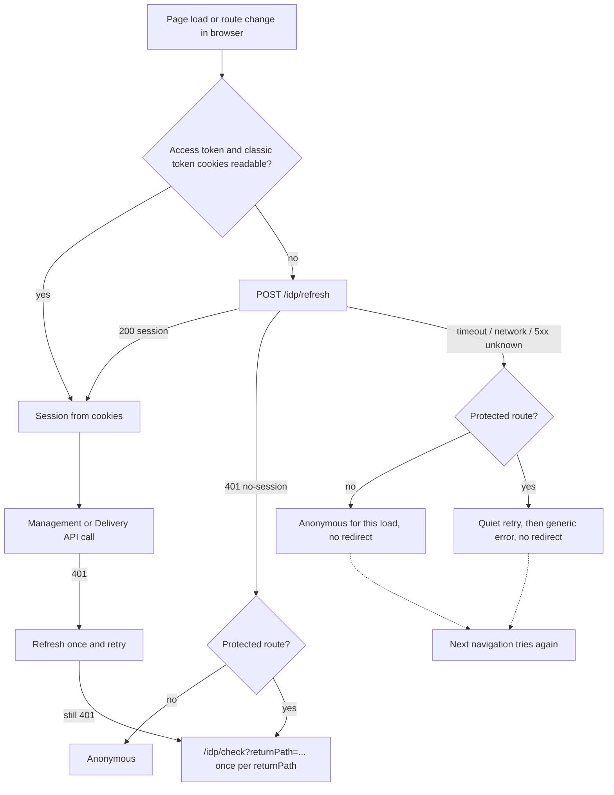
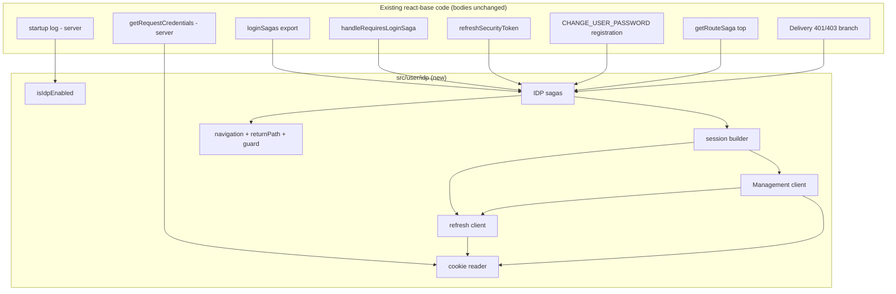
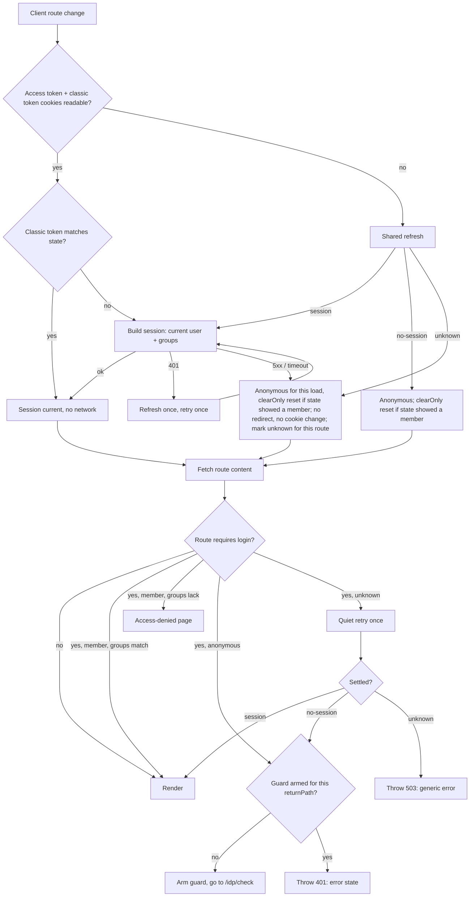
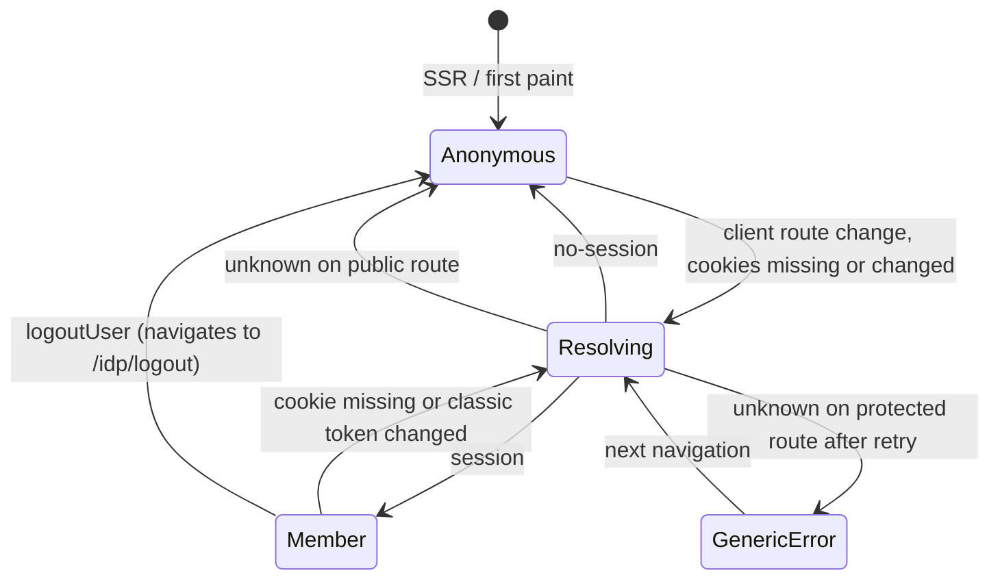

# IDP Session Auth - Plan

## Goal Capsule

- **Objective:** Members of a Keycloak tenant with MFA can log in once through the Contensis IDP and stay logged in on a react-base site that has opted in, and an IDP outage never logs them out. Sites that have not opted in behave exactly as they do today.
- **Means:** A self-contained, opt-in IDP module in react-base, reached through one-line switches on the `USE_IDP` setting (KTD1). It uses only `POST /idp/refresh` (fetch), `GET /idp/check` and `GET /idp/logout` (navigations), and identity-client's cookies.
- **Product authority:** `CONCRETE_DECISIONS.md` (crb-workspace root) is the decision of record, followed by this Product Contract. PR #29 docs and the 12 Oct export are reference only. Two recorded exceptions to the decisions file: R2 replaces the §3 fail-loudly rule, and R25 brings access-token release into scope against §10 Q2. Both were directed by the user.
- **Supersedes:** `docs/plans/2026-10-12-1512-feat-idp-session-auth-plan.md`, a second agent's view of the same feature. Its unique content is merged here (R21, R22, AE12, the react-starter Key Decision).
- **Stop conditions:** Stop and ask if implementation needs any of these. Editing a classic or WSFED function body beyond the switches in KTD1. Writing or deleting any identity-client cookie. Reading the session during SSR. Growing the `/idp/*` contract.
- **Execution profile:** TypeScript library change in `packages/contensis-react-base`, plus an example in the sibling `packages/react-starter`. No test runner exists in either package. Proof is type-check, lint, build, and the manual checklist in the Verification Contract (KTD11).
- **Who finishes:** `ce-work` implements U1–U9 and runs the build and lint gates. The live checklist needs a deployed host and a VPN seat (see Dependencies / Assumptions), so a person runs it.

---

## Product Contract

### Summary

react-base gains an IDP auth module, switched on by one site setting. It gives sites the auth surface they already use (`useLogin`, the user selectors, `requireLogin`, `refreshSecurityToken`, change password) on top of the `/idp/*` routes alone.

All IDP logic sits in one folder, reached through about nine one-line switches, so classic and WSFED login stay untouched and can be deleted cleanly at v5. The session check runs in the browser on every route change, before content is fetched. The access-token release reads the member from the access token only. react-starter ships a working example, and a one-page, framework-neutral write-up describes the flow.

### Problem Frame

Clients have been promised MFA login. On a Keycloak tenant with MFA on, a member completes the password and one-time code, comes back to the site, and is still logged out, with no error (KEYC-199). Every way react-base gets a token uses a classic grant, either directly or through the CMS `IsAuthenticated` endpoint, and Keycloak refuses classic grants for MFA users. The only credential that has passed MFA is the access and refresh token pair identity-client writes as cookies on the site's host. react-base never reads it.

The fix also has to fit a migration. Estates move to Keycloak one tenant at a time (v4 minor, opt-in). Classic login and WSFED/OIDC are removed later (v5 major). Until then the two coexist, and old react-base cookies outlive a cutover by days. Two of those legacy cookies share their names with identity-client's (`ContensisSecurityBearerToken`, `ContensisCMSUserName`), so any classic code path that still runs can overwrite or delete the member's real session. The team also wants the solution to show that the `/idp/*` contract ("fetch to refresh, redirect to check") is simple enough for any app to adopt. A tangled or heavyweight implementation would undermine that.

### Key Decisions

- **The IDP module runs alongside the existing auth code and does not modify it,** so the old auth functions can be deprecated and removed cleanly when the time comes. (session-settled: user-directed — chosen over building the IDP branches inside the existing functions (PR #29 Q3): keeps the v5 rip-out a deletion, not an edit.) Governs R4, R5.
- **One folder holds all IDP logic, reached through one-line switches on the setting.** (session-settled: user-approved — chosen over swapping the whole saga set at app assembly, which still needed per-function switches for directly imported entry points, and over scattered per-function gates: cleanest minimal shape.) Governs R4.
- **Sites keep the same public auth surface,** and migrate by turning the setting on. (session-settled: user-approved — chosen over a separate IDP hook and selectors, or new IDP-only login and logout actions: no site code change, and the surface survives v5 unchanged.) Governs R13, R14, R17, R18.
- **Browser only: server rendering stays session-blind.** Logged-out members on protected pages are redirected after hydration. (session-settled: user-directed — chosen over the server reading request cookies to redirect before rendering: Varnish does not support personalised content, which is why `enableSsrCookies` defaults to false.) Governs R19.
- **The portability proof is a small module plus a one-page recipe.** (session-settled: user-approved — chosen over also building a second non-react-base client, or shipping code only.) Governs R20.
- **Refresh outcomes, session sourcing and cookie ownership follow `CONCRETE_DECISIONS.md` §5.** (session-settled: user-directed — chosen over the admin UI's and the withdrawn plan's single "failed" result: when we don't know, we must not log the member out.) Governs R6, R7, R8, R9, R23.
- **`USE_IDP` takes precedence over every other login method, and server startup logs the active one.** (session-settled: user-directed — chosen over refusing to start when `USE_IDP` and `WSFED_LOGIN` are both on, as `CONCRETE_DECISIONS.md` §3 had it: one login process per site without a hard failure.) Governs R2.
- **Access-token release is fixed unconditionally under the setting.** (session-settled: user-directed — chosen over "verify first, fix only if svc-security rejects the classic token" and over leaving release to its own ticket: the legacy `RefreshToken` fallback is reachable whenever the chosen bearer fails, whatever the verification shows.) Governs R25.
- **react-starter is the first proof, then a client website as a separate exercise.** (session-settled: user-directed — chosen over going straight to a client website or a library-only scope: the starter has no auth wiring today, so its example doubles as the plain-app adoption guide.) Governs R21.
- **CRB has no MFA awareness.** MFA happens entirely behind `/idp/check`. (session-settled: user-approved.) Governs R22.
- **The `/account/login` route is not this work's concern.** A broader plan makes it an alias or redirect to `/idp/check` for all legacy apps. react-base under `USE_IDP` goes to `/idp/check` directly. (session-settled: user-directed — chosen over react-base intercepting the site's login route.) Governs R13.

### Requirements

**Activation and separation**

- R1. A single site setting, `USE_IDP`, turns the IDP mechanism on. It defaults to off, and with it off, classic and WSFED login behave exactly as today.
- R2. With the setting on, IDP login takes precedence over classic and WSFED login, including when `WSFED_LOGIN` is also on, and server startup logs that the app uses IDP auth.
- R3. The setting reaches every response that runs browser code, including sites using `disableSsrRedux`, and is identical for every visitor. (Responses with status 404 or above render with no scripts, so no browser code runs there.)
- R4. All IDP logic lives in one self-contained module. Existing classic and WSFED function bodies are not edited, and each hand-over into the module is a one-line switch on the setting.
- R5. At v5, removing classic and WSFED login means deleting their code and collapsing the switches into direct calls. The IDP module does not change.

**Session**

- R6. With the setting on, the member's session comes only from identity-client's cookies. react-base's legacy `RefreshToken` cookie and the `securityToken` query-string hand-off are ignored, not cleared.
- R7. react-base never writes or deletes identity-client's cookies, on any path.
- R8. When the access token or classic token cookie is missing, the browser calls `POST /idp/refresh` with the `X-Contensis-Refresh` header. One call is shared by everything waiting at that moment. The result is classified as `session` (200), `no-session` (401) or `unknown` (timeout, network error or 5xx). A 403 is a code defect.
- R9. Only `no-session` ends a session. On `unknown`, react-base never redirects or deletes anything: a public page renders anonymous for that load, a protected page retries quietly and then shows a generic error, and the next navigation tries again.
- R10. A 401 from the Management API triggers one refresh and one retry before it is treated as `no-session`.
- R11. Every authenticated Management API request (current user, user groups, change password) sends the access token in the `Authorization` header, read from the cookie when the request is made. No classic grant is ever requested.
- R12. `selectUserSecurityToken` keeps returning the classic security token, taken from identity-client's `ContensisClassicToken` cookie.
- R23. A Management API failure other than 401 (5xx, timeout, network error), and a refresh 200 that leaves the access token cookie unreadable, are `unknown` under R9. A failed groups call never sends a member to access-denied.
- R24. A 401 from the Delivery API for route content triggers one refresh and one reload of the route before it is treated as `no-session`. Every client-side route change checks the session before content is requested.
- R26. While the session is being resolved, the user state reports loading, and a protected route shows the site's loading component, not the anonymous view.
- R27. When another tab changes the session (logs out, or logs in as someone else), this tab picks up the change on its next navigation.

**Login and logout journeys**

- R13. A member who needs to log in is navigated to `/idp/check?returnPath=<current path>`. That covers a protected route with no session, a `no-session` result on a protected route, and a `loginUser()` call. `loginUser()` ignores any credentials passed. When the current path is the site's login route, `returnPath` is that page's `redirect_uri` or `ReturnURL` target, or `/`.
- R14. `logoutUser(redirectPath)` navigates to `/idp/logout?returnPath=…`, using `redirectPath` when given. Otherwise it uses the current path, or `/` when the current route requires login.
- R15. A `returnPath` sent to `/idp/*` is a local path and never carries `securityToken`, `credentials` or `password` query parameters, matched case-insensitively. Other query parameters are kept.
- R16. A member is sent to `/idp/check` automatically at most once per `returnPath`. If they come back and the session still fails, they see an error state instead of another redirect, and protected-content 401s never cause an unbounded route reload. A `loginUser()` call is never blocked by this limit.

**Public surface**

- R17. Sites keep using `useLogin`, the user selectors, `requireLogin` (boolean and group arrays), `refreshSecurityToken` and `useChangePassword` without code changes. `refreshSecurityToken` keeps its no-argument signature and refreshes through `/idp/refresh`.
- R18. Group-restricted routes and the access-denied behaviour work as today, using the member's groups.
- R22. CRB has no MFA-specific behaviour, states or screens.

**Server rendering**

- R19. Server rendering never reads the session or varies by visitor. All IDP session work happens in the browser.

**Access-token release**

- R25. With the setting on, the access-token release endpoint resolves the member only from the access token (the `Authorization` header, then the access token cookie). It never falls back to the legacy `RefreshToken` cookie.

**Portability and proof**

- R20. A one-page, framework-neutral write-up in react-base `docs/` describes the flow. It covers the refresh call and its three outcomes, the check and logout navigations, the `returnPath` rules and the cookies read, with enough detail for another app's developer to implement it from that page alone.
- R21. react-starter ships a working `USE_IDP` example: a login and logout control, at least one protected route, and an access-denied page. The setting is off by default.

Product Contract preservation: changed — R3 (404 responses carry no scripts, so the requirement now covers responses that run browser code), R13 (login-route `returnPath`), R14 (protected-route logout target), R16 (`loginUser()` exempt from the redirect limit). Added R21–R27: R21 and R22 merged from the superseded 15:12 plan, R25 from the access-token release decision, and R23, R24, R26, R27 from flow analysis. All were confirmed by the user before writing.

### Key Flows

- F1. Page load or route change, with the setting on
  - **Trigger:** A page loads or the route changes in the browser.
  - **Steps:** If the access token and classic token cookies are readable, build the session from them. Otherwise refresh: `session` builds the session, `no-session` goes to `/idp/check` on a protected route and stays anonymous on a public one, and `unknown` never redirects: a public route renders anonymous for that load, and a protected route retries quietly and then shows a generic error. A later Management or Delivery API 401 refreshes and retries once.
  - **Covers:** R8, R9, R10, R13, R16, R24, R26



- F2. Logout
  - **Trigger:** The site calls `logoutUser()`.
  - **Steps:** Clear react-base's in-memory user state, then navigate to `/idp/logout?returnPath=…`. identity-client clears its cookies and ends the Keycloak session.
  - **Covers:** R7, R14, R15

### Acceptance Examples

- AE1. **Covers R6, R11, R13, R17.** Given a Keycloak tenant with MFA and the setting on, when a logged-out member opens a protected page, the browser goes to `/idp/check`. After the password and one-time code the member returns to that page, `useLogin().isAuthenticated` is true, and `user` includes their groups.
- AE2. **Covers R8.** Given a browser restart that leaves only identity-client's refresh cookie, when the member opens any page, a refresh returns 200 and they are logged in without seeing a login form.
- AE3. **Covers R9.** Given a protected page, when `/idp/refresh` returns 503 or times out, the member is not redirected and no cookie is deleted. They see a quiet retry and then a generic error, and the next navigation tries again.
- AE4. **Covers R9, R13.** Given `/idp/refresh` returns 401, a public page renders anonymous with no redirect, and a protected page navigates to `/idp/check`.
- AE5. **Covers R6.** Given a leftover react-base `RefreshToken` cookie for user A and an identity-client session for user B, the site shows user B.
- AE6. **Covers R16.** Given `/idp/check` returns the member straight to the page and the Management API still answers 401, the member sees an error state and is not redirected a second time.
- AE7. **Covers R15.** Given the current path `/documents?SecurityToken=x&page=2`, the navigation is to `/idp/check?returnPath=/documents?page=2` (URL-encoded).
- AE8. **Covers R1, R2.** With the setting off, a classic site's login, refresh and logout behave as before. With both `USE_IDP` and `WSFED_LOGIN` on, the app starts, logs that it uses IDP auth, and members log in only through `/idp/check`.
- AE9. **Covers R11, R17.** Given a logged-in IDP member, when they change their password through `useChangePassword`, the request succeeds without any classic grant.
- AE10. **Covers R24, R16.** Given a member idle for more than 30 minutes (the access token cookie has expired), when they click a protected link, one refresh runs, the page loads, and the route reloads at most once.
- AE11. **Covers R14, R16.** Given a member on a protected page, when they log out and then click "Log in", logout lands on `/`, and login goes to `/idp/check` with no error state.
- AE12. **Covers R19.** Given a protected page served by SSR with identity-client cookies on the request, the HTML is the anonymous view. The refresh and member UI appear only client-side.
- AE13. **Covers R23, R18.** Given a logged-in member on a group-restricted route, when the groups call returns 503, they see the generic error, not access-denied.
- AE14. **Covers R25.** Given a release-gated site, a leftover `RefreshToken` for user A, and an identity-client session for user B whose access token is rejected, the release returns 401 and never resolves user A.
- AE15. **Covers R27.** Given two tabs signed in as B, when tab A logs out and signs in as C, tab B's next navigation shows C.
- AE16. **Covers R21.** Given react-starter built with `USE_IDP` on and deployed to the `idp` tenant, a member can log in, open the protected route, log out, and see access-denied on a group route they lack.

---

<!-- ce-section: work-relationships -->
### How This Work Fits Together

This plan covers Phase 1 of `CONCRETE_DECISIONS.md` §3: the opt-in react-base mechanism, proven in react-starter. The surrounding breakdown is the current understanding, not a committed roadmap.

- Tenant migration (Phase 2): depends on this work. Estates move per tenant by turning on Keycloak and `USE_IDP` together.
- Client website adoption: depends on this work, the client website's v4 branch, and the environment items below. It adds the two site changes listed under Deferred to Follow-Up Work.
- Removing classic and WSFED login (Phase 3, v5 major): enabled by R4 and R5. It also covers the `mapClientCredentials` string-expiry defect, the `IsAuthenticated` path and `OidcUserManager`.
- Aliasing `/account/login` to `/idp/check`: can proceed independently of this work, outside react-base. R13 keeps react-base from sending the login route as a `returnPath`.

### Scope Boundaries

**Outside this work's identity**

- Securing the Delivery API, which stays out of scope per `CONCRETE_DECISIONS.md` §4.
- Changes to identity-client, Keycloak, the CMS, the Management API SDK, or the `/idp/*` contract.
- MFA mechanics, tenant and realm configuration, and platform-side Keycloak work.

**Not in this plan**

- Server-side session awareness, including any server redirect to `/idp/check`.
- Removing classic or WSFED login, and the v5 cleanup items.
- Registration and forgot-password flows, which are anonymous posts to `/account/*` and unchanged.
- Clearing react-base's legacy cookies, which expire on their own within a day.
- Local development against `/idp/*`, and environment work on a client's test environment.
- A test framework for react-base or react-starter (KTD11).

**Considered and not built**

- A cross-tab lock around refresh (Web Locks). Per-tab single flight is enough while refresh tokens stay reusable. Build it if KEYC-180 (refresh-token rotation) is scheduled before tenants migrate.
- Remembering `no-session` for the rest of the page so anonymous visitors skip the refresh on later route changes. The cost is one small 401 per client navigation. Revisit if `/idp/refresh` load becomes a concern.
- Decoding the access token's `exp` to refresh before it expires. Cookie lifetime matches the token's, and 401 recovery (R10, R24) covers the gap. Revisit if clock skew causes visible 401 round trips.
- Removing `securityToken` from the address bar. R6 ignores it, and it leaks no further than it does today.
- Making the client treat a release-endpoint 5xx as `unknown` or retry a release 401. KTD3 refreshes the session before the release call, so a 401 there is rare. A refused release keeps today's access-denied behaviour. Revisit if release 5xx rates are material.
- Guarding `LoginHelper`'s public classic methods (`LogoutUser`, `ClearCachedCredentials`, `SetLoginCookies`) against direct site calls. No react-base path reaches them under the setting, and clients do not call them. The R20 write-up warns sites not to.
- Changing `RouteLoader`. While the session resolves, the route's loading state renders the loading component (KTD3).
- A redirect guard for browsers where `sessionStorage` is blocked. A guard kept anywhere else is lost on the navigation to `/idp/check`. In those browsers, a `/idp/check` round trip that keeps failing can repeat. Revisit if blocked storage shows up among members.

#### Deferred to Follow-Up Work

- Client website adoption needs three site changes, all listed in the R20 write-up:
  - Replace the username/password form with a "Sign in" button.
  - Make the `PrivateAccount` guard render nothing while `useLogin().isLoading` is true.
  - Make its not-found page branch on `statusCode`.
- Coordinating the `/account/login` → `/idp/check` alias so it always carries a `returnPath`.

### Dependencies / Assumptions

- The tenant has `Identity_UseKeycloak` on and `/idp/*` routed to identity-client, and its realm carries the KEYC-308 scopes.
- `CONTENSIS_ALLOW_MFA_CLASSIC_GRANTS` is off on any test tenant, since it would mask the bug.
- Real testing needs a deployed host: localhost cannot reach `/idp/*` until Alex's fix lands. Completing a Keycloak login needs a VPN seat, because `idp-dev.zengenti.com` is private. The react-starter example needs a deployed preview on the `idp` tenant (`cms-idp`); how it gets deployed there is unconfirmed.
- A client's end-to-end validation also needs the Varnish delivery re-route restored, the client's blocks and IDP service deployed to the client's test environment, and the client website on its v4 upgrade branch.
- Release dependency: refresh tokens stay reusable across tabs (KEYC-180 not yet shipped). If rotation ships first, concurrent tab refreshes would log members out, and the cross-tab lock under Considered and not built becomes required.
- Assumption: a client's `/secure-documents` accepts the Keycloak-issued classic token. Source research says yes, and one live request confirms it.
- Assumption: `@contensis/forms` needs nothing beyond the readable `ContensisSecurityBearerToken` access token cookie, which KTD3 keeps fresh. The manual checklist confirms a form post as a member.

### Sources / Research

- `CONCRETE_DECISIONS.md` and `SOURCES.md` (crb-workspace root): the decisions of record and the source index.
- PR #29 overview and details (`sources/pr29-2026-10-12-overview.md`, `sources/pr29-2026-10-12-keycloak-details.md` in crb-workspace) are reference only. They cover the `/idp/*` endpoints, cookie names and readability, cookie lifetimes and refresh failure behaviour.
- Grounding dossier: `.compound/ce-brainstorm/idp-auth-2026-10-13/grounding.md` (crb-workspace).
- Classic login paths to leave untouched: `src/user/redux/sagas/login.ts`, `src/user/util/LoginHelper.class.ts`, `src/user/util/ContensisManagementApi.ts`.
- Cookie names shared with identity-client: `src/user/util/CookieConstants.ts`. `SetLoginCookies` and `ClearCachedCredentials` write and delete them (`src/user/util/LoginHelper.class.ts`).
- User reducer quirks the IDP module works around (KTD7): `isAuthenticated` cannot be reset by `SET_AUTHENTICATION_STATE`, a put without `clientCredentials` nulls them, and a user without `email` throws (`src/user/redux/reducers.ts`).
- Management SDK: `contensis-management-api` 2.4.1 grants a token only when `isBearerTokenExpired()` is true, which it is when the expiry is missing, near or not a `Date`. `clientType: 'none'` throws without a Delivery access token (`contensis-core-api` 1.2.5 `http-client`).
- Routing: the access-token gate (`ensureAccessTokenSaga`) and the Delivery 401/403 branch in `src/routing/redux/sagas.js`. Errors thrown inside `getRouteSaga` reach `do500` and render the site's `notFoundComponent` with the status code (`src/routing/components/RouteLoader.tsx`).
- Config injection: `USE_IDP` follows `WSFED_LOGIN`. In development it is a webpack define and a dev-server global. In production it comes from `.env` through `zengenti-buildstartup-package` into `startup.js` and `start.js` as the string `"true"`. Responses with status 404 or above are rendered STATIC with no scripts (`src/server/webApp.tsx`, `src/server/util/html.ts`).
- Release credential order: `src/server/features/access-token-api/authenticateRequest.ts` (`getRequestCredentials`).
- Consumer usage in a client website: `useLogin` on its login and account pages, a component-level `PrivateAccount` guard, and `selectUserSecurityToken` in `src/app/redux/documents/sagas.ts`.

---

## Planning Contract

### Key Technical Decisions

- KTD1. **Nine switch points, each a one-line `if (isIdpEnabled())` hand-over.** Swapping the user saga array alone cannot cover entry points that are imported directly (routing imports `handleRequiresLoginSaga`, and `refreshSecurityToken` is public API). Every switch sits at a function boundary or a registration line, never mid-body. Governs R4, R5.

  | # | Location | Switch |
  |---|---|---|
  | 1 | `src/user/redux/sagas/login.ts` `loginSagas` export | IDP saga set for `LOGIN_USER`, `LOGOUT_USER`, `VALIDATE_USER`. The classic `redirectAfterSuccessfulLoginSaga` is not registered. |
  | 2 | `login.ts` `handleRequiresLoginSaga`, first line | Delegate to the IDP require-login saga |
  | 3 | `login.ts` `refreshSecurityToken`, first line | Delegate to the IDP refresh saga |
  | 4 | `src/user/redux/sagas/resetPassword.js` `CHANGE_USER_PASSWORD` registration | IDP change-password saga |
  | 5 | `src/routing/redux/sagas.js` `getRouteSaga`, before `ensureAccessTokenSaga` | Run the IDP session check (KTD3) |
  | 6 | `sagas.js` Delivery `[401, 403]` branch, first line | Delegate to the IDP Delivery auth-error saga (R24) |
  | 7 | `src/server/features/access-token-api/authenticateRequest.ts` `getRequestCredentials`, first line | IDP credential read (KTD10) |
  | 8 | `src/server/util/displayStartupConfiguration.ts` | Log the active login method (R2) |
  | 9 | `src/globals.d.ts` | Declare the `USE_IDP` global (type only) |

- KTD2. **`USE_IDP` follows the `WSFED_LOGIN` pattern, read through one function.** `isIdpEnabled()` in the IDP module reads the bare build-time global in development, guarded with `typeof` so consumers that never define it don't throw a ReferenceError, and `window`/`global.USE_IDP` in production. It accepts `true` and `'true'`. Precedence (R2) needs no WSFED edit: no switched path reaches WSFED code. The function is evaluated when it's called, not cached at module load, so server and client agree. Governs R1, R2, R3.

- KTD3. **The session check runs at the top of every client-side `getRouteSaga`, before any content request.** It is free when the cookies are readable and calls the shared refresh when they are not. Client navigations already run inside the route's loading state. A first page load does not, because the hydrated entry matches the path and the routing reducer leaves `isLoading` false. So when the check must go to the network on a route that requires login, it puts `UPDATE_LOADING_STATE` true first. A protected route then shows the site's loading component until the check settles (R26). The user `isLoading` flag for component-level guards starts true under the setting (KTD7), and the check clears it. Placing it before the Delivery fetch is what keeps the access token fresh after idle periods (AE10), and before the release call (`ensureAccessTokenSaga`). It does nothing on SSR (R19). The protected-route decision (redirect, anonymous, or error) stays in the IDP require-login saga at switch 2, which routing already calls after `onRouteLoaded`. Governs R8, R9, R19, R24, R26, R27.

- KTD4. **One refresh client, single-flight per tab.** It sends `POST /idp/refresh` same-origin with `X-Contensis-Refresh: 1` and a 5-second timeout (`AbortController`, matching the admin UI). Concurrent callers share one in-flight promise. It classifies 200, 401, and everything else as `unknown` (R8). It also classifies as `unknown` a 200 after which the access token cookie is still unreadable, logs one console error naming the missing cookie, and doesn't refresh again on that page load (R23). On `unknown` for a protected route, one quiet retry after 1 second runs before the generic error, so the worst case is about 11 seconds. A 403 is logged as a code defect and treated as `unknown`, so it never logs anyone out. Governs R8, R9, R23.

- KTD5. **The IDP module builds its own Management API client from the cookie at call time.** It uses the SDK's `Client` (dynamic import, as `ContensisManagementApi.ts` does). It sets the bearer token to the access token cookie and `bearerTokenExpiryDate` to a far-future `Date`, so the SDK never asks for a grant. It sets no credentials, so any slip fails instead of firing a classic grant. It passes a `fetchFn` (supported by the SDK's client config) that aborts after 5 seconds, matching KTD4, so a hung Management API produces the `unknown` that R23 names instead of stalling the route. It never uses `clientType: 'none'` (throws), never uses redux `clientCredentials` (ISO-string expiries count as expired and trigger a grant), and never uses `getManagementApiClient` (classic-shaped, and deleted at v5). A wrapper retries once after a shared refresh on 401 (R10) and classifies other failures as `unknown` (R23). Governs R5, R10, R11, R23.

- KTD6. **The generic error and the loop-guard error are thrown, not put.** The IDP sagas run inside `getRouteSaga`'s `try`. Throwing `{ status, statusText, data: { message } }` reaches the existing `do500`, and `RouteLoader` renders the site's `notFoundComponent` with that status. A put would be overwritten by the later `SET_ENTRY`. The generic error is 503. The loop-guard error (R16) is 401. Both are thrown only on protected routes. On public routes the sagas return quietly. `useLogin().isError` is also set so component guards can tell. Governs R9, R16.

- KTD7. **Redux state is mapped onto the existing reducer, which is not edited.**
  - A session puts `SET_AUTHENTICATION_STATE` with `isAuthenticated: true`, `clientCredentials: { contensisClassicToken }` (no access token, refresh token or expiry), and the current user plus `groups`.
  - Resolving puts `isLoading: true` and carries the existing `clientCredentials` forward, because the reducer nulls them otherwise. Under the setting, the IDP saga set puts `isLoading: true` as soon as the store starts, on server and client alike. Every visitor gets the same value, so R19 holds, and component guards never see "not loading, not authenticated" before the first check settles.
  - Ending a previously shown session (another tab logged out, R27) dispatches `LOGOUT_USER` with an IDP-only `clearOnly` flag. The reducer resets on it, and the IDP logout saga skips navigation when the flag is set.
  - A current user without `email` is given an empty one, because the reducer throws otherwise.

  Governs R12, R17, R26, R27.

- KTD8. **The automatic-redirect guard lives in `sessionStorage`, per normalised `returnPath`, with a 5-minute TTL.** It is set only by automatic redirects (protected route, `no-session`, API 401). It is cleared when the member is actually shown on that path — after the route content has loaded, not merely when a session resolves — and on `logoutUser()`. A Delivery auth error escalates under its own key, which that clear leaves alone. `loginUser()` neither checks nor sets it. Storage is per tab and survives the cross-origin round trip to Keycloak. A query-string marker was rejected: it shows in bookmarks and analytics, and a bookmarked marker would strand a logged-out member on the error page. Storage access is wrapped in try/catch, and unreadable or unwritable `sessionStorage` counts as "guard not armed". An in-memory fallback would be lost on the full navigation to `/idp/check`, so it would guard nothing. Governs R16.

- KTD9. **The IDP module imports only code that survives v5.** It may use user action types and creators, selectors, `matchUserGroup`, `isSSR`, `logError` and the SDK. It does not import `LoginHelper`, `CookieHelper`, `ContensisManagementApi`, `mapClientCredentials` or `CookieConstants`. It reads cookies with a fresh `document.cookie` read at call time and declares identity-client's cookie names itself. It builds the access-denied URL itself (`/account/access-denied?original_uri=…`, the same format as `LoginHelper.GetAccessDeniedRoute`). The cost is one duplicated route string, and it lets R5 hold literally. Governs R5, R7.

- KTD10. **Release reads the access token only.** Under the setting, `getRequestCredentials` returns the `Authorization` header or else the `ContensisSecurityBearerToken` cookie as the bearer, and no `refreshToken`. `authenticateRequest` is untouched: with no refresh token its legacy fallback can't run, and with no `ContensisCMSUserName` the classic token no longer shadows the access token. The server reads the setting from `global.USE_IDP`. The live "classic token as Bearer" request still runs once, and its result goes in the R20 write-up. (session-settled: user-directed — chosen over verify-first-then-fix and over a separate ticket: the fallback is reachable whatever the verification shows.) Governs R25.

- KTD11. **Verification is build, type-check and lint plus a manual checklist on a deployed tenant, run through react-starter.** No test runner is added to either package. (session-settled: user-directed — chosen over adding Vitest with mocked `/idp/*` outcomes: keeps this work to the auth change, with live behaviour proven on the real tenant.) Governs R21.

- KTD12. **Identity changes from other tabs are detected on the route-change check.** It compares the `ContensisClassicToken` cookie with the token in state. If they differ, it rebuilds the user. If the cookie is gone and refresh says `no-session`, it resets to anonymous (KTD7). Without this check, tab B would show user B while its API calls act as user C. Governs R27.

### High-Level Technical Design

Switch topology: each existing entry point hands over to the IDP module through one line. The IDP module depends on nothing that v5 deletes.



Per-route-change decision (client only). The cookie check runs before content (KTD3), and the protected-route decision runs after `onRouteLoaded` (switch 2).



Session states held in redux per tab.



### Output Structure

```text
src/user/idp/
  index.ts                 barrel: isIdpEnabled + the sagas the switches call
  setting.ts               isIdpEnabled, activeLoginMethod (KTD2)
  cookies.ts               identity-client cookie names + call-time reads (KTD9)
  refresh.ts               single-flight /idp/refresh + classification (KTD4)
  managementClient.ts      bearer-from-cookie client + 401 retry wrapper (KTD5)
  returnPath.ts            sanitise + login-route substitution (R13, R15)
  navigation.ts            /idp/check, /idp/logout, access-denied URLs
  loginGuard.ts            sessionStorage redirect guard (KTD8)
  session.ts               build/resolve session, identity-change check (KTD7, KTD12)
  sagas/
    routeSession.ts        route-change session check (KTD3)
    requireLogin.ts        protected-route decision (KTD6)
    deliveryAuthError.ts   Delivery 401/403 handling (R24)
    userActions.ts         login, logout, validate, refreshSecurityToken, change password
docs/IDP_LOGIN.md          R20 write-up
```

### Sequencing

U1 → U2 → U3 → U4 and U5 (parallel) → U6 → U8 → U9. U7 needs U1 and U2 (for the cookie names) and can land in parallel with U3–U6. Switches 1–6 land last, in U6, so the flag stays inert until the whole module exists. Switches 8 and 9 land in U1 and switch 7 in U7. Each of those does nothing until the flag is read.

---

## Implementation Units

### U1. Setting, global declaration and startup log

**Goal:** `USE_IDP` can be read on server and client, and server startup names the active login method.

**Requirements:** R1, R2, R3; KTD1 switches 8 and 9, KTD2.

**Dependencies:** none.

**Files:**
- Create `src/user/idp/setting.ts`, `src/user/idp/index.ts`
- Modify `src/globals.d.ts`, `src/server/util/displayStartupConfiguration.ts`
- Test file: none (KTD11). Scenarios run through the manual checklist (Verification Contract).

**Approach:**
1. Declare the `USE_IDP` global beside `WSFED_LOGIN` with the same type.
2. `isIdpEnabled()` reads the dev global through a `typeof` guard, otherwise `window`/`global`, and accepts `true` or `'true'`.
3. `activeLoginMethod()` returns IDP, WSFED or classic, with IDP first.
4. Add one log line to `DisplayStartupConfiguration`, in its existing style.

**Patterns to follow:** `LoginHelper.WSFED_LOGIN` dev/prod read in `src/user/util/LoginHelper.class.ts`. `OidcUserManager.ts` uses the same pattern.

**Test scenarios:**
- Server started with `USE_IDP=true` in `.env` logs the IDP login method.
- Server started with `USE_IDP` and `WSFED_LOGIN` both true starts and logs IDP. Covers AE8.
- Server started with neither logs classic.
- A dev build whose define-config lacks `USE_IDP` renders without a ReferenceError and reports classic.
- A production page with `disableSsrRedux` on has `window.USE_IDP === 'true'` from `startup.js`.

**Verification:** react-base `npm run build` and `npm run lint` pass, and the startup log shows the method in each configuration above.

### U2. Identity-client primitives: cookies, refresh, returnPath, navigation, guard

**Goal:** The small, framework-free pieces the R20 recipe describes exist and match the contract.

**Requirements:** R6, R7, R8, R9, R13, R14, R15, R16, R23; KTD4, KTD8, KTD9.

**Dependencies:** U1.

**Files:**
- Create `src/user/idp/cookies.ts`, `refresh.ts`, `returnPath.ts`, `navigation.ts`, `loginGuard.ts`
- Test file: none (KTD11).

**Approach:**
1. `cookies.ts` names `ContensisSecurityBearerToken` (access token) and `ContensisClassicToken`, and reads them from `document.cookie` at call time. It exposes no write or delete.
2. `refresh.ts` implements KTD4: shared in-flight promise, timeout, classification, the 200-without-cookie rule, and the one-time console error.
3. `returnPath.ts` picks the candidate path. That is the current location, or on the login route that page's `redirect_uri` or `ReturnURL` target (R13). It also produces the logout target (R14).
   - The candidate is resolved against the site's origin and accepted only when the origin matches. The result keeps the path, query and hash. Anything else becomes `/`, including `//host`, `/\host` and absolute cross-origin URLs.
   - The three R15 parameters are removed (case-insensitively) last, after any substitution.
   - Without this check, the login route would hand an attacker-chosen `redirect_uri` to identity-client, whose documented check is only "starts with `/`".
4. `navigation.ts` performs full navigations to `/idp/check`, `/idp/logout` and access-denied, URL-encoding `returnPath`.
5. `loginGuard.ts` implements KTD8. If `sessionStorage` throws, the guard counts as not armed.

**Patterns to follow:** `to` from `await-to-js`, and `logError` with an `[idp]` prefix (`src/util/errors.ts`).

**Test scenarios:**
- Covers AE7. Current path `/documents?SecurityToken=x&page=2` produces `returnPath=%2Fdocuments%3Fpage%3D2`.
- Current path `/account/login?redirect_uri=/members` produces `returnPath=/members`. With no target, it produces `/`.
- `/account/login?redirect_uri=//evil.example` and `/account/login?redirect_uri=/%5Cevil.example` both produce `returnPath=/`.
- `/account/login?ReturnURL=https://<site host>/asset.pdf?securityToken=x` produces `returnPath=/asset.pdf`.
- Two components need a session at once with no cookies: the network panel shows one `POST /idp/refresh`.
- The refresh request carries `X-Contensis-Refresh: 1` and same-origin credentials.
- A 6-second stall classifies as `unknown`. A 503 classifies as `unknown`. A 401 classifies as `no-session`.
- A 200 where `ContensisSecurityBearerToken` stays unreadable classifies as `unknown`, logs one console error, and causes no second refresh on that page load.
- Covers AE3. No IDP code path changes `document.cookie`: search the module for cookie writes, and watch the Application panel through every checklist run.

**Verification:** The module builds and lints. A review confirms there are no imports from the KTD9 exclusion list and no cookie writes.

### U3. Management client and session builder

**Goal:** A session can be built from cookies alone: current user and groups, without any classic grant, with R10/R23 classification.

**Requirements:** R10, R11, R12, R17, R18, R23, R27; KTD5, KTD7, KTD12.

**Dependencies:** U2.

**Files:**
- Create `src/user/idp/managementClient.ts`, `src/user/idp/session.ts`
- Test file: none (KTD11).

**Approach:**
1. `managementClient.ts` follows KTD5. A `withManagementClient(fn)` helper builds the client fresh for each attempt and retries once after a shared refresh on 401.
2. `session.ts` resolves the session.
   - Read the cookies, refreshing if needed.
   - Fetch `getCurrent` and then the groups, with the same paging and inherited flag as `LoginHelper.GetUserDetails`.
   - Return `session` (user, groups, classic token), `no-session` or `unknown`.
   - A groups failure other than 401 returns `unknown`, not a user with no groups (R23).
3. Provide the KTD12 identity check: compare the classic token cookie with the token in state.

**Patterns to follow:** `LoginHelper.GetUserDetails` for the call shape (read it; do not import it), and `isApiError` in `src/util/errors.ts` for status detection.

**Test scenarios:**
- Covers AE9. Network panel during a session build shows `Authorization: Bearer <access token>` on `security/users/@current` and the groups call, and no request to `/authenticate/connect/token`.
- Management API returns 401 once, then 200: one refresh, one retry, and the session is established.
- Management API returns 401 twice: the result is `no-session`.
- `getCurrent` returns 503: the result is `unknown`. A public route renders anonymous for that load (R9), with no redirect and no cookie change.
- Covers AE13. The groups call returns 503: `unknown`, never a member with empty groups.
- A stalled `security/users/@current` call resolves as `unknown` after 5 seconds, and the route continues.
- `selectUserSecurityToken` equals the `ContensisClassicToken` cookie value after a session build. Covers R12.
- Covers AE5. A leftover legacy `RefreshToken` cookie for user A plus an identity-client session for user B builds user B.

**Verification:** Builds and lints. During a live session build, the network log shows no grant request.

### U4. Route sagas: session check, require-login decision, Delivery auth errors

**Goal:** Every client route change resolves the session before content is fetched, and protected routes redirect, render, or show an error per R9/R13/R16/R18.

**Requirements:** R8, R9, R13, R16, R18, R19, R24, R26, R27; KTD3, KTD6, KTD7, KTD8, KTD12.

**Dependencies:** U3.

**Files:**
- Create `src/user/idp/sagas/routeSession.ts`, `sagas/requireLogin.ts`, `sagas/deliveryAuthError.ts`
- Test file: none (KTD11).

**Approach:**
1. `routeSession` (switch 5) returns immediately on SSR.
   - When cookies are readable and the classic token matches state, it returns without a network call.
   - Otherwise it puts the resolving state, resolves, and puts the session or the `clearOnly` reset (KTD7). When the matched static route or the hydrated entry's content-type mapping requires login, it first puts the route loading state (KTD3).
   - It records the outcome for this route change so `requireLogin` doesn't resolve again.
2. `requireLogin` (switch 2) returns `false` on SSR.
   - It merges route, content-type and `requireLogin` group requirements as the classic saga does, using `matchUserGroup`.
   - It applies the decision diagram: access-denied for a member lacking groups, guarded `/idp/check` for anonymous, one quiet retry then a thrown 503 for `unknown`, and a thrown 401 when the guard is already armed.
   - It returns the logged-in boolean that callers expect.
   - It clears the guard once a session is established for the path.
3. `deliveryAuthError` (switch 6) handles 401 and 403.
   - On 401 it forces a shared refresh and reloads the route once per path. The reload is a new route change, so the "already reloaded" marker is kept in module memory by path. It is cleared when that path loads without a Delivery 401, or when the member goes to a different path. A second 401, or `no-session`, follows the guarded `/idp/check` path. `unknown` throws 503.
   - A 403 with a session goes to access-denied, as today. A 403 without a session follows the anonymous path.
   - On SSR it rethrows the Delivery error so `do500` behaves as today.

**Execution note:** Write the per-route-change decision table (cookies present or absent × state member or anonymous × route public, protected or group × outcome) as a comment block in `requireLogin.ts` first, and check each branch against the diagram before coding.

**Patterns to follow:** The classic `handleRequiresLoginSaga` in `src/user/redux/sagas/login.ts` for merging group requirements and for its return contract. `setRouteSaga` and `do500` in `src/routing/redux/sagas.js`.

**Test scenarios:**
- Covers AE1. A logged-out member opens a protected route: navigation to `/idp/check?returnPath=…`. After Keycloak and MFA they land back on the route, logged in, with groups.
- Covers AE4. A refresh 401 on a public route renders anonymous with no redirect. On a protected route it navigates to `/idp/check`.
- Covers AE3. A refresh 503 on a protected route shows the loading component, one quiet retry, then the site's not-found component with status 503. No redirect, no cookie change, and the next navigation tries again.
- Covers AE6. `/idp/check` bounces straight back while the Management API still 401s: the error state (status 401), no second redirect.
- Covers AE10. Idle more than 30 minutes, then a protected link: one refresh before the content fetch, the page loads, and no reload loop.
- A Delivery 401 with a fresh token reloads the route once. A second 401 follows the guarded path and never reloads again.
- A first full page load of a protected route mapped by content type shows the loading component, not a blank page, until the check settles.
- A logged-in member without the route's group lands on `/account/access-denied?original_uri=…`, never `/idp/check`.
- Covers AE15. Tab A logs out and signs in as C; tab B's next navigation shows C. Tab A logs out only; tab B's next navigation shows anonymous, and a protected route there goes to `/idp/check`.
- Covers AE12. View-source of a protected route with session cookies on the request shows the anonymous view and no member data.
- A legacy `?securityToken=` link to a protected route with no session still navigates to `/idp/check`, and the parameter is absent from `returnPath`.
- A release-gated site (`releaseUri` configured) with an expired access token cookie: the session check refreshes before the release call, and release succeeds.

**Verification:** Every branch of the decision diagram has a checklist run on the deployed tenant. The flag-off regression pass (U6) shows no behaviour change.

### U5. User-action sagas: login, logout, validate, refresh, change password

**Goal:** `useLogin`, `withLogin`, `refreshSecurityToken` and `useChangePassword` work unchanged under the setting.

**Requirements:** R13, R14, R16, R17, R22, R11; KTD7, KTD8.

**Dependencies:** U3.

**Files:**
- Create `src/user/idp/sagas/userActions.ts`
- Test file: none (KTD11).

**Approach:**
1. Export the IDP saga set for switch 1.
   - On start, it puts the user `isLoading: true` (KTD7).
   - `LOGIN_USER` navigates to `/idp/check` with the R13 `returnPath`. It ignores credentials, logging one console warning when they are passed, and it bypasses the guard.
   - `LOGOUT_USER` clears the guard, then navigates to `/idp/logout` with the R14 target. With `clearOnly` set it does nothing.
   - `VALIDATE_USER` runs the session resolve.
2. `refreshSecurityToken` (switch 3) forces the shared refresh and updates the classic token in state. It never navigates.
3. The change-password saga (switch 4) calls `updatePassword` through `withManagementClient`. It puts the same success and error actions as the classic `changePasswordSaga`, so `useChangePassword` is unchanged.

**Patterns to follow:** `changePasswordSaga` in `src/user/redux/sagas/resetPassword.js` for action names and payloads. `useLogin` dispatch shapes in `src/user/hooks/useLogin.ts`.

**Test scenarios:**
- `useLogin().loginUser('a', 'b')` navigates to `/idp/check?returnPath=<current path>` and logs one warning about ignored credentials.
- Covers AE11. Logout from a protected page lands on `/` after `/idp/logout`. Clicking "Log in" then reaches `/idp/check` with no error state.
- `logoutUser('/news')` returns to `/news`.
- Covers AE9. Change password as an IDP member succeeds, the network log shows a Bearer header and no grant, and `useChangePassword` reports success.
- Change password with a wrong current password surfaces the same error state `useChangePassword` shows on classic sites.
- `refreshSecurityToken()` on a valid session makes one `POST /idp/refresh` and no navigation. On `no-session` it makes no navigation either.
- No screen, state or error message mentions MFA. Covers R22.

**Verification:** Builds and lints. Each hook behaves on the deployed tenant as listed.

### U6. Switches into existing code

**Goal:** KTD1 switches 1–6 are in place, so the setting activates the module and leaves classic untouched when off. Switches 7–9 land in U7 and U1.

**Requirements:** R1, R2, R4, R5, R17; KTD1.

**Dependencies:** U4, U5 (U7 adds switch 7).

**Files:**
- Modify `src/user/redux/sagas/login.ts`, `src/user/redux/sagas/resetPassword.js`, `src/routing/redux/sagas.js`
- Test file: none (KTD11).

**Approach:**
1. Add each switch as a single line at the location in KTD1.
2. Don't touch any other line in those bodies.
3. Confirm the diff of each modified file is limited to the switch line and its import.

**Execution note:** Run the flag-off regression pass on a classic site before turning the flag on anywhere.

**Patterns to follow:** The existing `LoginHelper.WSFED_LOGIN` branch in `loginUserSaga` is the precedent for a one-line hand-over.

**Test scenarios:**
- Covers AE8. With the setting off, a classic site's login, protected route, refresh and logout behave as before. Compare network and cookie traces with the current `master` build on the same site.
- With the setting off, a WSFED site's sign-in redirect still goes to the WSFED IdP.
- With the setting on, no request goes to `/REST/Contensis/Security/IsAuthenticated` or `/authenticate/connect/token` during any checklist run.

**Verification:** The `git diff` for `login.ts`, `resetPassword.js` and `sagas.js` shows only the switch lines and imports. The flag-off regression pass shows no change.

### U7. Access-token release reads the access token only

**Goal:** Under the setting, the release endpoint can't resolve a member from legacy cookies.

**Requirements:** R25; KTD1 switch 7, KTD10.

**Dependencies:** U1, U2 (cookie names only).

**Files:**
- Modify `src/server/features/access-token-api/authenticateRequest.ts` (first line of `getRequestCredentials` only)
- Test file: none (KTD11).

**Approach:** Add the switch from KTD10. Server code reads the setting through `isIdpEnabled()` and the cookie name from the IDP module. Run the one live "classic token as Bearer" request against `security/users/@current` and record the result for U9.

**Patterns to follow:** The existing `getRequestCredentials` return shape.

**Test scenarios:**
- Covers AE14. A release-gated site with a leftover `RefreshToken` for user A and an expired or rejected access token for user B: release returns 401 and the server makes no classic refresh grant.
- A release-gated site with a valid IDP session: release returns 200 with a token. On a group-restricted scope, a member lacking the group gets 403.
- With the setting off, release resolves credentials exactly as before (`ContensisCMSUserName` first, legacy fallback intact).

**Verification:** Builds and lints. Release requests in the checklist show the expected status codes, and the server log shows no classic grant under the setting.

### U8. react-starter example

**Goal:** A plain app shows the whole flow with nothing but the setting and standard react-base APIs.

**Requirements:** R21, R17, R18; AE16.

**Dependencies:** U6, U7.

**Files:**
- Modify `react-starter/webpack/define-config.js` (`USE_IDP: false` in development and production)
- Modify `react-starter/src/globals.d.ts`
- Modify `react-starter/src/app/routes/staticRoutes.ts`: a `requireLogin: true` members route, a group-restricted route, and `/account/access-denied`
- Create `react-starter/src/app/components/loginControl/loginControl.component.tsx`
- Create templates for the members and access-denied pages under `react-starter/src/app/templates/`
- Modify `react-starter/src/app/templates/main/main.template.tsx` to render the login control
- Modify `react-starter/src/app/templates/notFound/notFound.template.tsx`. Today it always says "404 Page Not Found". It should show a "couldn't sign you in" message for status 401 and a generic "something went wrong, try again" for 5xx (KTD6).
- Document `USE_IDP=true` for deployed builds next to the existing `.env` keys
- Test file: none (KTD11).

**Approach:**
1. The login control uses `useLogin()` only.
   - While `isLoading`, it renders nothing.
   - When authenticated, it shows the member's name and a "Log out" button.
   - Otherwise it shows a "Log in" button.
2. Protected pages use `requireLogin` on routes, not component guards, so the example shows the pattern the R20 write-up recommends.
3. The access-denied page offers "Sign in as someone else", which calls `logoutUser('/')`.

**Patterns to follow:** Existing `src/app/components/<name>/<name>.component.tsx` folders, the `staticRoutes.ts` entries, and the `MainTemplate` layout.

**Test scenarios:**
- Covers AE16. A deployed build with `USE_IDP=true`: log in from the control, open the members route, open the group route without the group (access-denied), sign in as someone else, then log out.
- A default build (setting off) renders the control as logged out. The members route behaves as a classic protected route (redirects to `/account/login`).
- Browser restart with only the refresh cookie: the first page load logs the member in without a form. Covers AE2.

**Verification:** react-starter `npm run typecheck`, `npm run lint` and `npm run build` pass after `npm run build:crb`. The AE16 run passes on the deployed tenant.

### U9. IDP login write-up

**Goal:** One page lets another app's developer implement the flow, and lets a react-base site adopt it.

**Requirements:** R20; R22.

**Dependencies:** U2–U7 (it documents their behaviour), plus U7's live-request result.

**Files:**
- Create `docs/IDP_LOGIN.md`
- Modify `README.md` to link it beside the other feature docs
- Test file: none (documentation).

**Approach:** One page in the style of `docs/LIVE_PREVIEW.md` and `docs/DELIVERY_ACCESS_TOKENS.md`. It cites the contract rather than restating identity-client internals. The framework-neutral part covers:
- the cookies read, and that cookie presence alone never proves a session
- the refresh call with its header, timeout and three outcomes, plus the 200-without-cookie rule
- the check and logout navigations
- the `returnPath` rules
- the once-per-path guard
- "only 401 ends a session"

The react-base part covers:
- the setting in development (define) and production (`.env`)
- the startup log
- precedence over `WSFED_LOGIN`
- what `selectClientCredentials` now holds
- the release behaviour and the recorded "classic token as Bearer" result
- why component guards must render nothing while `isLoading` is true
- that the site's `notFoundComponent` must branch on `statusCode`, because IDP errors render through it with 401 or 503
- that `loginUser` ignores credentials
- not calling `LoginHelper` classic methods directly
- the client adoption changes

**Test expectation:** none — documentation. Review: a developer outside react-base reads it and can name the request, header, outcomes and navigations without opening code.

**Verification:** The page fits on one screen of headings, links resolve, and every rule matches a KTD or R in this plan.

---

## Verification Contract

**Automated gates** (no test runner exists; KTD11):

| Package | Command | Proves |
|---|---|---|
| contensis-react-base | `npm run build` | Type-check (`tspc`, strict) and bundle |
| contensis-react-base | `npm run lint` | ESLint flat config |
| crb-workspace root | `npm run build:crb` | Built output that react-starter consumes |
| react-starter | `npm run typecheck`, `npm run lint`, `npm run build` | Example compiles against the built react-base, and `buildstartup` emits `USE_IDP` |

**Manual checklist** on a deployed host. Keycloak login steps need the VPN. Off-network runs can cover everything up to the redirect, and the cookie mechanics once cookies exist.

| Pass | Where | Scenarios |
|---|---|---|
| Flag-off regression | A classic client site (v4 branch, setting off) and react-starter default build | AE8 (off half), U6 scenarios, U7 flag-off scenario |
| IDP happy paths | react-starter on `cms-idp` with `USE_IDP=true` | AE1, AE2, AE9, AE11, AE16, U5 scenarios |
| Failure paths | Same, with refresh responses forced through browser devtools request blocking or overrides | AE3, AE4, AE6, AE10, AE13, U2 refresh classification |
| Session hygiene | Same | AE5, AE7, AE12, AE15, legacy `?securityToken=` link, no cookie writes |
| Release | A release-gated configuration of react-starter | AE14, U7 scenarios, the "classic token as Bearer" live request |
| Startup | Server logs in each configuration | U1 scenarios, AE8 (both-on half) |

A checklist row passes only with the network and Application-panel evidence the scenario names.

---

## Definition of Done

- U1–U9 are complete, and each unit's Verification holds.
- All automated gates in the Verification Contract pass.
- Every manual checklist pass is recorded with its result. Any pass that is blocked by an environment dependency is named as blocked, with the dependency.
- The modified classic and routing files differ from `master` only by the KTD1 switch lines and their imports.
- `src/user/idp/` imports nothing from the KTD9 exclusion list and contains no cookie write or delete.
- `docs/IDP_LOGIN.md` exists and records the "classic token as Bearer" result.
- No experimental or abandoned-attempt code remains in the diff.
